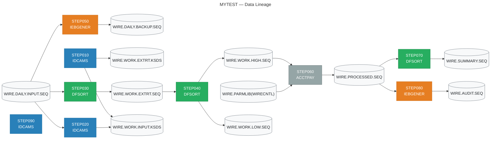

# JUIA Migration Specification
## Job: MYTEST

| Field | Value |
|-------|-------|
| Source JCL | `TEST.jcl` |
| Generated by | JUIA — JCL Utility Intelligence Agent |
| Generated | 2026-10-12 08:08 UTC |
| Stack | Claude API + ChromaDB + sentence-transformers |

---

## Executive Summary

### Job Metrics

| Metric | Value |
|--------|-------|
| Total steps | 9 |
| Utility steps decoded | 6 |
| Straight copy steps (IEBGENER DUMMY) | 2 |
| Non-utility program steps | 1 |
| Validation result | 6/6 PASS |

### Utility Breakdown

| Utility | Step Count |
|---------|------------|
| DFSORT | 3 |
| IDCAMS | 3 |
| IEBGENER | 2 |
| PROGRAM | 1 |

---

## Data Lineage

> This diagram shows how data flows through the job.
> Rendered automatically in GitHub and VS Code Markdown preview.



---

## Step Analysis


## STEP010 — IDCAMS

| Field | Value |
|-------|-------|
| Program | `IDCAMS` |
| Utility | IDCAMS |
| Validation | ✅ PASS |
| Corrections applied | 1 |

### Business Rule

This step initialises two VSAM KSDS (Key-Sequenced Data Set) work files used in a wire transfer processing workflow. It first unconditionally attempts to delete any pre-existing versions of both clusters (WIRE.WORK.INPUT.KSDS and WIRE.WORK.EXTRT.KSDS), suppresses any condition codes from those deletes up to and including 8 (i.e. tolerates 'dataset not found' errors), and then recreates both clusters fresh with fixed 200-byte records and a 16-byte key starting at byte 1. The INPUT cluster is allocated more space (20 primary cylinders) as it receives raw wire transfer input, while the EXTRT cluster (10 primary cylinders) holds extracted/filtered records for downstream processing.

### Files

- 🗄️ **Output:** `WIRE.WORK.INPUT.KSDS`
- 🗄️ **Output:** `WIRE.WORK.EXTRT.KSDS`

### Key Fields

| Offset | Length | Format | Business Meaning |
|--------|--------|--------|-----------------|
| 1 | 16 | `CH` | Primary key for WIRE.WORK.INPUT.KSDS — a 16-byte character key starting at the first byte of each record, likely a wire transfer reference number or unique transaction identifier used for keyed access into the input staging dataset |
| 1 | 16 | `CH` | Primary key for WIRE.WORK.EXTRT.KSDS — an identical 16-byte character key at byte 1, likely the same wire transfer reference number, enabling keyed retrieval from the extracted/filtered output dataset |

### Operations

- **[DELETE]** Delete the pre-existing VSAM cluster WIRE.WORK.INPUT.KSDS (including its DATA and INDEX components) using PURGE to override any retention date. This is a hard delete — if the dataset does not exist, IDCAMS returns condition code 8, which is handled by the subsequent IF block.
- **[DELETE]** Delete the pre-existing VSAM cluster WIRE.WORK.EXTRT.KSDS (including its DATA and INDEX components) using PURGE to override any retention date. Same tolerant-delete pattern as above.
- **[FILTER]** Conditional code suppression: IF LASTCC > 8 THEN SET MAXCC = 0. This resets the maximum condition code to zero only if either DELETE returned a code greater than 8 (i.e. a genuine unexpected error beyond 'not found'). Codes of 0 (success) or 8 (dataset not found / already deleted) are tolerated and allow processing to continue normally. This is a standard idempotent initialisation pattern.
- **[DEFINE]** Create VSAM KSDS cluster WIRE.WORK.INPUT.KSDS with fixed-length 200-byte records, a 16-byte key at offset 0 (byte 1), primary allocation of 20 cylinders with 5-cylinder secondary extents, and SHAREOPTIONS(2 3) allowing multiple readers with one writer within a system, and read-only sharing across systems. DATA component named WIRE.WORK.INPUT.KSDS.DATA and INDEX component named WIRE.WORK.INPUT.KSDS.INDEX.
- **[DEFINE]** Create VSAM KSDS cluster WIRE.WORK.EXTRT.KSDS with fixed-length 200-byte records, a 16-byte key at offset 0 (byte 1), primary allocation of 10 cylinders with 5-cylinder secondary extents, and SHAREOPTIONS(2 3). DATA component named WIRE.WORK.EXTRT.KSDS.DATA and INDEX component named WIRE.WORK.EXTRT.KSDS.INDEX. Smaller primary allocation reflects that this holds a subset of the input data.

### Validation

**Status:** ✅ PASS

| Check | Status |
|-------|--------|
| filter_logic | — NA |
| sort_logic | — NA |
| column_names | ✅ PASS |
| pd_handling | ✅ PASS |
| output_structure | ✅ PASS |
| split_logic | — NA |
| aggregation | — NA |

### Migration Notes

1. MIGRATION PATTERN: This is a classic DELETE-then-DEFINE initialisation step. On modern platforms (Delta Lake, Snowflake, PostgreSQL) replace with DROP TABLE IF EXISTS followed by CREATE TABLE, or TRUNCATE if the schema is stable. 2. SHAREOPTIONS(2 3): Option 2 within a system permits multiple readers and one writer concurrently; option 3 across systems allows full sharing — this implies the datasets may be accessed by multiple concurrent jobs or regions (e.g. CICS + batch). Ensure the target platform has equivalent concurrency controls. 3. KEYS(16 0): IDCAMS key offset is zero-based, so the key occupies bytes 1–16 in 1-based terms. This is reflected in the key_fields above. 4. RECORDSIZE(200 200): Both min and max are 200, confirming truly fixed-length records — no variable-length handling needed in migration. 5. CYLINDERS(20 5) vs CYLINDERS(10 5): The INPUT file is twice the size of the EXTRT file, suggesting EXTRT holds a filtered/extracted subset of INPUT data — downstream steps likely populate INPUT first, then extract qualifying records into EXTRT. 6. PURGE on DELETE bypasses the dataset's expiry date — ensure the migrated process similarly has no retention lock on the staging tables. 7. The IF LASTCC > 8 / SET MAXCC = 0 guard means this step will not fail if run for the first time (datasets absent) — the migrated equivalent must replicate this idempotent behaviour using IF EXISTS semantics.

### Generated PySpark

💻 **Full file:** `/workspaces/juia/outputs/MYTEST/4ffa5442183f4ad3a73e1efe8bb19172/pyspark/STEP010_IDCAMS.py`

```python
# =============================================================================
# Step Name    : STEP010
# Program      : IDCAMS
# Utility Type : IDCAMS DELETE / DEFINE (KSDS cluster initialisation)
# Source Step  : STEP010 — IDCAMS SYSIN control cards
#
# Business Rule:
#   This step initialises two VSAM KSDS work files used in a wire transfer
#   processing workflow.  It unconditionally attempts to delete any pre-existing
#   versions of WIRE.WORK.INPUT.KSDS and WIRE.WORK.EXTRT.KSDS (tolerating a
#   "dataset not found" condition code of 8), then recreates both clusters
#   fresh with fixed 200-byte records and a 16-byte key starting at byte 1.
#   The INPUT cluster receives raw wire transfer records (20 primary cylinders)
#   while the EXTRT cluster holds the extracted/filtered subset for downstream
#   processing (10 primary cylinders).
#
# Purpose:
#   Modern Delta Lake equivalent of the DELETE-then-DEFINE idempotent
#   initialisation pattern.  Drops each staging table if it already exists
#   (replicating PURGE semantics), then creates empty Delta tables with the
#   correct schema (replicating DEFINE CLUSTER).  The operation is fully
#   idempotent: running it against an empty environment is not an error,
#   exactly as IDCAMS tolerates CC=8 from a failed DELETE.
#
# Generated by JUIA (JCL Universal Intelligence Adapter)
# =============================================================================

from __future__ import annotations

import logging
from dataclasses import dataclass, field
from typing import Dict

from pyspark.sql import SparkSession
from pyspark.sql.types import (
    BinaryType,
    StringType,
    StructField,
    StructType,
)
```

*... (truncated — see `/workspaces/juia/outputs/MYTEST/4ffa5442183f4ad3a73e1efe8bb19172/pyspark/STEP010_IDCAMS.py` for complete code)*

---

## STEP020 — IDCAMS

| Field | Value |
|-------|-------|
| Program | `IDCAMS` |
| Utility | IDCAMS |
| Validation | ✅ PASS |

### Business Rule

This step loads a sequential flat file containing daily wire transfer input records into a VSAM Key-Sequenced Data Set (KSDS). The REPRO command copies every record from the sequential input file (WIRE.DAILY.INPUT.SEQ) verbatim into the VSAM KSDS (WIRE.WORK.INPUT.KSDS), which organises the records in keyed order according to the KSDS key definition. This prepares the raw daily wire data for downstream processing that requires random-access or keyed retrieval via VSAM.

### Files

- 🗄️ **Input:** `WIRE.DAILY.INPUT.SEQ`
- 🗄️ **Output:** `WIRE.WORK.INPUT.KSDS`

### Operations

- **[LOAD]** IDCAMS REPRO copies all records from the sequential flat file WIRE.DAILY.INPUT.SEQ into the VSAM KSDS WIRE.WORK.INPUT.KSDS without any filtering, transformation, or selection. Records are inserted into the KSDS and automatically ordered by the KSDS primary key as defined at cluster definition time. No field-level logic is applied by this step itself.

### Validation

**Status:** ✅ PASS

| Check | Status |
|-------|--------|
| filter_logic | — NA |
| sort_logic | ✅ PASS |
| column_names | ✅ PASS |
| pd_handling | ✅ PASS |
| output_structure | ✅ PASS |
| split_logic | — NA |
| aggregation | — NA |

### Migration Notes

1. The REPRO command performs a straightforward sequential-to-VSAM bulk load with no filtering, sorting, or transformation — all records are copied as-is. 2. The KSDS primary key layout (offset, length, format) is not defined in this JCL step; it was established at DEFINE CLUSTER time for WIRE.WORK.INPUT.KSDS and must be retrieved from the IDCAMS DEFINE step or cluster catalogue to fully document key fields. 3. In migration, this step is equivalent to reading the flat file and writing to a keyed store (e.g., Delta Lake, DynamoDB, or a relational table with a primary key). The physical key must be identified from the KSDS cluster definition before implementing the target schema. 4. If the KSDS already contains records, REPRO in this mode will add records; duplicate key conflicts will cause the step to fail with a non-zero return code — migration code must handle upsert or pre-truncation logic accordingly. 5. The DISP=SHR on VSAMOUT means the KSDS is shared; care should be taken in the modern equivalent to handle concurrent write access appropriately. 6. No REPLACE or REUSE parameter is specified, so pre-existing records with duplicate keys will cause errors rather than being overwritten.

### Generated PySpark

💻 **Full file:** `/workspaces/juia/outputs/MYTEST/4ffa5442183f4ad3a73e1efe8bb19172/pyspark/STEP020_IDCAMS.py`

```python
# =============================================================================
# FILE HEADER
# =============================================================================
# Step Name    : STEP020
# Program      : IDCAMS
# Utility Type : IDCAMS REPRO (Sequential-to-VSAM Bulk Load)
# Source Step  : STEP020 / IDCAMS REPRO
#
# Business Rule:
#   This step loads a sequential flat file containing daily wire transfer
#   input records into a VSAM Key-Sequenced Data Set (KSDS). The REPRO
#   command copies every record from the sequential input file
#   (WIRE.DAILY.INPUT.SEQ) verbatim into the VSAM KSDS
#   (WIRE.WORK.INPUT.KSDS), which organises the records in keyed order
#   according to the KSDS key definition. This prepares the raw daily wire
#   data for downstream processing that requires random-access or keyed
#   retrieval via VSAM.
#
# Purpose Overview:
#   Equivalent of IDCAMS REPRO: read every record from the daily wire
#   transfer sequential input and write them, unmodified, to the target
#   Delta Lake table (the modern analogue of a VSAM KSDS). The target
#   table is assumed to be partitioned / sorted on the logical primary key
#   that was established at DEFINE CLUSTER time on the mainframe. Because
#   REPRO was issued without REPLACE or REUSE, duplicate primary-key
#   conflicts must be detected and raised as errors rather than silently
#   overwritten; this implementation honours that behaviour through a
#   pre-write duplicate check and raises on violation.
#
# Original SYSIN Control Cards:
#   REPRO INFILE(SEQIN)      -
#         OUTFILE(VSAMOUT)
#
# DD Statements:
#   //SEQIN   DSN=WIRE.DAILY.INPUT.SEQ,DISP=SHR   <- sequential input
#   //VSAMOUT DSN=WIRE.WORK.INPUT.KSDS,DISP=SHR   <- VSAM KSDS output
#
# Migration Notes:
#   1. REPRO performs a verbatim bulk copy — no filtering, sorting, or
#      field transformation is applied by this step.
```

*... (truncated — see `/workspaces/juia/outputs/MYTEST/4ffa5442183f4ad3a73e1efe8bb19172/pyspark/STEP020_IDCAMS.py` for complete code)*

---

## STEP030 — DFSORT

| Field | Value |
|-------|-------|
| Program | `SORT` |
| Utility | DFSORT |
| Validation | ✅ PASS |

### Business Rule

This step filters the daily wire transfer input file to extract only those records where the transaction type code is 'PE' (positions 55-56) AND the transaction amount (positions 17-25, packed decimal) is greater than zero — effectively selecting only positive-value PE-type wire transactions. The surviving records are then sorted first by an 8-character key at positions 44-51 ascending (likely an account or routing identifier), then by the packed-decimal amount at positions 17-25 descending (largest amounts first within each account group). The result is written to a new sequential work extract dataset for downstream processing.

### Files

- 🗄️ **Input:** `WIRE.DAILY.INPUT.SEQ`
- 🗄️ **Output:** `WIRE.WORK.EXTRT.SEQ`

### Key Fields

| Offset | Length | Format | Business Meaning |
|--------|--------|--------|-----------------|
| 55 | 2 | `CH` | Transaction type code — only records equal to 'PE' (Payment/Entry type, likely a specific wire payment category such as 'Periodic Entry' or 'Payment Executed') are included |
| 17 | 9 | `PD` | Transaction amount in packed decimal format — used both as a filter condition (must be greater than zero, excluding zero-value or credit/void transactions) and as the secondary descending sort key (largest amounts ranked first within each group) |
| 44 | 8 | `CH` | Primary sort key — 8-character alphanumeric field, likely an account number, beneficiary identifier, or routing/reference key; sorted ascending to group related wire transactions together |

### Operations

- **[FILTER]** Include only records where the 2-byte character field at position 55 equals the literal 'PE' AND the 9-byte packed decimal field at position 17 is greater than zero. Records failing either condition (wrong transaction type, or zero/negative amount) are excluded from the output. Both conditions must be true simultaneously (AND logic).
- **[SORT]** Sort the filtered records by two keys: (1) primary key — 8-byte character field at position 44, ascending order, grouping records by account/reference identifier; (2) secondary key — 9-byte packed decimal field at position 17, descending order, so the largest transaction amounts appear first within each primary key group.
- **[EXTRACT]** Write the filtered and sorted records to a new catalogued sequential output dataset (WIRE.WORK.EXTRT.SEQ) with fixed-block 80-byte records, allocated 10 primary cylinders with 5 secondary, for use as a work file in subsequent processing steps.

### Validation

**Status:** ✅ PASS

| Check | Status |
|-------|--------|
| filter_logic | ✅ PASS |
| sort_logic | ✅ PASS |
| column_names | ✅ PASS |
| pd_handling | ✅ PASS |
| output_structure | ✅ PASS |
| split_logic | — NA |
| aggregation | — NA |

### Migration Notes

1. PACKED DECIMAL (PD) interpretation: The 9-byte PD field at offset 17 holds up to 17 significant digits with the last nibble being the sign; in PySpark/Python this must be decoded from raw bytes (e.g., using a UDF or the 'bcd' library) — direct column comparison is not possible without unpacking. 2. The INCLUDE condition uses GT +0 on a signed PD field, meaning strictly positive values only; zero-value and negative-value records are excluded, which is important for migration — ensure the modern equivalent correctly handles signed packed decimal sign nibbles (0xC=positive, 0xD=negative, 0xF=unsigned positive). 3. The record length is 80 bytes (LRECL=80), consistent with a card-image or fixed-format wire transaction record. 4. Offset references are 1-based (DFSORT convention); subtract 1 for 0-based Python/PySpark slicing (e.g., offset 55, length 2 → bytes [54:56]). 5. The external control card member SYS2.CNTL(WIREEXT) should be captured and version-controlled as part of migration — it represents reusable business logic shared potentially across multiple jobs. 6. The 'PE' transaction type code should be confirmed with business stakeholders — common interpretations in wire transfer contexts include 'Periodic Entry', 'Payment Executed', or a SWIFT/Fedwire payment category code. 7. No SUM or REFORMAT operations are present; records are passed through unmodified in content, only filtered and reordered.

### Generated PySpark

💻 **Full file:** `/workspaces/juia/outputs/MYTEST/4ffa5442183f4ad3a73e1efe8bb19172/pyspark/STEP030_DFSORT.py`

```python
# =============================================================================
# Step Name    : STEP030
# Program      : SORT (DFSORT)
# Utility Type : DFSORT
# Source JCL   : WIRE.DAILY.INPUT.SEQ → WIRE.WORK.EXTRT.SEQ
#
# Business Rule:
#   Filter the daily wire transfer input file to retain only those records
#   where the transaction type code (positions 55–56, character) equals 'PE'
#   AND the transaction amount (positions 17–25, packed decimal) is strictly
#   greater than zero.  The surviving records are sorted first by an 8-character
#   account/routing key (positions 44–51) ascending, then by the decoded
#   packed-decimal amount descending — so the largest amounts appear first
#   within each account group.  The result feeds downstream wire-processing
#   steps as a work extract dataset.
#
# Purpose Overview:
#   Implements the DFSORT INCLUDE + SORT control cards from STEP030.  The
#   packed-decimal amount field must be decoded to a Python integer (or long)
#   before this function is called; raw bytes cannot be compared numerically.
#   No SUM or REFORMAT operations are present — records pass through with their
#   original content intact, only reordered and subset.
#
# Original SYSIN Control Cards (SYS2.CNTL(WIREEXT)):
#   INCLUDE COND=(55,2,CH,EQ,C'PE',AND,17,9,PD,GT,+0)
#   SORT FIELDS=(44,8,CH,A,17,9,PD,D)
#
# Input  DD : //SORTIN  DSN=WIRE.DAILY.INPUT.SEQ,DISP=SHR
# Output DD : //SORTOUT DSN=WIRE.WORK.EXTRT.SEQ,
#                        DISP=(NEW,CATLG,DELETE),
#                        SPACE=(CYL,(10,5)),
#                        DCB=(RECFM=FB,LRECL=80,BLKSIZE=0,DSORG=PS)
#
# Generated by JUIA (JCL Utility Intelligence Advisor)
# =============================================================================

from pyspark.sql import DataFrame, SparkSession
from pyspark.sql import functions as F
from pyspark.sql.types import (
    BinaryType,
```

*... (truncated — see `/workspaces/juia/outputs/MYTEST/4ffa5442183f4ad3a73e1efe8bb19172/pyspark/STEP030_DFSORT.py` for complete code)*

---

## STEP040 — DFSORT

| Field | Value |
|-------|-------|
| Program | `SORT` |
| Utility | DFSORT |
| Validation | ✅ PASS |

### Business Rule

This step reads a wire transfer extract file, sorts all records in descending order by transaction amount, then splits the output into two files based on transaction value: high-value wire transfers (amount greater than $1,000,000) are written to HIGHVAL, and low-value wire transfers (amount less than or equal to $1,000,000) are written to LOWVAL. This supports downstream processing that applies different handling, scrutiny, or reporting rules to large versus small wire transactions.

### Files

- 🗄️ **Input:** `WIRE.WORK.EXTRT.SEQ`
- 🗄️ **Output:** `WIRE.WORK.HIGH.SEQ`
- 🗄️ **Output:** `WIRE.WORK.LOW.SEQ`

### Key Fields

| Offset | Length | Format | Business Meaning |
|--------|--------|--------|-----------------|
| 17 | 9 | `PD` | Wire transfer transaction amount stored as a packed decimal value (9 bytes = up to 17 significant digits). Used as both the sort key and the threshold split criterion to separate high-value (>$1,000,000) from low-value (<=1,000,000) transactions. |

### Operations

- **[SORT]** Sort all records from WIRE.WORK.EXTRT.SEQ in descending (D) order by the 9-byte packed decimal (PD) transaction amount field at offset 17. Descending order means the largest wire transfer amounts appear first in both output files.
- **[SPLIT]** After sorting, split the sorted records into two output datasets using OUTFIL. Records where the packed decimal amount at offset 17, length 9 is greater than +1,000,000 are written to WIRE.WORK.HIGH.SEQ (HIGHVAL). Records where the same amount is less than or equal to +1,000,000 are written to WIRE.WORK.LOW.SEQ (LOWVAL). These two conditions are mutually exclusive and together cover all records, so no records are dropped.
- **[FILTER]** HIGHVAL filter: INCLUDE records where position 17, length 9, PD format is GT (greater than) +1000000. LOWVAL filter: INCLUDE records where position 17, length 9, PD format is LE (less than or equal to) +1000000. Together these two filters partition the full sorted dataset without loss.

### Validation

**Status:** ✅ PASS

| Check | Status |
|-------|--------|
| filter_logic | ✅ PASS |
| sort_logic | ✅ PASS |
| column_names | ✅ PASS |
| pd_handling | ✅ PASS |
| output_structure | ✅ PASS |
| split_logic | ✅ PASS |
| aggregation | — NA |

### Migration Notes

1. FIELD FORMAT — The amount field (offset 17, length 9) is PD (Packed Decimal). In PySpark/Python this must be decoded from raw bytes; it is NOT a standard integer or float. A custom UDF using a library such as 'packdec' or manual nibble-parsing is required if migrating from raw binary source files. 2. OFFSET CONVENTION — DFSORT uses 1-based byte offsets. In Python/PySpark subtract 1 for 0-based slicing: bytes 16 to 25 (exclusive) in Python. 3. COMPLETE PARTITION — The GT/LE split on +1000000 is exhaustive and mutually exclusive, meaning every input record lands in exactly one output file. No records are silently dropped. 4. RECORD LENGTH — Both output files are FB LRECL=200, matching the input structure; no reformatting or field transformation is applied. Records are passed through as-is. 5. SORT THEN SPLIT — DFSORT performs the sort globally across all records first, then the OUTFIL INCLUDE conditions are applied to the sorted stream. Both output files will individually be in descending amount order. 6. OUTPUT SIZING — HIGHVAL and LOWVAL are each allocated 5 primary + 2 secondary cylinders. During migration, validate that target storage (e.g., HDFS, S3, Azure Data Lake) has sufficient capacity and that partition sizing is reviewed against actual data volumes. 7. SIGNED PACKED DECIMAL — PD fields are signed. The positive literal +1000000 implies the amount field carries a sign nibble. Ensure migration tooling correctly handles both positive and negative packed decimal values if negative wire amounts are theoretically possible.

### Generated PySpark

💻 **Full file:** `/workspaces/juia/outputs/MYTEST/4ffa5442183f4ad3a73e1efe8bb19172/pyspark/STEP040_DFSORT.py`

```python
# =============================================================================
# FILE HEADER
# =============================================================================
# Step Name    : STEP040
# Program      : SORT
# Utility Type : DFSORT
# Source JCL   : STEP040 — DFSORT wire transfer extract sort and split
#
# Business Rule:
#   This step reads a wire transfer extract file, sorts all records in
#   descending order by transaction amount, then splits the output into two
#   files based on transaction value.  High-value wire transfers (amount
#   greater than $1,000,000) are written to HIGHVAL (WIRE.WORK.HIGH.SEQ),
#   and low-value wire transfers (amount less than or equal to $1,000,000)
#   are written to LOWVAL (WIRE.WORK.LOW.SEQ).  This supports downstream
#   processing that applies different handling, scrutiny, or reporting rules
#   to large versus small wire transactions.
#
# Purpose Overview:
#   1. Accept a pre-decoded DataFrame representing WIRE.WORK.EXTRT.SEQ.
#   2. Sort the entire dataset in descending order by the packed-decimal
#      transaction amount field (mainframe offset 17, length 9, format PD).
#   3. Partition the sorted stream into two non-overlapping, exhaustive
#      output DataFrames — HIGH (amount > 1,000,000) and LOW (amount
#      <= 1,000,000) — mirroring the DFSORT OUTFIL INCLUDE logic exactly.
#   4. Return both DataFrames so callers can write them to their respective
#      target datasets.
#
# Original SYSIN Control Cards:
#   SORT FIELDS=(17,9,PD,D)
#   OUTFIL FNAMES=HIGHVAL,
#          INCLUDE=(17,9,PD,GT,+1000000)
#   OUTFIL FNAMES=LOWVAL,
#          INCLUDE=(17,9,PD,LE,+1000000)
#
# Generated by JUIA (JCL Utility Intelligence Accelerator)
# =============================================================================

# =============================================================================
# IMPORTS
```

*... (truncated — see `/workspaces/juia/outputs/MYTEST/4ffa5442183f4ad3a73e1efe8bb19172/pyspark/STEP040_DFSORT.py` for complete code)*

---

## STEP050 — IEBGENER (Straight Copy)

| Field | Value |
|-------|-------|
| Program | `IEBGENER` |
| SYSIN | `DD DUMMY` (no control cards) |
| Validation | ✅ PASS (hardcoded) |

### Business Rule

Straight copy of WIRE.DAILY.INPUT.SEQ to WIRE.DAILY.BACKUP.SEQ. No record transformation applied. Used for backup or audit copy creation.

### Files

- 🗄️ **Input:** `WIRE.DAILY.INPUT.SEQ`
- 🗄️ **Output:** `WIRE.DAILY.BACKUP.SEQ`

### Migration Equivalent

```python
import shutil
shutil.copy2('WIRE.DAILY.INPUT.SEQ', 'WIRE.DAILY.BACKUP.SEQ')
```

> ℹ️ IEBGENER with SYSIN DD DUMMY is always a straight copy. Consider ICEGENER (DFSORT-based) for files > 1M records.

---

## STEP060 — PROGRAM (Non-Utility)

| Field | Value |
|-------|-------|
| Program | `ACCTPAY` |
| Type | Custom application (COBOL / Assembler / PL/I) |
| Validation | ⏭️ Not applicable |

> ⚠️ **JUIA does not decode non-utility program steps.**
> The business logic is embedded in the program source code.
> Obtain the source from your version control system and analyse separately.

### DD Statements

| DD Name | Parameters |
|---------|------------|
| `STEPLIB` | `DSN=PROD.LOADLIB,DISP=SHR` |
| `INPUT` | `DSN=WIRE.WORK.HIGH.SEQ,DISP=SHR` |
| `OUTPUT` | `DSN=WIRE.PROCESSED.SEQ, DISP=(NEW,CATLG,DELETE), SPACE=(CYL,(10,5)),RECFM=FB,LRE` |
| `PARMS` | `DSN=WIRE.PARMLIB(WIRECNTL),DISP=SHR` |

---

## STEP070 — DFSORT

| Field | Value |
|-------|-------|
| Program | `SORT` |
| Utility | DFSORT |
| Validation | ✅ PASS |
| Corrections applied | 1 |

### Business Rule

This step summarises wire transfer processed records by a 3-character code (bytes 63-65, likely a currency code, wire type, or routing identifier). Records sharing the same sort key are collapsed into a single output record by summing a 9-byte packed decimal amount field (bytes 17-25). The output record is then reformatted to a fixed 200-byte layout containing: the original 16-byte identifier, the 3-byte sort/group key, the summed amount converted to a 12-byte fixed-point signed integer, an 8-byte date or reference field, a 2-byte status or type code, and a 3-byte supplementary code. The net result is a wire transfer summary dataset grouped by the key code with aggregated monetary totals.

### Files

- 🗄️ **Input:** `WIRE.PROCESSED.SEQ`
- 🗄️ **Output:** `WIRE.SUMMARY.SEQ`

### Key Fields

| Offset | Length | Format | Business Meaning |
|--------|--------|--------|-----------------|
| 63 | 3 | `CH` | Primary sort and grouping key — likely a currency code, wire type code, or routing/category identifier used to group wire records for summarisation |
| 17 | 9 | `PD` | Packed decimal monetary amount field (e.g. wire transfer value) — summed across all records sharing the same sort key to produce an aggregated total |
| 1 | 16 | `CH` | Leading identifier field carried through to output — likely an account number, transaction reference prefix, or entity identifier |
| 44 | 8 | `CH` | 8-byte field passed through to output unchanged — likely a date (e.g. value date or processing date) or a reference number |
| 55 | 2 | `CH` | 2-byte field passed through to output unchanged — likely a status code, transaction type indicator, or currency flag |
| 66 | 3 | `CH` | 3-byte field passed through to output unchanged — likely a supplementary code, branch code, or secondary category indicator immediately following the sort key |

### Operations

- **[SORT]** Sort all records from WIRE.PROCESSED.SEQ in ascending order on the 3-byte character field at bytes 63-65 (the grouping key). This orders records so that duplicates on the key are adjacent, enabling the subsequent SUM aggregation.
- **[AGGREGATE]** After sorting, collapse all records with the same 3-byte key (bytes 63-65) into a single record by summing the 9-byte packed decimal amount field at bytes 17-25. All duplicate records are deleted; only the single aggregated record per unique key is retained. The summed value replaces the original PD amount in the kept record.
- **[REFORMAT]** Reformat each surviving (post-aggregation) record into a new 200-byte fixed layout: bytes 1-16 from original positions 1-16 (16-byte identifier), bytes 17-19 from original positions 63-65 (3-byte group key), bytes 20-31 as the summed amount converted from 9-byte PD to a 12-byte fixed-point signed (FS) integer, bytes 32-39 from original positions 44-51 (8-byte date/reference), bytes 40-41 from original positions 55-56 (2-byte code), bytes 42-44 from original positions 66-68 (3-byte supplementary code). The remaining bytes up to position 200 will be padded or blank-filled by DFSORT to meet the LRECL=200 output record length.

### Validation

**Status:** ✅ PASS

| Check | Status |
|-------|--------|
| filter_logic | — NA |
| sort_logic | ✅ PASS |
| column_names | ✅ PASS |
| pd_handling | ✅ PASS |
| output_structure | ✅ PASS |
| split_logic | — NA |
| aggregation | ✅ PASS |

### Migration Notes

1. FORMAT CONVERSION: The SUM field at bytes 17-25 is 9-byte Packed Decimal (PD). The OUTREC converts it to FS (Fixed-point Signed) of LENGTH=12. In PySpark/Python this requires careful handling: PD is a signed packed BCD format and must be decoded from raw bytes before summing; standard Spark cannot read PD natively — a UDF or binary unpacking routine (e.g. using the 'struct' module or a custom EBCDIC PD decoder) will be required. 2. OUTPUT RECORD LENGTH: The OUTREC fields sum to 16+3+12+8+2+3 = 44 bytes of defined content within a 200-byte LRECL=FB record. DFSORT will pad the remaining 156 bytes with spaces/zeros. Ensure the target system preserves or explicitly pads to 200 bytes. 3. SUM SEMANTICS: The SUM FIELDS card specifies aggregation on bytes 17-25 (PD). Per DFSORT rules, SORT FIELDS=(63,3,CH,A) defines the grouping key independently; the SUM field is not an additional sort key. All records with identical bytes 63-65 are summed regardless of differing amount values. 4. FIELD GAPS IN OUTPUT: Note that bytes 57-62 and bytes 52-54 of the input are not carried to the output — these fields are intentionally dropped in the summary record, which may represent fields relevant only at transaction level (e.g. individual sequence numbers or timestamps). 5. EBCDIC vs UTF-8: Input data is likely EBCDIC-encoded on the mainframe. CH fields must be transcoded to UTF-8/ASCII during migration. PD fields are binary and must be decoded separately from EBCDIC transcoding pipelines. 6. The output dataset WIRE.SUMMARY.SEQ with RECFM=FB LRECL=200 maps cleanly to a fixed-width flat file or a Parquet/Delta table with explicit column boundaries in a modern platform.

### Generated PySpark

💻 **Full file:** `/workspaces/juia/outputs/MYTEST/4ffa5442183f4ad3a73e1efe8bb19172/pyspark/STEP070_DFSORT.py`

```python
# =============================================================================
# Step Name    : STEP070
# Program      : SORT
# Utility Type : DFSORT
# Source File  : STEP070_DFSORT.py
#
# Business Rule:
#   Summarise wire transfer processed records by a 3-character grouping key
#   located at bytes 63-65 of each input record (likely a currency code, wire
#   type code, or routing/category identifier).  All records that share the
#   same 3-byte key are collapsed into a single output record by summing the
#   9-byte packed decimal monetary amount at bytes 17-25.  The surviving
#   aggregated record is then reformatted into a fixed 200-byte layout:
#
#     Output bytes  1-16  : original identifier (input bytes  1-16)
#     Output bytes 17-19  : grouping key        (input bytes 63-65)
#     Output bytes 20-31  : summed amount, PD→FS 12-byte signed integer
#     Output bytes 32-39  : date/reference      (input bytes 44-51)
#     Output bytes 40-41  : status/type code    (input bytes 55-56)
#     Output bytes 42-44  : supplementary code  (input bytes 66-68)
#     Output bytes 45-200 : blank-padded to meet LRECL=200
#
#   The net result is a wire transfer summary dataset grouped by the key code
#   with aggregated monetary totals — one output record per unique key value.
#
# Purpose Overview:
#   Implements the DFSORT SORT/SUM/OUTREC sequence from JCL step STEP070.
#   Input  : WIRE.PROCESSED.SEQ  (fixed-width flat file, EBCDIC, LRECL varies)
#   Output : WIRE.SUMMARY.SEQ    (RECFM=FB, LRECL=200, one record per key)
#
# Generated by JUIA (JCL Utility Intelligence Analyser)
# =============================================================================

# ── Original Mainframe SYSIN Control Cards ────────────────────────────────────
#   SORT FIELDS=(63,3,CH,A)
#   SUM FIELDS=(17,9,PD)
#   OUTREC FIELDS=(1,16,
#                  63,3,
#                  17,9,PD,TO=FS,LENGTH=12,
#                  44,8,
```

*... (truncated — see `/workspaces/juia/outputs/MYTEST/4ffa5442183f4ad3a73e1efe8bb19172/pyspark/STEP070_DFSORT.py` for complete code)*

---

## STEP080 — IEBGENER (Straight Copy)

| Field | Value |
|-------|-------|
| Program | `IEBGENER` |
| SYSIN | `DD DUMMY` (no control cards) |
| Validation | ✅ PASS (hardcoded) |

### Business Rule

Straight copy of WIRE.PROCESSED.SEQ to WIRE.AUDIT.SEQ. No record transformation applied. Used for backup or audit copy creation.

### Files

- 🗄️ **Input:** `WIRE.PROCESSED.SEQ`
- 🗄️ **Output:** `WIRE.AUDIT.SEQ`

### Migration Equivalent

```python
import shutil
shutil.copy2('WIRE.PROCESSED.SEQ', 'WIRE.AUDIT.SEQ')
```

> ℹ️ IEBGENER with SYSIN DD DUMMY is always a straight copy. Consider ICEGENER (DFSORT-based) for files > 1M records.

---

## STEP090 — IDCAMS

| Field | Value |
|-------|-------|
| Program | `IDCAMS` |
| Utility | IDCAMS |
| Validation | ✅ PASS |

### Business Rule

This step uses IDCAMS LISTCAT to catalogue and report on two VSAM KSDS (Key-Sequenced Data Set) datasets: WIRE.WORK.INPUT.KSDS and WIRE.WORK.EXTRT.KSDS. The ALL parameter requests the full catalogue listing for each dataset, including allocation details, statistics (records inserted, deleted, retrieved, updated), space utilisation, volume information, key ranges, and expiration attributes. The business purpose is diagnostic and auditing in nature — it is commonly used to verify that these wire processing work datasets exist in the system catalogue, to capture their current statistics (e.g. record counts, high-used RBA, free space) for job run documentation, to confirm correct allocation prior to or following processing steps, and to provide a catalogue snapshot for troubleshooting or compliance purposes within a wire transfer processing workflow.

### Operations

- **[EXTRACT]** LISTCAT ENTRIES(WIRE.WORK.INPUT.KSDS) ALL — queries the ICF (Integrated Catalog Facility) system catalogue and extracts the full catalogue entry for the VSAM KSDS dataset WIRE.WORK.INPUT.KSDS. The ALL parameter causes output of every available attribute group: HISTORY (creation/expiration dates, owner), VOLUME (VOLSER, device type, extents, HI-A-RBA, HI-U-RBA, physical record size), ALLOCATION (primary/secondary space, space type), STATISTICS (records inserted/deleted/retrieved/updated, CI splits, CA splits, free CI/CA percentages, record count, REC-RETRIEVED), and DATA/INDEX component details including key length, key offset, maximum record length, CI size, and FREESPACE settings.
- **[EXTRACT]** LISTCAT ENTRIES(WIRE.WORK.EXTRT.KSDS) ALL — queries the ICF system catalogue and extracts the full catalogue entry for the VSAM KSDS dataset WIRE.WORK.EXTRT.KSDS (likely an extract or extraction work file in the wire transfer process). As with the first LISTCAT, ALL attributes are reported including statistics, volume placement, key structure, and space utilisation, enabling comparison or verification of this downstream extract dataset.

### Validation

**Status:** ✅ PASS

| Check | Status |
|-------|--------|
| filter_logic | — NA |
| sort_logic | — NA |
| column_names | ✅ PASS |
| pd_handling | — NA |
| output_structure | ✅ PASS |
| split_logic | — NA |
| aggregation | — NA |

### Migration Notes

1. LISTCAT produces no output datasets and reads no data records — it solely interrogates the VSAM system catalogue (SYSPRINT/SYSOUT captures the report). There are no input_files or output_files in the data-movement sense. 2. Both datasets are KSDS type, confirming they are key-sequenced and support random access by key — relevant when migrating to a modern platform where the equivalent would be a partitioned table with a primary key or an indexed store. 3. The dataset naming convention (WIRE.WORK.INPUT.KSDS and WIRE.WORK.EXTRT.KSDS) strongly implies these are transient working datasets within a wire transfer processing job stream — INPUT holds incoming wire records and EXTRT holds extracted/filtered records for downstream processing. 4. In a modern migration, this step should be replaced with equivalent data catalogue metadata checks or data quality validation steps (e.g. checking row counts, schema existence, partition metadata) against the target platform. 5. LISTCAT condition code 0 confirms both datasets exist and are accessible; a non-zero return code would indicate a missing or inaccessible dataset, which may be used implicitly by subsequent IF-THEN-ELSE logic in the broader JCL job. Ensure this error-detection behaviour is preserved in the migrated pipeline. 6. The ALL parameter output is voluminous — if this step exists purely for diagnostic logging, it may be safely omitted in production migrations or replaced with a lightweight metadata existence check.

### Generated PySpark

💻 **Full file:** `/workspaces/juia/outputs/MYTEST/4ffa5442183f4ad3a73e1efe8bb19172/pyspark/STEP090_IDCAMS.py`

```python
# =============================================================================
# Step Name    : STEP090
# Program      : IDCAMS
# Utility Type : IDCAMS LISTCAT
# Source Step  : STEP090 (JCL IDCAMS LISTCAT)
#
# Business Rule:
#   This step uses IDCAMS LISTCAT to catalogue and report on two VSAM KSDS
#   (Key-Sequenced Data Set) datasets used within a wire transfer processing
#   workflow:
#       - WIRE.WORK.INPUT.KSDS  : incoming wire records work dataset
#       - WIRE.WORK.EXTRT.KSDS  : extracted/filtered wire records work dataset
#
#   The ALL parameter requests the full catalogue listing for each dataset,
#   including allocation details, statistics (records inserted, deleted,
#   retrieved, updated), space utilisation, volume information, key ranges,
#   and expiration attributes.
#
#   In the original JCL, a condition code of 0 confirms both datasets exist
#   and are accessible; a non-zero return code signals a missing or
#   inaccessible dataset and may gate downstream processing steps via
#   IF-THEN-ELSE logic in the broader job stream.
#
# Purpose Overview:
#   This module migrates the IDCAMS LISTCAT step to a modern Python/PySpark
#   equivalent that performs metadata verification against the target data
#   platform (Delta Lake / Apache Spark catalogue).  It replicates the
#   diagnostic, auditing, and existence-checking behaviour of LISTCAT ALL:
#
#     1. Verifies that the migrated target tables/datasets exist in the
#        Spark / Delta catalogue (equivalent to LISTCAT confirming ICF
#        catalogue entries).
#     2. Collects and reports dataset-level statistics (row counts, schema,
#        size, partition metadata) mirroring the STATISTICS group output of
#        LISTCAT ALL (REC-TOTAL, REC-INSERTED, HI-U-RBA, etc.).
#     3. Produces a structured catalogue snapshot suitable for job run
#        documentation, compliance auditing, and troubleshooting — the
#        same goals served by capturing SYSPRINT output in the mainframe job.
#     4. Raises a descriptive exception (non-zero return code equivalent)
#        when a required dataset is absent, preserving the error-detection
```

*... (truncated — see `/workspaces/juia/outputs/MYTEST/4ffa5442183f4ad3a73e1efe8bb19172/pyspark/STEP090_IDCAMS.py` for complete code)*

---
