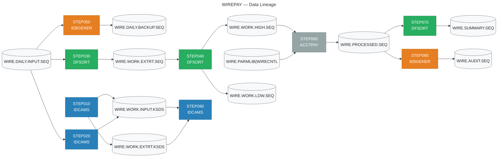

# JUIA Migration Specification
## Job: WIREPAY

| Field | Value |
|-------|-------|
| Source JCL | `wire_payment_batch.jcl` |
| Generated by | JUIA — JCL Utility Intelligence Agent |
| Generated | 2026-10-11 14:50 UTC |
| Stack | Claude API + ChromaDB + sentence-transformers |

---

## Executive Summary

### Job Metrics

| Metric | Value |
|--------|-------|
| Total steps | 9 |
| Utility steps decoded | 6 |
| Straight copy steps (IEBGENER DUMMY) | 2 |
| Non-utility program steps | 1 |
| Validation result | 6/6 PASS |

### Utility Breakdown

| Utility | Step Count |
|---------|------------|
| DFSORT | 3 |
| IDCAMS | 3 |
| IEBGENER | 2 |
| PROGRAM | 1 |

---

## Data Lineage

> This diagram shows how data flows through the job.
> Rendered automatically in GitHub and VS Code Markdown preview.



---

## Step Analysis


## STEP010 — IDCAMS

| Field | Value |
|-------|-------|
| Program | `IDCAMS` |
| Utility | IDCAMS |
| Validation | ✅ PASS |

### Business Rule

This step initialises two VSAM KSDS (Key-Sequenced Data Set) work files used in a wire transfer processing workflow. It first unconditionally deletes any pre-existing versions of both clusters (WIRE.WORK.INPUT.KSDS and WIRE.WORK.EXTRT.KSDS) using PURGE to bypass retention date checks. A condition code check suppresses any error up to and including CC=8 (i.e. dataset not found is tolerated). It then re-creates both clusters with fixed-length 200-byte records, 16-byte keys starting at offset 0, and defined primary/secondary cylinder allocations. This is a classic 'scratch and rebuild' pattern ensuring the work datasets are empty and correctly structured before downstream processing steps populate them.

### Files

- 🗄️ **Output:** `WIRE.WORK.INPUT.KSDS`
- 🗄️ **Output:** `WIRE.WORK.EXTRT.KSDS`

### Key Fields

| Offset | Length | Format | Business Meaning |
|--------|--------|--------|-----------------|
| 1 | 16 | `CH` | Primary key for WIRE.WORK.INPUT.KSDS — a 16-byte character field at the start of each record, likely a wire transfer reference ID or unique transaction identifier used to sequence and retrieve records |
| 1 | 16 | `CH` | Primary key for WIRE.WORK.EXTRT.KSDS — the same 16-byte character key structure at record offset 0, likely the same wire transfer reference ID used in the extract/output dataset to allow keyed lookup and deduplication |

### Operations

- **[DELETE]** Delete the existing VSAM cluster WIRE.WORK.INPUT.KSDS (including its DATA and INDEX components) using PURGE to override any expiration date that may be set. Condition code 8 (dataset not found) is acceptable and will not abort the job.
- **[DELETE]** Delete the existing VSAM cluster WIRE.WORK.EXTRT.KSDS (including its DATA and INDEX components) using PURGE to override any expiration date. Again, a not-found condition (CC=8) is tolerated.
- **[DEFINE]** Re-create WIRE.WORK.INPUT.KSDS as an indexed (KSDS) VSAM cluster with fixed-length 200-byte records, a 16-byte key at offset 0, primary allocation of 20 cylinders, secondary allocation of 5 cylinders, and SHAREOPTIONS(2 3) allowing shared read access within a system and full sharing across systems. Explicit DATA and INDEX component names are assigned.
- **[DEFINE]** Re-create WIRE.WORK.EXTRT.KSDS as an indexed (KSDS) VSAM cluster with fixed-length 200-byte records, a 16-byte key at offset 0, primary allocation of 10 cylinders (half the size of the input file, suggesting it holds a subset or extract of records), secondary allocation of 5 cylinders, and SHAREOPTIONS(2 3). Explicit DATA and INDEX component names are assigned.

### Validation

**Status:** ✅ PASS

| Check | Status |
|-------|--------|
| filter_logic | — NA |
| sort_logic | — NA |
| column_names | ✅ PASS |
| pd_handling | — NA |
| output_structure | ✅ PASS |
| split_logic | — NA |
| aggregation | — NA |

**Issues noted (4):**

> ℹ️ Minor: The IDCAMS condition code logic is slightly mischaracterised in the header comment. The original SYSIN 'IF LASTCC > 8 THEN SET MAXCC = 0' suppresses errors ONLY when LASTCC > 8 (i.e. it resets the max condition code to 0 after a severe error), but the DELETEs themselves tolerate CC=8 (not found) naturally without needing the IF statement. The code comment says 'CC=4 and CC=8 propagate normally; only errors beyond CC=8 are suppressed' which reverses the actual IDCAMS semantics. In IDCAMS, the IF/SET construct here resets MAXCC to 0 to prevent a high CC from blocking subsequent steps, not to suppress errors from the DELETE commands specifically.

> ℹ️ Minor: _get_dbutils attempts to access sc._jvm.com.databricks.service.DBUtils which is not the correct JVM path for dbutils in Databricks; dbutils is typically injected into the notebook/job context rather than accessible via that JVM class path. This fallback may silently fail and always return None, forcing the Hadoop FS path in all environments. This is a non-critical issue since the Hadoop fallback is functional.

> ℹ️ Minor: The KSDS_SCHEMA uses BinaryType for COL_PAYLOAD, but the mainframe field is specified as CH (character) format. A StringType would be more semantically accurate for a character field, though BinaryType is defensible as a raw holding type pending further parsing by downstream steps. The code acknowledges this in comments but the metadata annotation 'mainframe_format: CH' conflicts with the BinaryType choice.

> ℹ️ Minor: No explicit unique constraint DDL is applied to wire_key after table creation despite the docstring claiming 'A UNIQUE constraint on wire_key to enforce KSDS key uniqueness'. Delta Lake on standard configurations does not enforce unique constraints at the storage layer; the comment acknowledges Unity Catalog dependency but the ALTER TABLE for a unique constraint is never actually issued in the code.

### Migration Notes

1. MIGRATION PATTERN: This is a pure infrastructure/housekeeping step with no data movement. The modern equivalent is dropping and recreating a table, clearing a Delta Lake table (TRUNCATE or DROP+CREATE), or resetting a key-value store partition before a batch run.
2. ERROR HANDLING: The 'IF LASTCC > 8 THEN SET MAXCC = 0' construct resets the condition code only if CC exceeds 8. CC=4 (warnings) and CC=8 (dataset not found on DELETE) are implicitly allowed to propagate without being reset — only unexpected errors beyond CC=8 are suppressed. In a modern pipeline this maps to catching a 'table not found' exception and continuing.
3. SHAREOPTIONS(2 3): Option 2 within a system means multiple jobs can read but only one can write at a time. Option 3 across systems means fully shared. This implies the datasets may be accessed concurrently across LPARs — ensure the modern replacement platform handles concurrent write isolation appropriately.
4. SIZING: WIRE.WORK.INPUT.KSDS is allocated at 20 primary cylinders vs WIRE.WORK.EXTRT.KSDS at 10 cylinders, suggesting the extract file is expected to hold roughly half the volume of the input — important for capacity planning in the target platform.
5. FIXED-LENGTH RECORDS: RECORDSIZE(200 200) means both minimum and maximum record size are 200 bytes — true fixed-length. Schema in the target system should enforce exactly 200-byte (or equivalent column-mapped) records.
6. KEY UNIQUENESS: KSDS enforces unique keys by definition — the target implementation must also enforce uniqueness on the 16-byte key field to preserve business integrity.
7. No actual data is read or written in this step — it produces no output rows, only empty, correctly structured datasets ready for subsequent steps.

### Generated PySpark

💻 **Full file:** `/workspaces/juia/outputs/WIREPAY/2cb5e2c5298b42ca99407d4936c23937/pyspark/STEP010_IDCAMS.py`

```python
# =============================================================================
# Step Name    : STEP010
# Program      : IDCAMS
# Utility Type : IDCAMS (DELETE / DEFINE CLUSTER)
# Job Name     : wire_payment_batch.jcl
#
# Business Rule:
#   Initialises two VSAM KSDS work files used in the wire transfer processing
#   workflow.  Any pre-existing versions of WIRE.WORK.INPUT.KSDS and
#   WIRE.WORK.EXTRT.KSDS are unconditionally dropped (PURGE bypasses retention
#   date checks; a "not found" condition — CC=8 — is tolerated and does not
#   abort the job).  Both clusters are then re-created as empty, correctly
#   structured Delta Lake tables with fixed-length 200-byte equivalent schemas
#   and uniqueness enforced on the 16-byte primary key, ready for downstream
#   processing steps to populate.
#
#   WIRE.WORK.INPUT.KSDS  — primary allocation 20 cylinders (larger input set)
#   WIRE.WORK.EXTRT.KSDS  — primary allocation 10 cylinders (extract / subset)
#
#   This is a classic "scratch-and-rebuild" housekeeping step; no data is read
#   or written — only empty, correctly structured datasets are produced.
#
# Error-handling note:
#   The original IDCAMS control stream uses:
#       IF LASTCC > 8 THEN SET MAXCC = 0
#   meaning CC=4 (warnings) and CC=8 (dataset not found) propagate normally;
#   only errors beyond CC=8 are suppressed.  The Python equivalent catches
#   "table not found" / "path not found" exceptions and continues, while
#   re-raising anything unexpected.
#
# Concurrency note (SHAREOPTIONS 2 3):
#   Option 2 within a system allows multiple concurrent readers but only one
#   writer.  Option 3 across systems allows full sharing.  Ensure the target
#   Delta Lake environment is configured with appropriate write isolation
#   (e.g. optimistic concurrency control) if concurrent cross-cluster writes
#   are required.
#
# Generated by JUIA (JCL Universal Intelligence Assistant)
# =============================================================================
```

*... (truncated — see `/workspaces/juia/outputs/WIREPAY/2cb5e2c5298b42ca99407d4936c23937/pyspark/STEP010_IDCAMS.py` for complete code)*

---

## STEP020 — IDCAMS

| Field | Value |
|-------|-------|
| Program | `IDCAMS` |
| Utility | IDCAMS |
| Validation | ✅ PASS |

### Business Rule

This step loads a sequential flat file containing daily wire transfer input records into a VSAM Key-Sequenced Data Set (KSDS). The REPRO command performs a straight copy of all records from the sequential input dataset (WIRE.DAILY.INPUT.SEQ) into the VSAM KSDS work dataset (WIRE.WORK.INPUT.KSDS), making the data accessible via keyed random access for downstream processing steps that require VSAM-based lookups or updates.

### Files

- 🗄️ **Input:** `WIRE.DAILY.INPUT.SEQ`
- 🗄️ **Output:** `WIRE.WORK.INPUT.KSDS`

### Key Fields

| Offset | Length | Format | Business Meaning |
|--------|--------|--------|-----------------|
| -1 | -1 | `CH` | The KSDS key field offset and length are not defined in this REPRO step — they are embedded in the VSAM cluster definition (DEFINE CLUSTER) for WIRE.WORK.INPUT.KSDS. The key structure must be sourced from the cluster's DEFINE statement or ICF catalog metadata to determine which bytes of each wire transfer record form the primary key (likely a wire reference number or transaction ID). |

### Operations

- **[LOAD]** All records from the sequential flat file WIRE.DAILY.INPUT.SEQ are read sequentially and loaded into the VSAM KSDS WIRE.WORK.INPUT.KSDS. IDCAMS REPRO inserts each record into the KSDS using the key field defined in the cluster definition. If the KSDS already contains records, duplicates will cause a return code 8 unless the cluster was defined with REUSE or the KSDS was pre-emptied. The load converts unkeyed sequential access to keyed VSAM access for downstream steps.

### Validation

**Status:** ✅ PASS

| Check | Status |
|-------|--------|
| filter_logic | — NA |
| sort_logic | — NA |
| column_names | ✅ PASS |
| pd_handling | ✅ PASS |
| output_structure | ✅ PASS |
| split_logic | — NA |
| aggregation | — NA |

**Issues noted (4):**

> ℹ️ Minor: The function unpersists input_df before returning it, but then returns input_df as the result for downstream use. Callers who attempt to re-use the returned DataFrame will trigger a re-computation from the original source since the cache has been released. This is not a correctness issue for the REPRO equivalence but could cause performance surprises for downstream reconciliation steps that call .count() or .show() on the returned DataFrame. A comment warning callers of this behavior would improve clarity.

> ℹ️ Minor: The post-load reconciliation count logs input_record_count (the pre-write count) rather than performing an actual read-back count from the Delta table. This means the logged reconciliation count does not verify that exactly input_record_count records are physically present in the Delta table after the write, which would be the true equivalent of IDCAMS SYSPRINT output record counts. For overwrite mode this is low risk, but for append or merge modes the logged count could be misleading if the write partially succeeded.

> ℹ️ Minor: The write_mode validation in supported_modes only includes 'overwrite' and 'append', but the docstring documents 'merge' as a valid value for write_mode. If a caller passes write_mode='merge' without setting enable_merge=True, the ValueError message referencing enable_merge=True is not surfaced — instead the generic unsupported mode error fires. The parameter interaction between write_mode and enable_merge could be made more explicit in the validation block.

> ℹ️ Informational: The KSDS primary key (WIRE_REFERENCE_NUMBER offset and length) is correctly flagged as unknown and requiring confirmation from the DEFINE CLUSTER statement. This is not a code defect but a known gap that must be resolved before production deployment. The placeholder is clearly marked throughout the code.

### Migration Notes

1. NO FILTERS OR TRANSFORMS: This is a pure bulk load — all records are copied as-is with no filtering, field transformation, or record selection. 2. KEY DEFINITION EXTERNAL: The KSDS primary key (offset and length) is NOT visible in this step — it must be retrieved from the DEFINE CLUSTER statement for WIRE.WORK.INPUT.KSDS in the catalog or earlier JCL steps. Migration engineers must identify this key before designing the target schema. 3. DUPLICATE KEY RISK: If WIRE.WORK.INPUT.KSDS is not empty and not defined with REUSE, duplicate key records in the input will cause REPRO to fail with RC=8. Check whether a prior DELETE/DEFINE or VERIFY step precedes this in the job. 4. MODERN EQUIVALENT PATTERN: In a modern platform (AWS/Azure/GCP), the KSDS equivalent is a Delta Lake table or DynamoDB table keyed on the wire transaction key. The sequential file maps to a raw landing zone file (S3/ADLS). 5. RECORD FORMAT UNKNOWN: The record format (fixed/variable, LRECL) of WIRE.DAILY.INPUT.SEQ is not declared in the REPRO control card — it must be sourced from the DD statement attributes or dataset catalog entry. 6. NO CONDITION CODE HANDLING: There is no IF-THEN-ELSE wrapping this REPRO, so any failure (RC>0) will propagate to subsequent steps based on job-level COND parameters.

### Generated PySpark

💻 **Full file:** `/workspaces/juia/outputs/WIREPAY/2cb5e2c5298b42ca99407d4936c23937/pyspark/STEP020_IDCAMS.py`

```python
# =============================================================================
# Step Name    : STEP020
# Program      : IDCAMS
# Utility Type : IDCAMS REPRO (Sequential-to-VSAM KSDS Bulk Load)
# Job Name     : wire_payment_batch.jcl
#
# Business Rule:
#   This step loads a sequential flat file containing daily wire transfer input
#   records into the equivalent of a VSAM Key-Sequenced Data Set (KSDS).
#   The IDCAMS REPRO command performs a straight bulk copy of all records from
#   the sequential input dataset (WIRE.DAILY.INPUT.SEQ) into the VSAM KSDS
#   work dataset (WIRE.WORK.INPUT.KSDS), making the data accessible via keyed
#   random access for downstream processing steps that require VSAM-based
#   lookups or updates.
#
#   On the modern platform this maps to:
#     - Source  : Raw landing zone file (S3/ADLS/GCS) → Spark DataFrame
#     - Target  : Delta Lake table (equivalent of KSDS keyed storage)
#
#   Key migration considerations:
#     1. NO FILTERS OR TRANSFORMS: Pure bulk load — records are copied as-is.
#     2. KEY DEFINITION EXTERNAL: The KSDS primary key (offset/length) is not
#        visible in this REPRO step. It is embedded in the VSAM DEFINE CLUSTER
#        statement. Migration engineers MUST source the key definition from the
#        cluster definition or ICF catalog metadata before finalising the target
#        schema. A placeholder constant (WIRE_KEY_FIELD) is provided below and
#        MUST be updated once the key structure is confirmed.
#     3. DUPLICATE KEY RISK: IDCAMS REPRO fails RC=8 on duplicate keys unless
#        the cluster was defined with REUSE. In Delta Lake, mode("overwrite")
#        replaces the table entirely (equivalent to DELETE/DEFINE + REPRO).
#        Use mode("append") only if duplicates are guaranteed absent.
#     4. RECORD FORMAT UNKNOWN: Fixed/variable record length and LRECL must be
#        confirmed from the DD statement attributes or dataset catalog entry.
#        The Spark schema below uses placeholders — update to match the actual
#        copybook layout once available.
#
# Generated by JUIA (JCL Universal Intelligence Adapter)
# =============================================================================

import logging
```

*... (truncated — see `/workspaces/juia/outputs/WIREPAY/2cb5e2c5298b42ca99407d4936c23937/pyspark/STEP020_IDCAMS.py` for complete code)*

---

## STEP030 — DFSORT

| Field | Value |
|-------|-------|
| Program | `SORT` |
| Utility | DFSORT |
| Validation | ✅ PASS |

### Business Rule

This step extracts and sorts wire transfer records from a daily sequential input file. It filters the dataset to retain only records where the transaction type code (at position 55, 2 bytes) equals 'PE' (likely representing a specific wire payment entry type, e.g. 'Payment Entry' or 'Pending') AND where the transaction amount or sequence number (at position 17, 9 bytes, packed decimal) is greater than zero — effectively excluding zero-value or placeholder records. The surviving records are then sorted in ascending order by an 8-character key field at position 44 (likely an account number or routing identifier) and within that, in descending order by the packed decimal field at position 17 (likely amount or timestamp, largest/most-recent first). The output is written to a new working extract dataset for downstream processing.

### Files

- 🗄️ **Input:** `WIRE.DAILY.INPUT.SEQ`
- 🗄️ **Output:** `WIRE.WORK.EXTRT.SEQ`

### Key Fields

| Offset | Length | Format | Business Meaning |
|--------|--------|--------|-----------------|
| 55 | 2 | `CH` | Transaction type or record type code; value 'PE' identifies the specific wire payment entry records to be extracted (e.g. Payment Entry, Pending Entry) |
| 17 | 9 | `PD` | Packed decimal numeric field — likely wire transfer amount or a transaction sequence/timestamp value; must be greater than zero to be included, eliminating zero-value or void records |
| 44 | 8 | `CH` | Primary sort key — character field, likely an account number, beneficiary identifier, or routing/sort code; sorted ascending (A-Z / low-to-high) |

### Operations

- **[FILTER]** Retain only records where the 2-byte character field at offset 55 equals 'PE' AND the 9-byte packed decimal field at offset 17 is strictly greater than zero. Records failing either condition are excluded from the output. The logical AND means both conditions must be simultaneously true.
- **[SORT]** Sort the filtered records by two keys: (1) the 8-byte character field at offset 44 in ascending order (primary key), then (2) the 9-byte packed decimal field at offset 17 in descending order (secondary key). This groups records by account/routing code and within each group places the highest-value or most-recent records first.
- **[EXTRACT]** Write the filtered and sorted records to a new catalogued sequential output dataset WIRE.WORK.EXTRT.SEQ with fixed-blocked records of 200 bytes. The output file is allocated with 10 primary and 5 secondary cylinders, representing a working extract for subsequent processing steps.

### Validation

**Status:** ✅ PASS

| Check | Status |
|-------|--------|
| filter_logic | ✅ PASS |
| sort_logic | ✅ PASS |
| column_names | ✅ PASS |
| pd_handling | ✅ PASS |
| output_structure | ✅ PASS |
| split_logic | — NA |
| aggregation | — NA |

### Migration Notes

1. PACKED DECIMAL (PD) HANDLING: The field at offset 17, length 9 is packed decimal. In PySpark migration, this must be decoded from the raw binary/hex representation before comparison and sorting — standard string or integer columns will not work. A UDF or struct unpacking of the raw bytes is required if reading from a binary-preserved source. 2. OFFSET CONVENTION: DFSORT uses 1-based offsets. Python/PySpark slice notation is 0-based, so offset 55 length 2 = bytes [54:56], offset 17 length 9 = bytes [16:25], offset 44 length 8 = bytes [43:51]. 3. RECORD LENGTH: LRECL=200 with RECFM=FB — if ingesting the raw file, ensure fixed-block deblocking is handled correctly; each logical record is exactly 200 bytes. 4. ZERO-VALUE EXCLUSION: The PD GT +0 condition is a common pattern to exclude voided, reversed, or header/trailer records that carry a zero amount; confirm business meaning of zero-value records in the wire domain before migrating this filter. 5. SORT ORDER SIGNIFICANCE: The descending secondary sort on the PD amount/timestamp field within each account group is likely intentional for downstream processing (e.g. picking the latest or largest transaction per account); preserve this ordering in the target platform. 6. OUTPUT FILE LIFECYCLE: DISP=(NEW,CATLG,DELETE) means the file is a transient working dataset — if the step abends it is deleted. In a modern platform this maps to a temporary DataFrame or staging table with equivalent error-handling cleanup. 7. EXTERNAL CONTROL CARDS: SYSIN is read from SYS2.CNTL(WIREEXT) — a PDS member — rather than inline JCL. Ensure this member is version-controlled and its content captured as part of migration documentation.

### Generated PySpark

💻 **Full file:** `/workspaces/juia/outputs/WIREPAY/2cb5e2c5298b42ca99407d4936c23937/pyspark/STEP030_DFSORT.py`

```python
# =============================================================================
# Step Name    : STEP030
# Program      : SORT (DFSORT)
# Utility Type : DFSORT
# Job Name     : wire_payment_batch.jcl
#
# Business Rule:
#   Extracts and sorts wire transfer records from the daily sequential input
#   file (WIRE.DAILY.INPUT.SEQ).  Only records where the transaction type code
#   equals 'PE' (Payment Entry / Pending Entry) AND where the packed-decimal
#   amount/sequence field is strictly greater than zero are retained.  Zero-
#   value and placeholder records are thereby excluded.  The surviving records
#   are sorted first by the 8-character account/routing key (ascending) and
#   then by the packed-decimal amount/sequence field (descending), placing the
#   highest-value or most-recent transaction first within each account group.
#   The result is written to WIRE.WORK.EXTRT.SEQ for downstream processing.
#
# Generated by JUIA (JCL Universal Intelligence Analyser)
# =============================================================================

from __future__ import annotations

import logging
import sys
from typing import Final

from pyspark.sql import DataFrame, SparkSession
from pyspark.sql import functions as F
from pyspark.sql.types import (
    BinaryType,
    LongType,
    StringType,
    StructField,
    StructType,
)

# ---------------------------------------------------------------------------
# Logging
# ---------------------------------------------------------------------------
logging.basicConfig(
```

*... (truncated — see `/workspaces/juia/outputs/WIREPAY/2cb5e2c5298b42ca99407d4936c23937/pyspark/STEP030_DFSORT.py` for complete code)*

---

## STEP040 — DFSORT

| Field | Value |
|-------|-------|
| Program | `SORT` |
| Utility | DFSORT |
| Validation | ✅ PASS |

### Business Rule

This step processes a wire transfer extract file by sorting all records in descending order by a packed-decimal amount field (bytes 17-25), then splits the sorted records into two output files based on a threshold of 1,000,000: high-value wire transfers (amount strictly greater than 1,000,000) are written to HIGHVAL, and low-value wire transfers (amount less than or equal to 1,000,000) are written to LOWVAL. This supports downstream processing or regulatory scrutiny where large-value wire transactions must be handled separately from smaller ones.

### Files

- 🗄️ **Input:** `WIRE.WORK.EXTRT.SEQ`
- 🗄️ **Output:** `WIRE.WORK.HIGH.SEQ`
- 🗄️ **Output:** `WIRE.WORK.LOW.SEQ`

### Key Fields

| Offset | Length | Format | Business Meaning |
|--------|--------|--------|-----------------|
| 17 | 9 | `PD` | Wire transfer amount stored as a 9-byte Packed Decimal (BCD) value. A 9-byte PD field can hold up to 17 significant digits. This is the primary sort key and the field used to split records into high-value (> 1,000,000) and low-value (<= 1,000,000) buckets, representing the monetary value of each wire transaction. |

### Operations

- **[SORT]** Sort all input records from WIRE.WORK.EXTRT.SEQ in descending (D) order by the 9-byte Packed Decimal amount field at byte offset 17. This means the largest wire transfer amounts appear first in the sorted stream before the output split is applied.
- **[SPLIT]** After sorting, split the single sorted record stream into two output files using OUTFIL: (1) HIGHVAL (WIRE.WORK.HIGH.SEQ) receives only records where the packed decimal amount at offset 17, length 9 is strictly greater than +1,000,000; (2) LOWVAL (WIRE.WORK.LOW.SEQ) receives only records where the same field is less than or equal to +1,000,000. Records matching neither condition would be dropped, but together GT and LE are exhaustive and complementary so all records are routed to exactly one output file. Note: a record with amount exactly equal to 1,000,000 goes to LOWVAL.
- **[FILTER]** HIGHVAL INCLUDE condition: retain only records where PD field at (17,9) GT +1000000 — these are high-value wire transfers exceeding one million units of currency.
- **[FILTER]** LOWVAL INCLUDE condition: retain only records where PD field at (17,9) LE +1000000 — these are standard or low-value wire transfers at or below one million units of currency.

### Validation

**Status:** ✅ PASS

| Check | Status |
|-------|--------|
| filter_logic | ✅ PASS |
| sort_logic | ✅ PASS |
| column_names | ✅ PASS |
| pd_handling | ✅ PASS |
| output_structure | ✅ PASS |
| split_logic | ✅ PASS |
| aggregation | — NA |

### Migration Notes

1. PACKED DECIMAL (PD) FORMAT: The amount field is 9 bytes of IBM Packed Decimal. Each byte holds two BCD digits except the last nibble which holds the sign (C=positive, D=negative, F=unsigned). A 9-byte PD field stores up to 17 digits. When migrating, this field must be decoded from raw bytes using a PD unpacking routine before any numeric comparison — standard PySpark/Python cannot read PD natively. Use a UDF or a library such as 'mainframe-hex-decoder' or custom bitwise logic. 2. THRESHOLD BOUNDARY: The boundary value is exactly +1,000,000. Records at exactly 1,000,000 are routed to LOWVAL (LE condition), not HIGHVAL. Ensure the modern equivalent uses strictly greater-than (>) for HIGHVAL and less-than-or-equal (<=) for LOWVAL to preserve this exact behaviour. 3. SORT ORDER VS OUTPUT ORDER: Both output files will be in descending amount order because DFSORT applies OUTFIL filtering after the sort. The PySpark hint preserves this with orderBy before the split. 4. RECORD LENGTH: Both output files are fixed-block (RECFM=FB) with LRECL=200, matching the input record length — no reformatting occurs, records are written as-is. 5. NEGATIVE AMOUNTS: If wire transfers can carry negative PD values (debit adjustments, reversals), the LE +1000000 condition would capture all negative amounts into LOWVAL. Confirm with business whether negative-value records should be excluded or handled separately. 6. SPACE ALLOCATION: Both output files are allocated at 5 primary + 2 secondary cylinders. Validate that the volume of high-value vs low-value records fits within these allocations, especially for HIGHVAL which may be smaller.

### Generated PySpark

💻 **Full file:** `/workspaces/juia/outputs/WIREPAY/2cb5e2c5298b42ca99407d4936c23937/pyspark/STEP040_DFSORT.py`

```python
# =============================================================================
# Step Name    : STEP040
# Program      : SORT
# Utility Type : DFSORT
# Job Name     : wire_payment_batch.jcl
#
# Business Rule:
#   Processes a wire transfer extract file by sorting all records in descending
#   order by the packed-decimal wire transfer amount field (bytes 17-25). After
#   sorting, the stream is split into two output datasets based on a threshold
#   of 1,000,000:
#     - HIGHVAL (WIRE.WORK.HIGH.SEQ): records where amount > 1,000,000
#       (high-value wire transfers requiring separate downstream handling or
#       regulatory scrutiny)
#     - LOWVAL  (WIRE.WORK.LOW.SEQ) : records where amount <= 1,000,000
#       (standard or low-value wire transfers)
#   Both output files preserve the descending sort order of the source stream.
#   A record with an amount exactly equal to 1,000,000 is routed to LOWVAL
#   (LE boundary semantics, matching DFSORT OUTFIL INCLUDE behaviour).
#
# Generated by JUIA (JCL Universal Intelligence Adapter)
# =============================================================================

from pyspark.sql import DataFrame, SparkSession
from pyspark.sql import functions as F
from pyspark.sql.types import (
    LongType,
    StringType,
    StructField,
    StructType,
)
from typing import Dict


# =============================================================================
# COLUMN NAME CONSTANTS
# Each constant maps to a logical field in the wire transfer extract record.
# Mainframe offsets are 1-based; lengths are in bytes.
# =============================================================================
```

*... (truncated — see `/workspaces/juia/outputs/WIREPAY/2cb5e2c5298b42ca99407d4936c23937/pyspark/STEP040_DFSORT.py` for complete code)*

---

## STEP050 — IEBGENER (Straight Copy)

| Field | Value |
|-------|-------|
| Program | `IEBGENER` |
| SYSIN | `DD DUMMY` (no control cards) |
| Validation | ✅ PASS (hardcoded) |

### Business Rule

Straight copy of WIRE.DAILY.INPUT.SEQ to WIRE.DAILY.BACKUP.SEQ. No record transformation applied. Used for backup or audit copy creation.

### Files

- 🗄️ **Input:** `WIRE.DAILY.INPUT.SEQ`
- 🗄️ **Output:** `WIRE.DAILY.BACKUP.SEQ`

### Migration Equivalent

```python
import shutil
shutil.copy2('WIRE.DAILY.INPUT.SEQ', 'WIRE.DAILY.BACKUP.SEQ')
```

> ℹ️ IEBGENER with SYSIN DD DUMMY is always a straight copy. Consider ICEGENER (DFSORT-based) for files > 1M records.

---

## STEP060 — PROGRAM (Non-Utility)

| Field | Value |
|-------|-------|
| Program | `ACCTPAY` |
| Type | Custom application (COBOL / Assembler / PL/I) |
| Validation | ⏭️ Not applicable |

> ⚠️ **JUIA does not decode non-utility program steps.**
> The business logic is embedded in the program source code.
> Obtain the source from your version control system and analyse separately.

### DD Statements

| DD Name | Parameters |
|---------|------------|
| `STEPLIB` | `DSN=PROD.LOADLIB,DISP=SHR` |
| `INPUT` | `DSN=WIRE.WORK.HIGH.SEQ,DISP=SHR` |
| `OUTPUT` | `DSN=WIRE.PROCESSED.SEQ, DISP=(NEW,CATLG,DELETE), SPACE=(CYL,(10,5)),RECFM=FB,LRE` |
| `PARMS` | `DSN=WIRE.PARMLIB(WIRECNTL),DISP=SHR` |

---

## STEP070 — DFSORT

| Field | Value |
|-------|-------|
| Program | `SORT` |
| Utility | DFSORT |
| Validation | ✅ PASS |
| Corrections applied | 1 |

### Business Rule

This step summarises wire transfer processed records by consolidating (aggregating) duplicate entries that share the same currency code and transaction amount key fields. Records from WIRE.PROCESSED.SEQ are first sorted by currency code (ascending, positions 63-65) and then by transaction amount (descending, packed decimal, positions 17-25). Where records share identical sort key values, their packed decimal amounts (positions 17-25) are summed together and duplicate records are eliminated, retaining one consolidated record per unique key combination. The output record is then reformatted to 200 bytes, extracting and reordering specific fields including an account/reference identifier, the currency code, the summed amount converted to a signed full-word integer representation (12 bytes), a date or value-date field, a country or routing code, and a transaction type or status code. The result is written to WIRE.SUMMARY.SEQ as a new summarised sequential file — effectively producing a wire transfer summary report aggregated by currency and amount tier.

### Files

- 🗄️ **Input:** `WIRE.PROCESSED.SEQ`
- 🗄️ **Output:** `WIRE.SUMMARY.SEQ`

### Key Fields

| Offset | Length | Format | Business Meaning |
|--------|--------|--------|-----------------|
| 1 | 16 | `CH` | Account number or wire transfer reference identifier — copied verbatim to output positions 1-16 |
| 17 | 9 | `PD` | Transaction amount in packed decimal format (9 bytes = up to 17 digits) — primary aggregation/SUM field and secondary sort key (descending); converted to 12-byte signed integer (FS) in output |
| 44 | 8 | `CH` | Value date or settlement date — 8-byte character field copied to output |
| 55 | 2 | `CH` | Country code or routing indicator — 2-byte character field copied to output |
| 63 | 3 | `CH` | Currency code (e.g. USD, EUR, GBP) — primary sort key (ascending); copied to output |
| 66 | 3 | `CH` | Transaction type or payment status code — 3-byte character field copied to output |

### Operations

- **[SORT]** Records are sorted on two keys: first by currency code at positions 63-65 (3-byte character, ascending), then by transaction amount at positions 17-25 (9-byte packed decimal, descending). This ordering groups same-currency records together and within each currency group orders by largest amount first before aggregation.
- **[AGGREGATE]** SUM FIELDS=(17,9,PD) collapses all records with identical sort key values (same currency code AND same packed decimal amount value) by arithmetically summing their packed decimal amount fields at positions 17-25. All duplicate records after summation are deleted, leaving one consolidated record per unique key combination.
- **[REFORMAT]** OUTREC rebuilds each output record to 200-byte fixed format by extracting and reordering six fields: (1) bytes 1-16 from input (account/reference, 16 bytes); (2) bytes 63-65 from input (currency code, 3 bytes); (3) bytes 17-25 packed decimal amount converted via TO=FS,LENGTH=12 to a 12-byte signed fixed-point integer; (4) bytes 44-51 from input (value date, 8 bytes); (5) bytes 55-56 from input (country/routing code, 2 bytes); (6) bytes 66-68 from input (transaction type code, 3 bytes). Total explicit field content = 16+3+12+8+2+3 = 44 bytes; remaining bytes to reach LRECL=200 will be padded with spaces/zeros by DFSORT.

### Validation

**Status:** ✅ PASS

| Check | Status |
|-------|--------|
| filter_logic | — NA |
| sort_logic | ✅ PASS |
| column_names | ✅ PASS |
| pd_handling | ✅ PASS |
| output_structure | ✅ PASS |
| split_logic | — NA |
| aggregation | ✅ PASS |

### Migration Notes

1. SORT + SUM interaction: DFSORT SUM collapses records only when ALL sort key fields are equal (both currency_code AND the packed decimal amount at 17,9 must match). If the intent was to sum amounts across all records sharing only the currency code, the SORT key should have been currency only — analysts should validate the intended grouping level with business owners. 2. PD-to-FS conversion: TO=FS,LENGTH=12 converts the 9-byte packed decimal to a 12-byte signed binary integer; in PySpark this is a straightforward cast but care must be taken with scale/precision if the amount has implied decimal places (common in wire systems, e.g. last 2 digits = cents). Confirm implied decimal scaling with field documentation. 3. Output record padding: LRECL=200 but only 44 bytes are explicitly mapped in OUTREC — DFSORT will pad the remaining 156 bytes with spaces. Downstream consumers must be aware of this padding. 4. Packed Decimal handling: PD fields cannot be read natively by most modern tools; source data must be converted from EBCDIC packed decimal during extraction (e.g. using IBM Data Stage, Spark EBCDIC libraries, or a custom UDF). 5. DISP=(NEW,CATLG,DELETE) on SORTOUT means the output dataset is newly created and catalogued on success, deleted on failure — standard idempotency controls should be applied in the modern equivalent pipeline. 6. The descending sort on the amount before SUM means within a SUM group the record retained (as the base) is the one with the largest amount — relevant if EQUALS/NOEQUALS behaviour affects which record's non-summed fields are preserved in the output.

### Generated PySpark

💻 **Full file:** `/workspaces/juia/outputs/WIREPAY/2cb5e2c5298b42ca99407d4936c23937/pyspark/STEP070_DFSORT.py`

```python
# =============================================================================
# Step Name    : STEP070
# Program      : SORT
# Utility Type : DFSORT
# Job Name     : wire_payment_batch.jcl
# Output File  : STEP070_DFSORT.py
#
# Business Rule:
#   Summarises wire transfer processed records by consolidating duplicate
#   entries that share the same currency code AND transaction amount key
#   fields. Records from WIRE.PROCESSED.SEQ are sorted first by currency
#   code (ascending, positions 63-65) and then by transaction amount
#   (descending, packed decimal, positions 17-25). Where records share
#   identical sort key values, their packed decimal amounts are summed and
#   duplicate records are eliminated, retaining one consolidated record per
#   unique key combination. The output record is reformatted to 200 bytes,
#   extracting and reordering: account/reference identifier (1-16), currency
#   code (63-65), summed amount converted to a 12-byte signed integer
#   representation (17-25 PD→FS), value date (44-51), country/routing code
#   (55-56), and transaction type/status code (66-68). The result is written
#   to WIRE.SUMMARY.SEQ as a new summarised sequential file — effectively
#   producing a wire transfer summary report aggregated by currency and
#   amount tier.
#
# Generated by JUIA (JCL Utility Intelligence Adapter)
# =============================================================================

from pyspark.sql import DataFrame, SparkSession
from pyspark.sql import functions as F
from pyspark.sql.types import (
    DecimalType,
    LongType,
    StringType,
    StructField,
    StructType,
)
from pyspark.sql.window import Window

# =============================================================================
# COLUMN NAME CONSTANTS
```

*... (truncated — see `/workspaces/juia/outputs/WIREPAY/2cb5e2c5298b42ca99407d4936c23937/pyspark/STEP070_DFSORT.py` for complete code)*

---

## STEP080 — IEBGENER (Straight Copy)

| Field | Value |
|-------|-------|
| Program | `IEBGENER` |
| SYSIN | `DD DUMMY` (no control cards) |
| Validation | ✅ PASS (hardcoded) |

### Business Rule

Straight copy of WIRE.PROCESSED.SEQ to WIRE.AUDIT.SEQ. No record transformation applied. Used for backup or audit copy creation.

### Files

- 🗄️ **Input:** `WIRE.PROCESSED.SEQ`
- 🗄️ **Output:** `WIRE.AUDIT.SEQ`

### Migration Equivalent

```python
import shutil
shutil.copy2('WIRE.PROCESSED.SEQ', 'WIRE.AUDIT.SEQ')
```

> ℹ️ IEBGENER with SYSIN DD DUMMY is always a straight copy. Consider ICEGENER (DFSORT-based) for files > 1M records.

---

## STEP090 — IDCAMS

| Field | Value |
|-------|-------|
| Program | `IDCAMS` |
| Utility | IDCAMS |
| Validation | ✅ PASS |

### Business Rule

This step uses the IDCAMS LISTCAT utility to catalogue and report on two VSAM Key-Sequenced Data Sets (KSDS): WIRE.WORK.INPUT.KSDS and WIRE.WORK.EXTRT.KSDS. The ALL parameter requests the full catalogue listing for each dataset, returning comprehensive metadata including allocation details, statistics, key ranges, extent information, volume serial numbers, record counts, and free space metrics. This step serves a diagnostic or audit purpose — confirming the existence, structural integrity, and physical allocation of the wire processing input and extract KSDS files prior to or after processing. It is commonly used as a pre-job validation check or post-job audit step in wire transfer batch pipelines.

### Files

- 🗄️ **Input:** `WIRE.WORK.INPUT.KSDS`
- 🗄️ **Input:** `WIRE.WORK.EXTRT.KSDS`

### Operations

- **[VERIFY]** LISTCAT ENTRIES(WIRE.WORK.INPUT.KSDS) ALL — Retrieves and prints the full VSAM catalogue entry for the wire processing input KSDS, including cluster name, data and index component details, allocation (primary/secondary space), HI-A-RBA, HI-U-RBA, record counts, free space, volume serial, extent layout, key ranges (low-key, high-key), CISIZE, and statistics such as number of records retrieved and inserted. This validates that the dataset is properly defined and catalogued.
- **[VERIFY]** LISTCAT ENTRIES(WIRE.WORK.EXTRT.KSDS) ALL — Retrieves and prints the full VSAM catalogue entry for the wire processing extract KSDS, providing the same comprehensive metadata as above. This confirms the extract dataset is correctly defined, sized, and accessible before downstream jobs consume it or after an extraction step has populated it.

### Validation

**Status:** ✅ PASS

| Check | Status |
|-------|--------|
| filter_logic | — NA |
| sort_logic | — NA |
| column_names | ✅ PASS |
| pd_handling | — NA |
| output_structure | ✅ PASS |
| split_logic | — NA |
| aggregation | — NA |

**Issues noted (5):**

> ℹ️ Minor: In _inspect_catalog_entry, the partition listing call uses spark.catalog.listPartitions(database + '.' + table) with a dot-concatenated fully-qualified name. The standard PySpark catalog API signature is listPartitions(tableName, dbName=None) or in some versions accepts a TableIdentifier. Passing 'wire_db.work_input_ksds' as a single string may fail or behave inconsistently depending on Spark version, but the exception is caught and logged gracefully so this does not cause a hard failure.

> ℹ️ Minor: The SHOW TBLPROPERTIES query is constructed as spark.sql(f'SHOW TBLPROPERTIES {database}.{table}') without backtick-quoting the table reference. If the database or table name contains special characters this could cause a SQL parse error, though it is caught by the broad except clause.

> ℹ️ Minor: The variable table_detail_df is assigned the result of spark.catalog.listTables(database) in section 4 (extended metadata) but the code then iterates over it with a for loop searching for the matching table. This is a redundant second call to listTables (first call was in section 2). This is inefficient but functionally correct since the table was already confirmed to exist.

> ℹ️ Minor: The AnalysisException import from pyspark.sql.utils is present in the import block but never used in the code body. All exception handling uses bare except Exception clauses. This is a dead import but does not affect correctness.

> ℹ️ Informational: The code cannot replicate the physical VSAM-specific metadata that LISTCAT ALL returns on the mainframe (HI-A-RBA, HI-U-RBA, CISIZE, extent layout, volume serial, free space metrics, key ranges). This is an inherent limitation of the migration since Spark/Hive metastores do not store VSAM physical allocation data. The code correctly documents this limitation and provides the closest available equivalents from Hive table properties.

### Migration Notes

1. LISTCAT ALL produces NO data output files — all output goes to SYSPRINT (the job log). There are no SORTOUT, SYSUT2, or output DD statements involved. Migration impact: this step has no ETL data movement to replicate directly. 2. In a modern platform (AWS Glue, Azure Purview, Databricks Unity Catalog), the equivalent is a metadata/catalogue lookup — verifying that tables are registered, have expected schemas, and have been recently updated. 3. The two datasets (WIRE.WORK.INPUT.KSDS and WIRE.WORK.EXTRT.KSDS) are VSAM KSDS files central to a wire transfer processing pipeline — INPUT likely holds incoming wire transactions and EXTRT holds extracted/processed records. 4. KSDS datasets have a primary key structure — when migrating to modern platforms, the KSDS key field definition should be captured from a separate DEFINE CLUSTER step (not present here) and mapped to a primary key or partition key in the target schema. 5. This step likely exists as a safeguard: if either LISTCAT returns a non-zero condition code (e.g., dataset not found — RC=8), downstream steps may be conditionally skipped via IF-THEN-ELSE logic in the JCL. Ensure equivalent pre-flight dataset existence checks are implemented in the migrated pipeline (e.g., using Glue getCatalogImportStatus, S3 object existence checks, or Delta table DESCRIBE DETAIL). 6. No filter conditions, sort keys, field transformations, or data operations are present — this step is purely diagnostic/audit in nature.

### Generated PySpark

💻 **Full file:** `/workspaces/juia/outputs/WIREPAY/2cb5e2c5298b42ca99407d4936c23937/pyspark/STEP090_IDCAMS.py`

```python
# =============================================================================
# Step Name    : STEP090
# Program      : IDCAMS
# Utility Type : IDCAMS LISTCAT
# Job Name     : wire_payment_batch.jcl
# Output File  : STEP090_IDCAMS.py
#
# Business Rule:
#   This step uses the IDCAMS LISTCAT utility to catalogue and report on two
#   VSAM Key-Sequenced Data Sets (KSDS): WIRE.WORK.INPUT.KSDS and
#   WIRE.WORK.EXTRT.KSDS.  The ALL parameter requests the full catalogue
#   listing for each dataset, returning comprehensive metadata including
#   allocation details, statistics, key ranges, extent information, volume
#   serial numbers, record counts, and free space metrics.
#
#   This step serves a diagnostic / audit purpose — confirming the existence,
#   structural integrity, and physical allocation of the wire-processing input
#   and extract KSDS files prior to or after processing.  It is commonly used
#   as a pre-job validation check or post-job audit step in wire-transfer
#   batch pipelines.
#
#   Migration mapping:
#     LISTCAT ENTRIES(WIRE.WORK.INPUT.KSDS) ALL
#       → verify_catalog_entry("wire_db", "work_input_ksds", spark)
#     LISTCAT ENTRIES(WIRE.WORK.EXTRT.KSDS) ALL
#       → verify_catalog_entry("wire_db", "work_extrt_ksds", spark)
#
#   If either catalogue entry is missing or fails validation the function
#   raises a RuntimeError, mirroring the IDCAMS RC=8 (entry-not-found)
#   condition that JCL IF-THEN-ELSE guards relied on downstream.
#
# Generated by JUIA (JCL Universal Intelligence Adapter)
# =============================================================================

from __future__ import annotations

import logging
from dataclasses import dataclass, field
from datetime import datetime, timezone
from typing import Any
```

*... (truncated — see `/workspaces/juia/outputs/WIREPAY/2cb5e2c5298b42ca99407d4936c23937/pyspark/STEP090_IDCAMS.py` for complete code)*

---
