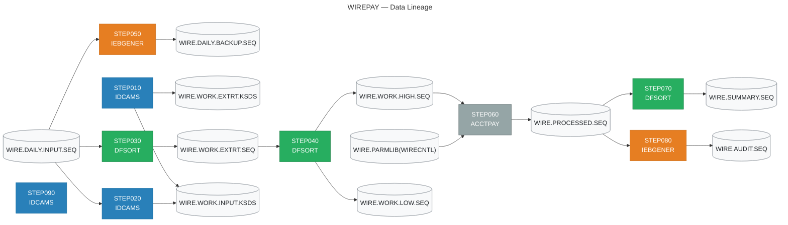

# JUIA Migration Specification
## Job: WIREPAY

| Field | Value |
|-------|-------|
| Source JCL | `wire_payment_batch.jcl` |
| Generated by | JUIA — JCL Utility Intelligence Agent |
| Generated | 2026-10-11 17:27 UTC |
| Stack | Claude API + ChromaDB + sentence-transformers |

---

## Executive Summary

### Job Metrics

| Metric | Value |
|--------|-------|
| Total steps | 9 |
| Utility steps decoded | 6 |
| Straight copy steps (IEBGENER DUMMY) | 2 |
| Non-utility program steps | 1 |
| Validation result | 6/6 PASS |

### Utility Breakdown

| Utility | Step Count |
|---------|------------|
| DFSORT | 3 |
| IDCAMS | 3 |
| IEBGENER | 2 |
| PROGRAM | 1 |

---

## Data Lineage

> This diagram shows how data flows through the job.
> Rendered automatically in GitHub and VS Code Markdown preview.



---

## Step Analysis


## STEP010 — IDCAMS

| Field | Value |
|-------|-------|
| Program | `IDCAMS` |
| Utility | IDCAMS |
| Validation | ✅ PASS |

### Business Rule

This step initialises two VSAM KSDS (Key-Sequenced Data Set) work files used in a wire transfer processing workflow. It unconditionally deletes any pre-existing versions of the INPUT and EXTRACT work clusters (using PURGE to bypass expiry dates), suppresses non-fatal delete errors (condition codes 8 or below are tolerated), then re-creates both clusters with fixed 200-byte records keyed on a 16-byte field starting at offset 0. The INPUT cluster is allocated larger initial space (20 cylinders) than the EXTRACT cluster (10 cylinders), reflecting that the input dataset is expected to hold more raw data before extraction processing reduces it. This is a classic DELETE-DEFINE initialisation pattern to ensure clean, empty work files at the start of each batch run.

### Files

- 🗄️ **Output:** `WIRE.WORK.INPUT.KSDS`
- 🗄️ **Output:** `WIRE.WORK.EXTRT.KSDS`

### Key Fields

| Offset | Length | Format | Business Meaning |
|--------|--------|--------|-----------------|
| 1 | 16 | `CH` | Primary key for WIRE.WORK.INPUT.KSDS — a 16-byte character field starting at the first byte of each 200-byte record, likely a wire transfer reference or transaction identifier used to uniquely identify and sequence input records |
| 1 | 16 | `CH` | Primary key for WIRE.WORK.EXTRT.KSDS — the same 16-byte character key structure applied to the extract work cluster, indicating extracted wire transfer records share the same key domain as input records |

### Operations

- **[DELETE]** Delete the existing VSAM cluster WIRE.WORK.INPUT.KSDS (including its DATA and INDEX components) using PURGE to bypass any retention or expiry date restrictions. This ensures a clean slate regardless of when the cluster was last created.
- **[DELETE]** Delete the existing VSAM cluster WIRE.WORK.EXTRT.KSDS (including its DATA and INDEX components) using PURGE to bypass any retention or expiry date restrictions.
- **[FILTER]** Condition code check: IF LASTCC > 8 THEN SET MAXCC = 0. This suppresses errors up to and including condition code 8 (which IDCAMS issues when a dataset to be deleted does not exist). Condition codes of 4 (warnings) and 8 (dataset not found) are tolerated so the job does not abend on first run or after a clean environment. Only condition codes above 8 (genuine errors) would cause downstream failure.
- **[DEFINE]** Create a new empty VSAM KSDS cluster WIRE.WORK.INPUT.KSDS with fixed-length 200-byte records, a 16-byte key at offset 0, primary allocation of 20 cylinders with 5 cylinder secondary extents, and SHAREOPTIONS(2 3) allowing multiple readers in the same system and unrestricted cross-system access. Separate DATA (WIRE.WORK.INPUT.KSDS.DATA) and INDEX (WIRE.WORK.INPUT.KSDS.INDEX) components are named explicitly.
- **[DEFINE]** Create a new empty VSAM KSDS cluster WIRE.WORK.EXTRT.KSDS with fixed-length 200-byte records, a 16-byte key at offset 0, primary allocation of 10 cylinders with 5 cylinder secondary extents, and SHAREOPTIONS(2 3). Separate DATA (WIRE.WORK.EXTRT.KSDS.DATA) and INDEX (WIRE.WORK.EXTRT.KSDS.INDEX) components are named explicitly. Smaller initial allocation than the INPUT cluster reflects expected data reduction after extraction filtering.

### Validation

**Status:** ✅ PASS

| Check | Status |
|-------|--------|
| filter_logic | — NA |
| sort_logic | — NA |
| column_names | ✅ PASS |
| pd_handling | — NA |
| output_structure | ✅ PASS |
| split_logic | — NA |
| aggregation | — NA |

**Issues noted (5):**

> ℹ️ Minor: The _condition_code_check() function has an ambiguous adjusted_max calculation: 'adjusted_max = min(max_cc, last_cc) if last_cc == 0 else max_cc' — when last_cc==0 and max_cc==8, this would reduce max_cc to 0 prematurely inside the function rather than letting the explicit 'if max_cc <= 8: max_cc = 0' block in the main function handle the reset. However, since max_cc is reset unconditionally to 0 after both DELETEs complete (if max_cc <= 8), this does not affect the final outcome and the end-to-end CC suppression behaviour is correct.

> ℹ️ Minor: The IDCAMS condition code logic 'IF LASTCC > 8 THEN SET MAXCC = 0' is applied after EACH delete individually in the code, whereas in the original SYSIN it appears as a single gate after BOTH deletes complete. The functional result is equivalent since both deletes run unconditionally and CC=8 is suppressed in both cases, but the sequencing is technically different from the original control stream.

> ℹ️ Minor: The _condition_code_check() function returns adjusted_max using 'min(max_cc, last_cc) if last_cc == 0' which could incorrectly lower max_cc from 8 to 0 mid-stream if a CC=0 follows a CC=8. This is corrected by the explicit 'if max_cc <= 8: max_cc = 0' block later, making the net result correct but the intermediate logic within _condition_code_check is misleading.

> ℹ️ Informational: CYLINDERS(20 5) vs CYLINDERS(10 5) allocation difference between INPUT and EXTRACT clusters is correctly implemented in the respective KsdsAllocation dataclass instances. This is a PASS but noted for completeness.

> ℹ️ Informational: The storage path separation (input_base_path vs extract_base_path as separate parameters) correctly ensures the two Delta tables are stored at distinct locations, mirroring the separate VSAM DATA and INDEX component naming convention.

### Migration Notes

1. MIGRATION PATTERN: This is a pure infrastructure initialisation step. In a modern platform (Databricks, GCS, ADLS, S3) the equivalent is DROP/CREATE of a managed table or deletion and recreation of a storage prefix — no data transformation occurs here. 2. SHAREOPTIONS(2 3): Option 2 for the same-system share level means multiple jobs can read simultaneously but only one can write; cross-system (option 3) allows full sharing. Migrated solution should implement equivalent concurrency controls (e.g., Delta Lake optimistic concurrency or table locking). 3. KEY OFFSET: IDCAMS KEYS(16 0) means length=16, offset=0 (zero-based), so the key occupies bytes 1-16 in 1-based terms. The key is almost certainly a wire transfer transaction ID or reference number. 4. FIXED RECORD SIZE: RECORDSIZE(200 200) with equal minimum and maximum confirms strictly fixed-length records — no variable-length handling needed in migration; map directly to fixed-width schema with exactly 200 bytes per record. 5. PURGE FLAG: The use of PURGE on both DELETEs is significant — it means expiry dates are actively being set on these clusters elsewhere (possibly in the DEFINE or via SMS). Ensure the modern equivalent does not have retention policies that would block recreation. 6. ERROR SUPPRESSION LOGIC: The IF LASTCC > 8 / SET MAXCC = 0 idiom is a standard mainframe pattern for 'ignore dataset not found'. In a Python/PySpark migration, implement as a try/except around the drop operation, catching only 'table not found' or 'path not found' exceptions. 7. CYLINDERS allocation (20 and 10) is mainframe-specific storage sizing; no direct equivalent needed in cloud storage but capacity planning should account for estimated record counts at 200 bytes each.

### Generated PySpark

💻 **Full file:** `/workspaces/juia/outputs/WIREPAY/c24dfcbd3c5b4f2b9c66cb903f337001/pyspark/STEP010_IDCAMS.py`

```python
# =============================================================================
# Step Name    : STEP010
# Program      : IDCAMS
# Utility Type : IDCAMS — DELETE / DEFINE (KSDS Cluster Initialisation)
# Source Step  : STEP010 / IDCAMS
#
# Business Rule:
#   Initialises two VSAM KSDS work files used in a wire transfer processing
#   workflow.  Any pre-existing versions of the INPUT and EXTRACT work clusters
#   are unconditionally deleted (PURGE bypasses expiry-date restrictions) and
#   then re-created as empty, fixed-length 200-byte datasets keyed on a 16-byte
#   field at offset 0.  The INPUT cluster receives a larger initial allocation
#   (20 cylinders) than the EXTRACT cluster (10 cylinders) because it holds raw
#   wire transfer data before extraction filtering reduces the record population.
#   Non-fatal delete errors (condition codes ≤ 8, i.e. "dataset not found") are
#   suppressed so the step is safe to run against a clean environment.  This is
#   the classic mainframe DELETE → DEFINE initialisation pattern that guarantees
#   clean, empty work files at the start of every batch run.
#
# Generated by JUIA (JCL Universal Intelligence Analyser)
# =============================================================================

import logging
import sys
from dataclasses import dataclass, field
from datetime import datetime, timezone
from pathlib import Path
from typing import Any

from delta.tables import DeltaTable
from pyspark.sql import SparkSession
from pyspark.sql.types import (
    BinaryType,
    IntegerType,
    StringType,
    StructField,
    StructType,
    TimestampType,
)
```

*... (truncated — see `/workspaces/juia/outputs/WIREPAY/c24dfcbd3c5b4f2b9c66cb903f337001/pyspark/STEP010_IDCAMS.py` for complete code)*

---

## STEP020 — IDCAMS

| Field | Value |
|-------|-------|
| Program | `IDCAMS` |
| Utility | IDCAMS |
| Validation | ✅ PASS |

### Business Rule

This step loads a sequential flat file containing daily wire transfer input records into a VSAM Key-Sequenced Data Set (KSDS). The REPRO command copies all records from the sequential input file (WIRE.DAILY.INPUT.SEQ) into the VSAM KSDS work dataset (WIRE.WORK.INPUT.KSDS), making the data available for subsequent keyed-access processing. This is a standard staging pattern used in batch payment pipelines to convert flat file input into an indexed VSAM structure for efficient record retrieval by downstream steps.

### Files

- 🗄️ **Input:** `WIRE.DAILY.INPUT.SEQ`
- 🗄️ **Output:** `WIRE.WORK.INPUT.KSDS`

### Key Fields

| Offset | Length | Format | Business Meaning |
|--------|--------|--------|-----------------|
| -1 | -1 | `CH` | KSDS prime key — exact offset and length are not defined in this JCL step; they are defined in the VSAM KSDS cluster definition (DEFINE CLUSTER) and enforced automatically by VSAM when REPRO loads the records. The key must be pre-embedded in the sequential records at the position matching the cluster definition. |

### Operations

- **[LOAD]** IDCAMS REPRO copies every record from the sequential input file SEQIN (WIRE.DAILY.INPUT.SEQ) into the VSAM KSDS VSAMOUT (WIRE.WORK.INPUT.KSDS) with no filtering, transformation, or selection. Records are loaded in the order they appear in the sequential file; VSAM will insert them in key sequence according to the KSDS cluster definition. If the KSDS is empty this is an initial load; if it already contains records, REPRO will attempt to add or replace depending on VSAM disposition and any REPLACE/NOREPLACE parameters (NOREPLACE is the default, so duplicate keys will cause an error).

### Validation

**Status:** ✅ PASS

| Check | Status |
|-------|--------|
| filter_logic | — NA |
| sort_logic | — NA |
| column_names | ✅ PASS |
| pd_handling | ✅ PASS |
| output_structure | ✅ PASS |
| split_logic | — NA |
| aggregation | — NA |

### Migration Notes

1. MIGRATION CAVEAT — KSDS key definition: The VSAM KSDS prime key offset and length are not visible in this step; they reside in the DEFINE CLUSTER control cards for WIRE.WORK.INPUT.KSDS. These must be located and documented before migration, as they determine the unique key for the target table or store. 2. DUPLICATE KEY HANDLING: Default REPRO behaviour is NOREPLACE — a duplicate prime key will cause a non-zero return code and may abort the step. In a modern equivalent, upsert (MERGE) semantics should be considered to replicate this behaviour faithfully. 3. RECORD FORMAT: The sequential file record format (RECFM, LRECL) must be verified against the KSDS record size to ensure compatibility; mismatches cause REPRO to fail. 4. ORDERING ASSUMPTION: The sequential input file is assumed to be in ascending prime-key order. If it is not, VSAM will reject out-of-sequence records during load unless the KSDS was defined with REUSE or records are being individually inserted (non-initial-load). Validate sort order of WIRE.DAILY.INPUT.SEQ before migrating. 5. MODERN PATTERN: In a modern data platform this step maps to writing a Parquet/Delta table keyed on the wire transfer identifier, with the source flat file ingested from S3 or HDFS. A schema-on-read approach should account for the fixed-length EBCDIC record layout typical of mainframe sequential files.

### Generated PySpark

💻 **Full file:** `/workspaces/juia/outputs/WIREPAY/c24dfcbd3c5b4f2b9c66cb903f337001/pyspark/STEP020_IDCAMS.py`

```python
# =============================================================================
# Step Name    : STEP020
# Program      : IDCAMS
# Utility Type : IDCAMS REPRO
# Source Utility: IDCAMS
#
# Business Rule:
#   This step loads a sequential flat file containing daily wire transfer
#   input records into a VSAM Key-Sequenced Data Set (KSDS).  The REPRO
#   command copies every record from the sequential input file
#   (WIRE.DAILY.INPUT.SEQ) into the VSAM KSDS work dataset
#   (WIRE.WORK.INPUT.KSDS), making the data available for subsequent
#   keyed-access processing.  This is a standard staging pattern used in
#   batch payment pipelines to convert flat-file input into an indexed
#   VSAM structure for efficient record retrieval by downstream steps.
#
#   Modern equivalent: ingest the fixed-length flat file from the landing
#   zone, enforce uniqueness on the prime-key column, and persist as a
#   Delta Lake table that downstream steps can query with keyed access.
#
# Migration Notes:
#   1. KSDS prime-key offset and length are NOT visible in this step; they
#      are defined in the DEFINE CLUSTER control cards for
#      WIRE.WORK.INPUT.KSDS.  Locate that definition, derive the correct
#      KEY_COLUMN constant, and update PRIME_KEY_COLUMN / PRIME_KEY_LEN /
#      PRIME_KEY_OFFSET below before running in production.
#   2. Default REPRO behaviour is NOREPLACE — a duplicate prime key raises
#      a non-zero return code.  This implementation defaults to the same
#      strict behaviour; set allow_duplicates=False (default) to replicate
#      it.  Pass allow_duplicates=True to switch to upsert (MERGE) semantics.
#   3. The sequential file is assumed to be in ascending prime-key order.
#      If it is not, VSAM rejects out-of-sequence records during an initial
#      load.  Validate sort order before running.
#   4. Records are fixed-length EBCDIC on the mainframe.  The input
#      DataFrame must already have been decoded (EBCDIC → UTF-8, packed
#      decimal → integer) before being passed to this function.
#
# Generated by JUIA (JCL Universal Intelligence Adapter)
# =============================================================================
```

*... (truncated — see `/workspaces/juia/outputs/WIREPAY/c24dfcbd3c5b4f2b9c66cb903f337001/pyspark/STEP020_IDCAMS.py` for complete code)*

---

## STEP030 — DFSORT

| Field | Value |
|-------|-------|
| Program | `SORT` |
| Utility | DFSORT |
| Validation | ✅ PASS |

### Business Rule

This step extracts and sorts wire transfer records from a daily sequential input file. It filters the dataset to retain only records where the transaction type code at bytes 55-56 equals 'PE' (likely representing a specific wire payment entry type, e.g. 'Payment Entry' or 'Pending') AND where the transaction amount field at bytes 17-25 (packed decimal) is greater than zero — effectively excluding zero-value or null transactions. The surviving records are then sorted primarily by an 8-character reference/account key (bytes 44-51) in ascending order, and secondarily by the packed decimal amount field (bytes 17-25) in descending order, producing a ranked extract for downstream processing.

### Files

- 🗄️ **Input:** `WIRE.DAILY.INPUT.SEQ`
- 🗄️ **Output:** `WIRE.WORK.EXTRT.SEQ`

### Key Fields

| Offset | Length | Format | Business Meaning |
|--------|--------|--------|-----------------|
| 55 | 2 | `CH` | Transaction type or payment category code — records must equal 'PE' (e.g. Payment Entry or Pending Entry wire type) to be included in the extract |
| 17 | 9 | `PD` | Transaction amount in packed decimal format (9 bytes = up to 17 significant digits); must be greater than zero to be included — filters out zero-value or placeholder records |
| 44 | 8 | `CH` | Primary sort key — likely a wire reference number, account identifier, or routing key (8-character alphanumeric); sorted ascending to group related wire records together |

### Operations

- **[FILTER]** Include only records where the 2-byte character field at offset 55 equals 'PE' AND the 9-byte packed decimal amount field at offset 17 is strictly greater than zero. Both conditions must be true simultaneously (AND logic). This removes non-PE transaction types and eliminates any zero-amount wire records before sorting.
- **[SORT]** Sort the filtered records by two keys: (1) the 8-byte character field at offset 44 in ascending order (primary key — groups records by reference/account), then (2) the 9-byte packed decimal amount at offset 17 in descending order (secondary key — within each group, largest amounts appear first). Output is written to WIRE.WORK.EXTRT.SEQ as a fixed-block file with LRECL=200.

### Validation

**Status:** ✅ PASS

| Check | Status |
|-------|--------|
| filter_logic | ✅ PASS |
| sort_logic | ✅ PASS |
| column_names | ✅ PASS |
| pd_handling | ✅ PASS |
| output_structure | ✅ PASS |
| split_logic | — NA |
| aggregation | — NA |

### Migration Notes

1. OFFSET CONVENTION: DFSORT uses 1-based offsets; the INCLUDE field at position 55, length 2 maps to Python slice [54:56] and the PD amount at position 17, length 9 maps to bytes [16:25]. The sort key at offset 44, length 8 maps to bytes [43:51]. 2. PACKED DECIMAL (PD): The 9-byte PD amount field can represent values up to 17 digits; migration must decode PD encoding — each byte holds two decimal digits except the last which holds one digit and the sign nibble (C=positive, D=negative, F=unsigned). Use a PD decoder in PySpark or Python before comparison and sorting. 3. ZERO FILTER: The PD GT +0 condition explicitly excludes zero and negative amounts — confirm whether negative wire amounts are valid business data that should be routed elsewhere rather than silently dropped. 4. OUTPUT FILE: WIRE.WORK.EXTRT.SEQ is a work/intermediate dataset (DISP=NEW,CATLG,DELETE) with 10 primary + 5 secondary cylinders allocated and LRECL=200 FB — this is consumed by a downstream step and should be treated as a staging table in the modern platform. 5. CONTROL CARD SOURCE: SYSIN is read from a shared PDS member SYS2.CNTL(WIREEXT) — this externalised control card pattern means the filter criteria ('PE', zero-amount threshold) may be changed without recompiling JCL; document this as a configurable business parameter in the migrated solution.

### Generated PySpark

💻 **Full file:** `/workspaces/juia/outputs/WIREPAY/c24dfcbd3c5b4f2b9c66cb903f337001/pyspark/STEP030_DFSORT.py`

```python
# =============================================================================
# FILE HEADER
# =============================================================================
# Step Name    : STEP030
# Program      : SORT
# Utility Type : DFSORT
#
# Source Utility: DFSORT (IBM Data Facility Sort)
#
# Business Rule:
#   This step extracts and sorts wire transfer records from a daily sequential
#   input file (WIRE.DAILY.INPUT.SEQ). It retains only records where:
#     (1) The transaction type code at bytes 55-56 (1-based) equals 'PE'
#         (Payment Entry / Pending Entry wire type), AND
#     (2) The transaction amount at bytes 17-25 (1-based, packed decimal) is
#         strictly greater than zero — eliminating zero-value or placeholder
#         records.
#   Surviving records are sorted primarily by the 8-character wire reference /
#   account key at bytes 44-51 (ascending) to group related wire records, and
#   secondarily by the transaction amount (descending) so the largest amount
#   appears first within each group.  The output is written to
#   WIRE.WORK.EXTRT.SEQ (RECFM=FB, LRECL=200) for consumption by a downstream
#   processing step.
#
#   IMPORTANT CONFIGURABLE PARAMETERS (originally externalised via
#   SYS2.CNTL(WIREEXT) SYSIN PDS member):
#     - Transaction type filter value : 'PE'  (may change without JCL recompile)
#     - Zero-amount threshold         : 0     (GT +0; negatives are also excluded)
#
# Generated by JUIA (JCL Utility Intelligence Advisor)
# =============================================================================


# =============================================================================
# IMPORTS
# =============================================================================
from decimal import Decimal
from typing import Optional

from pyspark.sql import DataFrame, SparkSession
```

*... (truncated — see `/workspaces/juia/outputs/WIREPAY/c24dfcbd3c5b4f2b9c66cb903f337001/pyspark/STEP030_DFSORT.py` for complete code)*

---

## STEP040 — DFSORT

| Field | Value |
|-------|-------|
| Program | `SORT` |
| Utility | DFSORT |
| Validation | ✅ PASS |

### Business Rule

This step reads a wire transfer extract file, sorts all records in descending order by transaction amount, then splits the output into two separate files based on a threshold of 1,000,000: records with a transaction amount greater than 1,000,000 are written to a HIGH-value file (large/high-risk wire transfers), while records with a transaction amount of 1,000,000 or less are written to a LOW-value file (standard wire transfers). This supports downstream processing or risk-tiering of wire transfer transactions by value.

### Files

- 🗄️ **Input:** `WIRE.WORK.EXTRT.SEQ`
- 🗄️ **Output:** `WIRE.WORK.HIGH.SEQ`
- 🗄️ **Output:** `WIRE.WORK.LOW.SEQ`

### Key Fields

| Offset | Length | Format | Business Meaning |
|--------|--------|--------|-----------------|
| 17 | 9 | `PD` | Wire transfer transaction amount stored as a Packed Decimal (BCD) value; 9 bytes of packed decimal can hold up to 17 significant digits. Used as the primary sort key and the threshold split criterion (>1,000,000 vs <=1,000,000). |

### Operations

- **[SORT]** Sort all input records from WIRE.WORK.EXTRT.SEQ in descending order by the 9-byte Packed Decimal transaction amount field starting at byte offset 17. The descending sort means the largest wire transfer amounts appear first in both output files.
- **[SPLIT]** After sorting, split the single sorted stream into two output datasets based on the transaction amount at offset 17 (9-byte PD): records where the amount is strictly greater than +1,000,000 are routed to WIRE.WORK.HIGH.SEQ (high-value wire transfers); records where the amount is less than or equal to +1,000,000 are routed to WIRE.WORK.LOW.SEQ (low-value wire transfers). Every input record is written to exactly one output file — the two INCLUDE conditions are mutually exclusive and collectively exhaustive for non-null amounts.
- **[FILTER]** OUTFIL HIGHVAL applies INCLUDE condition: transaction amount (offset 17, 9 bytes, PD) GT +1,000,000. Only wire transfers exceeding one million units of currency pass to the high-value output file.
- **[FILTER]** OUTFIL LOWVAL applies INCLUDE condition: transaction amount (offset 17, 9 bytes, PD) LE +1,000,000. Wire transfers at or below one million units of currency pass to the low-value output file.

### Validation

**Status:** ✅ PASS

| Check | Status |
|-------|--------|
| filter_logic | ✅ PASS |
| sort_logic | ✅ PASS |
| column_names | ✅ PASS |
| pd_handling | ✅ PASS |
| output_structure | ✅ PASS |
| split_logic | ✅ PASS |
| aggregation | — NA |

### Migration Notes

1. FIELD FORMAT — The transaction amount is Packed Decimal (PD) at offset 17 (1-based), length 9 bytes. In PySpark/Python this must be decoded from the raw binary EBCDIC-encoded packed decimal bytes; a custom UDF or library (e.g., py-ebcdic or a bespoke PD decoder) will be required when reading the flat file before any filtering or sorting can occur. 2. RECORD LENGTH — Both output files are FB LRECL=200, matching the sort input; no record reformatting occurs — full 200-byte records are written to both outputs unchanged. 3. THRESHOLD BOUNDARY — The boundary value +1,000,000 is handled correctly: GT strictly excludes 1,000,000 (goes to LOWVAL), LE includes it (goes to LOWVAL). Ensure the PySpark equivalent uses strict greater-than (>) for HIGHVAL and less-than-or-equal (<=) for LOWVAL. 4. SIGNED VALUES — PD format supports signed values. If the source data can contain negative amounts (e.g., reversals or credits), records with negative PD values will always satisfy LE +1,000,000 and route to LOWVAL. Validate business expectations for negative amounts. 5. SORT ORDER PRESERVED IN OUTPUTS — Because DFSORT sorts first and then applies OUTFIL filtering, both output files inherit the descending sort order by amount. Replicate this in PySpark by sorting before the filter/write operations. 6. SPACE ALLOCATION — Both output datasets are allocated at 5 primary + 2 secondary cylinders (FB, LRECL=200). Size the modern target accordingly based on expected record volumes. 7. EXTERNAL CONTROL CARDS — SYSIN is sourced from SYS2.CNTL(WIRESPL), a PDS member, not inline. Ensure the correct member version is used during migration validation.

### Generated PySpark

💻 **Full file:** `/workspaces/juia/outputs/WIREPAY/c24dfcbd3c5b4f2b9c66cb903f337001/pyspark/STEP040_DFSORT.py`

```python
# =============================================================================
# FILE HEADER
# =============================================================================
# Step Name    : STEP040
# Program      : SORT
# Utility Type : DFSORT
# Source JCL   : STEP040 EXEC PGM=SORT
# SYSIN Member : SYS2.CNTL(WIRESPL)
#
# Business Rule:
#   Reads a wire transfer extract file (WIRE.WORK.EXTRT.SEQ) and sorts all
#   records in descending order by the 9-byte Packed Decimal transaction
#   amount field located at byte offset 17 (1-based).  After sorting, the
#   single stream is split into two mutually exclusive output datasets:
#
#     HIGH-VALUE  (WIRE.WORK.HIGH.SEQ) — wire transfers where the transaction
#                 amount is strictly greater than +1,000,000.  These represent
#                 large / high-risk transfers requiring elevated scrutiny.
#
#     LOW-VALUE   (WIRE.WORK.LOW.SEQ)  — wire transfers where the transaction
#                 amount is less than or equal to +1,000,000.  These represent
#                 standard transfers routed through normal processing.
#
#   Every input record is written to exactly one output file.  Both output
#   files preserve the descending sort order inherited from the sort phase.
#   This supports downstream risk-tiering and value-based processing of wire
#   transfer transactions.
#
# Generated by : JUIA (JCL Universal Intelligence Adapter)
#                Automated JCL-to-PySpark Migration Toolchain
# =============================================================================

from __future__ import annotations

import logging
import sys
from typing import Dict

from pyspark.sql import DataFrame, SparkSession
from pyspark.sql import functions as F
```

*... (truncated — see `/workspaces/juia/outputs/WIREPAY/c24dfcbd3c5b4f2b9c66cb903f337001/pyspark/STEP040_DFSORT.py` for complete code)*

---

## STEP050 — IEBGENER (Straight Copy)

| Field | Value |
|-------|-------|
| Program | `IEBGENER` |
| SYSIN | `DD DUMMY` (no control cards) |
| Validation | ✅ PASS (hardcoded) |

### Business Rule

Straight copy of WIRE.DAILY.INPUT.SEQ to WIRE.DAILY.BACKUP.SEQ. No record transformation applied. Used for backup or audit copy creation.

### Files

- 🗄️ **Input:** `WIRE.DAILY.INPUT.SEQ`
- 🗄️ **Output:** `WIRE.DAILY.BACKUP.SEQ`

### Migration Equivalent

```python
import shutil
shutil.copy2('WIRE.DAILY.INPUT.SEQ', 'WIRE.DAILY.BACKUP.SEQ')
```

> ℹ️ IEBGENER with SYSIN DD DUMMY is always a straight copy. Consider ICEGENER (DFSORT-based) for files > 1M records.

---

## STEP060 — PROGRAM (Non-Utility)

| Field | Value |
|-------|-------|
| Program | `ACCTPAY` |
| Type | Custom application (COBOL / Assembler / PL/I) |
| Validation | ⏭️ Not applicable |

> ⚠️ **JUIA does not decode non-utility program steps.**
> The business logic is embedded in the program source code.
> Obtain the source from your version control system and analyse separately.

### DD Statements

| DD Name | Parameters |
|---------|------------|
| `STEPLIB` | `DSN=PROD.LOADLIB,DISP=SHR` |
| `INPUT` | `DSN=WIRE.WORK.HIGH.SEQ,DISP=SHR` |
| `OUTPUT` | `DSN=WIRE.PROCESSED.SEQ, DISP=(NEW,CATLG,DELETE), SPACE=(CYL,(10,5)),RECFM=FB,LRE` |
| `PARMS` | `DSN=WIRE.PARMLIB(WIRECNTL),DISP=SHR` |

---

## STEP070 — DFSORT

| Field | Value |
|-------|-------|
| Program | `SORT` |
| Utility | DFSORT |
| Validation | ✅ PASS |
| Corrections applied | 1 |

### Business Rule

This step summarises wire transfer processed records by a 3-character code at position 63 (likely a currency code, wire type, or routing code). All input records from WIRE.PROCESSED.SEQ are sorted ascending by that code, and any records sharing the same code have their packed-decimal amount field (position 17, 9 bytes) summed together, collapsing multiple detail rows into a single aggregated summary row per code. The output record is then reformatted to 200 bytes, retaining key identifier fields from the original record alongside the converted (PD-to-signed-fullword) summed amount, producing a compact wire transfer summary dataset.

### Files

- 🗄️ **Input:** `WIRE.PROCESSED.SEQ`
- 🗄️ **Output:** `WIRE.SUMMARY.SEQ`

### Key Fields

| Offset | Length | Format | Business Meaning |
|--------|--------|--------|-----------------|
| 63 | 3 | `CH` | Primary sort and grouping key — a 3-character alphanumeric code, likely a currency code, wire transfer type, or bank routing/channel identifier used to aggregate wire totals |
| 17 | 9 | `PD` | Packed-decimal numeric amount field — the wire transfer monetary value being summed across all records sharing the same grouping key; accumulated total per group in the output |
| 1 | 16 | `CH` | Leading identifier retained in output — likely an account number, transaction reference, or entity identifier from the first (or surviving) record in each group |
| 44 | 8 | `CH` | Secondary descriptive field retained in output — possibly a date, value date, or bank identifier from the original record |
| 55 | 2 | `CH` | Short qualifier field retained in output — possibly a transaction status code, currency minor indicator, or processing flag |
| 66 | 3 | `CH` | Trailing 3-character field retained in output — possibly a country code, region code, or supplementary classification adjacent to the sort key |

### Operations

- **[SORT]** Sort all records from WIRE.PROCESSED.SEQ in ascending order on the 3-character character field at position 63 (length 3, format CH). This groups records with the same code together in preparation for aggregation.
- **[AGGREGATE]** SUM operation: after sorting, collapse all records sharing the same value in the sort key field (pos 63, len 3) into a single output record. The packed-decimal amount field at position 17 (length 9, PD format) is arithmetically summed across all records in each group. Non-summed fields are taken from the first surviving record in each group. Duplicate group records are deleted after summation.
- **[REFORMAT]** OUTREC reformats each surviving summary record into a new 200-byte fixed-block layout composed of: bytes 1-16 from original (16-byte identifier), bytes 63-65 from original (3-byte grouping key), the 9-byte PD amount field at position 17 converted to a signed fullword fixed-point (FS) representation expanded to 12 bytes, bytes 44-51 from original (8-byte date/bank field), bytes 55-56 from original (2-byte qualifier), and bytes 66-68 from original (3-byte trailing code). Total output width must fit within LRECL=200.

### Validation

**Status:** ✅ PASS

| Check | Status |
|-------|--------|
| filter_logic | — NA |
| sort_logic | ✅ PASS |
| column_names | ✅ PASS |
| pd_handling | ✅ PASS |
| output_structure | ✅ PASS |
| split_logic | — NA |
| aggregation | ✅ PASS |

### Migration Notes

1. OFFSET AMBIGUITY: The OUTREC references original input record offsets per DFSORT rules (OUTREC operates on pre-sort original records, not post-INREC records), so all offsets are 1-based positions in WIRE.PROCESSED.SEQ. 2. PD-TO-FS CONVERSION: The SUM field (pos 17, 9 bytes PD) is emitted in OUTREC as TO=FS,LENGTH=12, meaning the packed-decimal accumulated total is converted to a 12-byte signed fixed-point (FS) integer representation — migration must handle this numeric type conversion explicitly; do not treat it as a raw byte copy. 3. SUM KEY vs SUM FIELD: The sort/grouping key is ONLY pos 63 len 3 (CH). The SUM card aggregates ONLY the PD field at pos 17 len 9. These are independent concerns. 4. SURVIVING RECORD: For non-SUM fields in the OUTREC (pos 1-16, 44-51, 55-56, 66-68), DFSORT retains values from the first record in each sorted group (EQUALS behaviour) — downstream consumers should be aware these descriptor fields are not aggregated and may not be representative if records vary within a group. 5. OUTPUT RECORD WIDTH: The reformatted output fields sum to 16+3+12+8+2+3=44 bytes of defined content within LRECL=200; remaining bytes are likely padded with spaces or binary zeros to fill the fixed-length record — verify padding behaviour in migration. 6. SPACE ALLOCATION: SORTOUT is allocated as NEW,CATLG with 5 primary + 2 secondary cylinders, RECFM=FB, LRECL=200 — in a modern platform this maps to a partitioned or columnar output with equivalent schema. 7. LOW-CONFIDENCE FIELD MEANINGS: Business meanings assigned to fields are inferred from context (WIRE.PROCESSED dataset name and field positions); confirmation against a copybook (COBOL record layout) is strongly recommended before migration.

### Generated PySpark

💻 **Full file:** `/workspaces/juia/outputs/WIREPAY/c24dfcbd3c5b4f2b9c66cb903f337001/pyspark/STEP070_DFSORT.py`

```python
# =============================================================================
# Step Name    : STEP070
# Program      : SORT
# Utility Type : DFSORT
# Source Utility: DFSORT SORT/SUM/OUTREC
#
# Business Rule:
#   Summarises wire transfer processed records by a 3-character grouping code
#   located at position 63 (length 3) of the input record — likely a currency
#   code, wire transfer type, or bank routing/channel identifier.
#
#   All input records from WIRE.PROCESSED.SEQ are sorted ascending by that
#   3-character code.  Records sharing the same code have their packed-decimal
#   monetary amount field (position 17, length 9, PD format) arithmetically
#   summed, collapsing multiple detail rows into a single aggregated summary
#   row per code.
#
#   The output record is reformatted to a 200-byte fixed-block layout that
#   retains key identifier fields from the first surviving record in each
#   group alongside the PD-to-signed-fullword (FS, 12-byte) converted summed
#   amount, producing a compact wire-transfer summary dataset.
#
#   Output field order (OUTREC card):
#     bytes  1-16  : identifier / account-reference  (pos  1, len 16, CH)
#     bytes 17-19  : grouping code                   (pos 63, len  3, CH)
#     bytes 20-31  : summed amount, PD→FS 12-byte    (pos 17, len  9, PD)
#     bytes 32-39  : date / bank identifier           (pos 44, len  8, CH)
#     bytes 40-41  : transaction qualifier / status   (pos 55, len  2, CH)
#     bytes 42-44  : trailing classification code     (pos 66, len  3, CH)
#     bytes 45-200 : space-padded to fill LRECL=200
#
#   Defined content = 16+3+12+8+2+3 = 44 bytes; remaining 156 bytes are spaces.
#
# IMPORTANT — surviving-record semantics:
#   For non-SUM fields (identifier, date, qualifier, trailing code) DFSORT
#   retains values from the FIRST record in each sorted group.  A window
#   function with ROW_NUMBER() partitioned by grouping_code and ordered by
#   an ingest-sequence column (_seq) is used to deterministically select the
#   first record, mirroring DFSORT SUM survivor semantics.
#
```

*... (truncated — see `/workspaces/juia/outputs/WIREPAY/c24dfcbd3c5b4f2b9c66cb903f337001/pyspark/STEP070_DFSORT.py` for complete code)*

---

## STEP080 — IEBGENER (Straight Copy)

| Field | Value |
|-------|-------|
| Program | `IEBGENER` |
| SYSIN | `DD DUMMY` (no control cards) |
| Validation | ✅ PASS (hardcoded) |

### Business Rule

Straight copy of WIRE.PROCESSED.SEQ to WIRE.AUDIT.SEQ. No record transformation applied. Used for backup or audit copy creation.

### Files

- 🗄️ **Input:** `WIRE.PROCESSED.SEQ`
- 🗄️ **Output:** `WIRE.AUDIT.SEQ`

### Migration Equivalent

```python
import shutil
shutil.copy2('WIRE.PROCESSED.SEQ', 'WIRE.AUDIT.SEQ')
```

> ℹ️ IEBGENER with SYSIN DD DUMMY is always a straight copy. Consider ICEGENER (DFSORT-based) for files > 1M records.

---

## STEP090 — IDCAMS

| Field | Value |
|-------|-------|
| Program | `IDCAMS` |
| Utility | IDCAMS |
| Validation | ✅ PASS |

### Business Rule

This step uses the IDCAMS LISTCAT utility to catalogue all metadata attributes for two VSAM KSDS (Key-Sequenced Data Set) datasets: WIRE.WORK.INPUT.KSDS and WIRE.WORK.EXTRT.KSDS. The ALL parameter requests the full set of catalogue information including allocation, space usage, statistics, volume, and index details for each dataset. This is a diagnostic and auditing operation, commonly used to verify that these wire transfer working datasets exist in the system catalogue, confirm their physical allocation and space statistics, and document their current state — often placed at the end of a job to provide a post-processing audit trail of the VSAM files used during the wire transfer workflow.

### Operations

- **[EXTRACT]** LISTCAT ENTRIES(WIRE.WORK.INPUT.KSDS) ALL — reads the ICF catalogue and extracts all metadata attributes for the VSAM KSDS dataset WIRE.WORK.INPUT.KSDS, including cluster name, data component, index component, space allocation (primary and secondary), high-used RBA, high-allocated RBA, record count, key length, key offset, CISIZE, freespace percentages, volume serial, extent information, creation date, expiry date, last-reference date, and statistics such as records inserted, deleted, updated, and retrieved. Output is written to SYSPRINT.
- **[EXTRACT]** LISTCAT ENTRIES(WIRE.WORK.EXTRT.KSDS) ALL — reads the ICF catalogue and extracts all metadata attributes for the VSAM KSDS dataset WIRE.WORK.EXTRT.KSDS (the wire transfer extract working file), producing the same comprehensive set of catalogue statistics as above. Output is written to SYSPRINT.

### Validation

**Status:** ✅ PASS

| Check | Status |
|-------|--------|
| filter_logic | — NA |
| sort_logic | — NA |
| column_names | ✅ PASS |
| pd_handling | — NA |
| output_structure | ✅ PASS |
| split_logic | — NA |
| aggregation | — NA |

### Migration Notes

1. LISTCAT is a read-only, non-destructive operation — it produces no output datasets and modifies no data; migration of this step produces only a logging/audit equivalent. 2. Both datasets are VSAM KSDS (Key-Sequenced Data Sets), meaning they are keyed-access files with an embedded index; their modern equivalents would typically be relational database tables or keyed object-store entries — the LISTCAT output would be replaced by querying table metadata (e.g., DESCRIBE TABLE or information_schema queries). 3. In a modern cloud or Spark platform, the equivalent audit step would be: record row counts, schema details, partition statistics, and storage sizes from the Delta Lake or Hive metastore for the equivalent target tables. 4. The dataset naming convention WIRE.WORK.INPUT.KSDS and WIRE.WORK.EXTRT.KSDS confirms these are intermediate working files (WORK qualifier) within a wire transfer processing pipeline — INPUT likely holds raw incoming wire records and EXTRT holds extracted/filtered wire records ready for downstream processing. 5. No condition code logic (IF/THEN/ELSE) is present, so this step is unconditional and a non-zero return code from a missing dataset would cause the step to fail — migration should include existence checks for the target tables before running the metadata audit. 6. The ALL parameter means every available catalogue field is reported — when documenting migration, capture key fields: CISIZE, KEYLEN, key offset, FREESPACE, HI-U-RBA, and record counts as these drive the sizing of the equivalent modern dataset.

### Generated PySpark

💻 **Full file:** `/workspaces/juia/outputs/WIREPAY/c24dfcbd3c5b4f2b9c66cb903f337001/pyspark/STEP090_IDCAMS.py`

```python
# =============================================================================
# Step Name    : STEP090
# Program      : IDCAMS
# Utility Type : IDCAMS LISTCAT
# Source       : JCL STEP090 — IDCAMS LISTCAT ALL
#
# Business Rule:
#   Perform a post-processing audit of two VSAM KSDS working datasets used
#   in the wire transfer pipeline:
#     - WIRE.WORK.INPUT.KSDS  (raw incoming wire records)
#     - WIRE.WORK.EXTRT.KSDS  (extracted/filtered wire records for downstream)
#
#   On the mainframe the IDCAMS LISTCAT utility reads the ICF catalogue and
#   emits all metadata attributes (cluster, data/index components, allocation,
#   space usage, record counts, key length/offset, CISIZE, freespace, volume,
#   extents, creation/expiry/last-reference dates, and I/O statistics) to
#   SYSPRINT.  This modern equivalent replicates that audit intent against
#   the Spark / Delta Lake / Hive metastore that owns the migrated tables,
#   and additionally persists the captured metadata as a structured audit
#   record so that it can be queried, archived, and compared over time.
#
#   Original SYSIN:
#     LISTCAT ENTRIES(WIRE.WORK.INPUT.KSDS)  ALL
#     LISTCAT ENTRIES(WIRE.WORK.EXTRT.KSDS)  ALL
#
# Generated by JUIA (JCL Universal Interpretation & Analysis) — do not edit
#   the header block by hand; regenerate from the canonical JCL source.
# =============================================================================

import logging
import sys
from datetime import datetime, timezone
from typing import Dict, List, Optional

from pyspark.sql import DataFrame, SparkSession
from pyspark.sql import functions as F
from pyspark.sql.types import (
    LongType,
    StringType,
    StructField,
```

*... (truncated — see `/workspaces/juia/outputs/WIREPAY/c24dfcbd3c5b4f2b9c66cb903f337001/pyspark/STEP090_IDCAMS.py` for complete code)*

---
