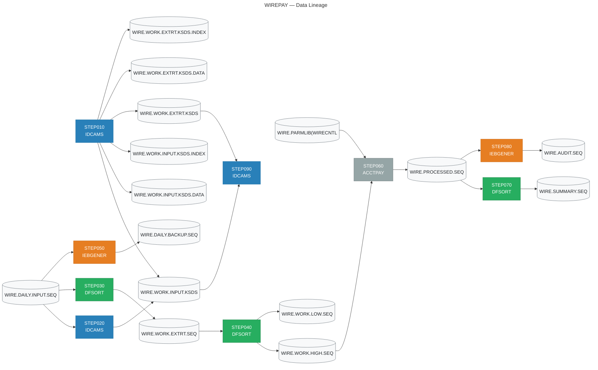

# JUIA Migration Specification
## Job: WIREPAY

| Field | Value |
|-------|-------|
| Source JCL | `wire_payment_batch.jcl` |
| Generated by | JUIA — JCL Utility Intelligence Agent |
| Generated | 2026-10-11 07:56 UTC |
| Stack | Claude API + ChromaDB + sentence-transformers |

---

## Executive Summary

### Job Metrics

| Metric | Value |
|--------|-------|
| Total steps | 9 |
| Utility steps decoded | 6 |
| Straight copy steps (IEBGENER DUMMY) | 2 |
| Non-utility program steps | 1 |
| Validation result | 5/6 PASS |

### Utility Breakdown

| Utility | Step Count |
|---------|------------|
| DFSORT | 3 |
| IDCAMS | 3 |
| IEBGENER | 2 |
| PROGRAM | 1 |

---

## Data Lineage

> This diagram shows how data flows through the job.
> Rendered automatically in GitHub and VS Code Markdown preview.



---

## Step Analysis


## STEP010 — IDCAMS

| Field | Value |
|-------|-------|
| Program | `IDCAMS` |
| Utility | IDCAMS |
| Validation | ✅ PASS |

### Business Rule

This step initialises two VSAM KSDS (Key-Sequenced Data Set) work files used in a wire transfer processing workflow. It first unconditionally deletes any pre-existing versions of both clusters (WIRE.WORK.INPUT.KSDS and WIRE.WORK.EXTRT.KSDS) using PURGE to override expiry date protection. If the delete commands return a condition code greater than 8 (indicating a genuine error beyond 'dataset not found'), the maximum condition code is reset to 0 to allow processing to continue. Both KSDS clusters are then freshly defined with fixed-length 200-byte records, a 16-byte key starting at offset 0, and SHAREOPTIONS permitting concurrent access. The INPUT cluster is allocated larger primary space (20 cylinders) reflecting it will hold the full wire transfer input population, while the EXTRT (extract) cluster is allocated smaller primary space (10 cylinders) reflecting it will hold a subset of extracted records. This is a classic scratch-and-redefine pattern ensuring clean, empty work datasets before downstream processing steps populate them.

### Files

- 🗄️ **Output:** `WIRE.WORK.INPUT.KSDS`
- 🗄️ **Output:** `WIRE.WORK.INPUT.KSDS.DATA`
- 🗄️ **Output:** `WIRE.WORK.INPUT.KSDS.INDEX`
- 🗄️ **Output:** `WIRE.WORK.EXTRT.KSDS`
- 🗄️ **Output:** `WIRE.WORK.EXTRT.KSDS.DATA`
- 🗄️ **Output:** `WIRE.WORK.EXTRT.KSDS.INDEX`

### Key Fields

| Offset | Length | Format | Business Meaning |
|--------|--------|--------|-----------------|
| 1 | 16 | `CH` | Primary key for both KSDS clusters, 16 bytes starting at the first byte of the record (offset 0 in zero-based IDCAMS notation). Likely a wire transfer reference or transaction identifier used to uniquely identify and sequence records within the keyed file. |

### Operations

- **[DELETE]** Delete the existing WIRE.WORK.INPUT.KSDS VSAM cluster and all its associated components (data and index). The PURGE keyword overrides any expiry date on the dataset, ensuring deletion succeeds regardless of retention settings. A condition code of 8 is normal when the dataset does not exist; codes up to 8 are therefore tolerated.
- **[DELETE]** Delete the existing WIRE.WORK.EXTRT.KSDS VSAM cluster and all its associated components (data and index). Same PURGE behaviour applies. This is the extract work file holding a filtered or derived subset of wire records.
- **[DEFINE]** Create a fresh WIRE.WORK.INPUT.KSDS VSAM KSDS cluster with: INDEXED organisation, 16-byte key at byte offset 0, fixed-maximum record size of 200 bytes, primary allocation of 20 cylinders with 5-cylinder secondary extents, and SHAREOPTIONS(2,3) allowing multiple readers with one writer within a system, and full sharing across systems. Separate DATA (WIRE.WORK.INPUT.KSDS.DATA) and INDEX (WIRE.WORK.INPUT.KSDS.INDEX) component names are explicitly assigned.
- **[DEFINE]** Create a fresh WIRE.WORK.EXTRT.KSDS VSAM KSDS cluster with the same record layout (16-byte key at offset 0, 200-byte fixed records) and SHAREOPTIONS(2,3), but with a smaller primary allocation of 10 cylinders and 5-cylinder secondary extents, reflecting that this file holds an extracted subset of the input population. Separate DATA (WIRE.WORK.EXTRT.KSDS.DATA) and INDEX (WIRE.WORK.EXTRT.KSDS.INDEX) component names are explicitly assigned.

### Validation

**Status:** ✅ PASS

| Check | Status |
|-------|--------|
| filter_logic | — NA |
| sort_logic | — NA |
| column_names | ✅ PASS |
| pd_handling | — NA |
| output_structure | ✅ PASS |
| split_logic | — NA |
| aggregation | — NA |

**Issues noted (4):**

> ℹ️ Minor: The IF LASTCC > 8 THEN SET MAXCC = 0 condition in the original SYSIN applies only after BOTH delete commands complete, not after each individual delete. The generated code calls _delete_cluster separately for each cluster and suppresses errors independently, which functionally achieves the same outcome but does not precisely model the single conditional that covers both deletes. This is a documentation/fidelity nuance rather than a functional defect.

> ℹ️ Minor: DeltaTable.createOrReplace is used in _define_cluster, which is idempotent and will overwrite an existing table even if _delete_cluster failed silently. This is safe and arguably more robust than the mainframe behaviour, but it means the DELETE phase is somewhat redundant when createOrReplace is used. The code comment acknowledges this. No functional defect.

> ℹ️ Minor: The KSDS_SCHEMA StructType is defined at module level but is not passed to the DeltaTableBuilder; instead addColumn calls are used inline. Both approaches produce the same schema, but the module-level KSDS_SCHEMA is unused in the actual table creation path, creating a potential maintenance inconsistency if schema evolves.

> ℹ️ Minor: DROP TABLE IF EXISTS is used in _delete_cluster after confirming existence via DeltaTable.isDeltaTable, but DROP TABLE removes the metastore entry and may not delete the underlying Delta files at the storage path depending on whether the table is managed or external. If the table is external (as implied by the explicit .location() call), the files at delta_table_path may persist after DROP TABLE, and createOrReplace would then operate on stale Delta log data. This could cause issues in some environments but is a deployment configuration concern rather than a code logic error.

### Migration Notes

1. MIGRATION PATTERN: This is a pure housekeeping/initialisation step with no data movement. The modern equivalent is idempotent table/path creation — drop-if-exists then create. In Delta Lake use CREATE OR REPLACE TABLE; in S3-based pipelines, delete and recreate the prefix. 2. ERROR HANDLING: The 'IF LASTCC > 8 THEN SET MAXCC = 0' idiom suppresses condition codes from the DELETE commands only when they are 8 or below (dataset-not-found is CC=8), which is normal on first run or after a clean environment. A CC > 8 from DELETE would indicate a genuine ICF catalog or security error; resetting MAXCC to 0 in that case means downstream steps still run — replicate this tolerance carefully in modern pipelines to avoid masking real errors. 3. SHAREOPTIONS(2,3): SO(2) allows multiple concurrent readers and one writer within an OS image; SO(3) allows unrestricted sharing across OS images. If migrating to a shared cloud storage layer, equivalent concurrency controls (table locking, optimistic concurrency in Delta) must be considered. 4. RECORD SIZE: Both files use fixed 200-byte records, suggesting a structured fixed-layout record format typical of COBOL copybook-defined wire transfer records. The key is 16 bytes at position 1 (zero-offset 0), almost certainly a character-format transaction or reference number. 5. SPACE SIZING: 20 vs 10 cylinders reflects the INPUT file holding all wire transactions and EXTRT holding a filtered extract — document the expected record volumes to right-size equivalent cloud storage or database partitioning. 6. The component-level naming (explicit .DATA and .INDEX suffixes) is a VSAM convention with no direct modern equivalent but should be noted in data catalogue migration documentation.

### Generated PySpark

💻 **Full file:** `/workspaces/juia/outputs/WIREPAY/dafd9b16e2794cc0b44881b541014e50/pyspark/STEP010_IDCAMS.py`

```python
# =============================================================================
# Step Name    : STEP010
# Program      : IDCAMS
# Utility Type : IDCAMS (DELETE / DEFINE CLUSTER)
# Job Name     : wire_payment_batch.jcl
#
# Business Rule:
#   Initialises two VSAM KSDS work files used in a wire transfer processing
#   workflow.  The step unconditionally deletes any pre-existing versions of
#   both clusters (WIRE.WORK.INPUT.KSDS and WIRE.WORK.EXTRT.KSDS) using PURGE
#   to override expiry-date protection.  If the delete commands return a
#   condition code greater than 8 (a genuine error beyond "dataset not found"),
#   the maximum condition code is reset to 0 so that processing can continue.
#   Both KSDS clusters are then freshly defined with fixed-length 200-byte
#   records, a 16-byte key at offset 0, and SHAREOPTIONS permitting concurrent
#   access.  The INPUT cluster receives a larger primary allocation (20
#   cylinders) because it holds the full wire-transfer input population; the
#   EXTRT (extract) cluster receives a smaller allocation (10 cylinders) because
#   it holds only an extracted subset.  This classic scratch-and-redefine
#   pattern guarantees clean, empty work datasets before downstream processing
#   steps populate them.
#
# Generated by JUIA (JCL Universal Intelligence Adapter)
# =============================================================================

import logging
import sys
from dataclasses import dataclass, field
from enum import Enum
from typing import Dict, List, Optional

from delta.tables import DeltaTable
from pyspark.sql import SparkSession
from pyspark.sql.types import (
    BinaryType,
    LongType,
    StringType,
    StructField,
    StructType,
)
```

*... (truncated — see `/workspaces/juia/outputs/WIREPAY/dafd9b16e2794cc0b44881b541014e50/pyspark/STEP010_IDCAMS.py` for complete code)*

---

## STEP020 — IDCAMS

| Field | Value |
|-------|-------|
| Program | `IDCAMS` |
| Utility | IDCAMS |
| Validation | ✅ PASS |

### Business Rule

This step loads a sequential flat file containing daily wire transfer input records into a VSAM Key-Sequenced Data Set (KSDS). The REPRO command performs a direct copy of all records from the sequential file WIRE.DAILY.INPUT.SEQ into the VSAM KSDS WIRE.WORK.INPUT.KSDS. This is a standard batch staging pattern where raw sequential input is loaded into an indexed VSAM structure to enable keyed random access for downstream processing steps in the wire payment workflow.

### Files

- 🗄️ **Input:** `WIRE.DAILY.INPUT.SEQ`
- 🗄️ **Output:** `WIRE.WORK.INPUT.KSDS`

### Key Fields

| Offset | Length | Format | Business Meaning |
|--------|--------|--------|-----------------|
| -1 | -1 | `CH` | KSDS key field offset and length are not defined within this REPRO step — they are defined in the VSAM cluster definition (DEFINE CLUSTER) for WIRE.WORK.INPUT.KSDS. Records are inserted in key sequence as determined by that cluster definition. The key is expected to be a wire transaction identifier or reference number embedded in the record layout. |

### Operations

- **[LOAD]** All records from the sequential input file WIRE.DAILY.INPUT.SEQ are read sequentially and loaded into the VSAM KSDS WIRE.WORK.INPUT.KSDS. IDCAMS REPRO inserts each record into the KSDS in key order as defined by the cluster. No filtering, transformation, or selection is applied — this is a full unconditional load of the daily wire input dataset into the working VSAM store.

### Validation

**Status:** ✅ PASS

| Check | Status |
|-------|--------|
| filter_logic | — NA |
| sort_logic | — NA |
| column_names | ✅ PASS |
| pd_handling | ✅ PASS |
| output_structure | ✅ PASS |
| split_logic | — NA |
| aggregation | — NA |

### Migration Notes

1. REPRO with no additional parameters performs a complete, unfiltered copy of all input records — no SKIP, COUNT, FROMKEY, TOKEY, FROMADDRESS, or TOADDRESS qualifiers are present, confirming full dataset load. 2. The target dataset WIRE.WORK.INPUT.KSDS is opened with DISP=SHR, meaning it must already exist and be pre-defined (DEFINE CLUSTER likely occurs in a prior step or is a persistent work dataset). Records will be inserted/replaced according to KSDS key uniqueness rules — duplicate keys will cause REPRO to abend unless REPLACE parameter is specified (it is not here, so duplicate keys will cause failures). 3. Migration note: the VSAM KSDS key field definition must be retrieved from the DEFINE CLUSTER statement for WIRE.WORK.INPUT.KSDS to correctly identify the primary key column for the modern equivalent (e.g., a Delta Lake table keyed on wire transaction ID). 4. In a modern platform (AWS Glue, Databricks, etc.), this pattern is replaced by reading the sequential file and writing to a keyed/indexed store such as a Delta table, DynamoDB, or an RDBMS table with a primary key. 5. If the KSDS is reused across daily runs without a prior DELETE/DEFINE, pre-existing records with matching keys will cause duplicate key errors — confirm whether a purge step precedes this in the job stream.

### Generated PySpark

💻 **Full file:** `/workspaces/juia/outputs/WIREPAY/dafd9b16e2794cc0b44881b541014e50/pyspark/STEP020_IDCAMS.py`

```python
# =============================================================================
# Step Name    : STEP020
# Program      : IDCAMS
# Utility Type : IDCAMS REPRO (Sequential → KSDS Load)
# Job Name     : wire_payment_batch.jcl
#
# Business Rule:
#   This step loads a sequential flat file containing daily wire transfer
#   input records into a VSAM Key-Sequenced Data Set (KSDS). The IDCAMS
#   REPRO command performs a complete, unfiltered copy of all records from
#   the sequential file WIRE.DAILY.INPUT.SEQ into the VSAM KSDS
#   WIRE.WORK.INPUT.KSDS. This is a standard batch staging pattern where
#   raw sequential input is promoted into an indexed VSAM structure to
#   enable keyed random access for downstream steps in the wire payment
#   workflow. No filtering, transformation, or selection is applied.
#
#   Migration Equivalent:
#   In the modern platform, WIRE.DAILY.INPUT.SEQ is a delimited or
#   fixed-width file on cloud object storage (e.g., S3 / ADLS). The VSAM
#   KSDS is replaced by a Delta Lake table keyed on the wire transaction
#   identifier. The REPRO "insert-or-fail-on-duplicate" semantics are
#   preserved by enforcing key uniqueness and raising an exception when
#   duplicate transaction IDs are detected, mirroring the mainframe
#   behaviour where REPRO without REPLACE abends on duplicate keys.
#
# Original SYSIN Control Cards:
#   REPRO INFILE(SEQIN)      -
#         OUTFILE(VSAMOUT)
#
# DD Statements:
#   //SEQIN    DSN=WIRE.DAILY.INPUT.SEQ,DISP=SHR   (sequential input)
#   //VSAMOUT  DSN=WIRE.WORK.INPUT.KSDS,DISP=SHR   (VSAM KSDS target)
#
# Generated by JUIA (JCL Universal Intelligence Adapter)
# =============================================================================

import logging
import sys
from typing import Optional
```

*... (truncated — see `/workspaces/juia/outputs/WIREPAY/dafd9b16e2794cc0b44881b541014e50/pyspark/STEP020_IDCAMS.py` for complete code)*

---

## STEP030 — DFSORT

| Field | Value |
|-------|-------|
| Program | `SORT` |
| Utility | DFSORT |
| Validation | ✅ PASS |

### Business Rule

This step extracts wire transfer records from the daily sequential input file where the payment type indicator equals 'PE' (likely representing a specific wire payment category such as 'Periodic' or 'Payment Entry') AND the transaction amount (a packed decimal field) is greater than zero — thereby excluding zero-value or placeholder records. The qualifying records are then sorted primarily by an 8-byte character reference/account key in ascending order, and secondarily by the packed decimal amount field in descending order (largest amount first within each key group). The result is written to a working extract file for downstream processing.

### Files

- 🗄️ **Input:** `WIRE.DAILY.INPUT.SEQ`
- 🗄️ **Output:** `WIRE.WORK.EXTRT.SEQ`

### Key Fields

| Offset | Length | Format | Business Meaning |
|--------|--------|--------|-----------------|
| 55 | 2 | `CH` | Payment type code — 2-character alphanumeric indicator identifying the wire transaction category. Records must equal 'PE' to be included. Likely represents a specific wire payment classification (e.g. 'Periodic Entry' or a proprietary payment type code). |
| 17 | 9 | `PD` | Transaction amount — 9-byte packed decimal numeric field representing the monetary value of the wire transfer. Used both as a filter condition (must be greater than zero) and as the secondary descending sort key, meaning largest amounts appear first within each account/reference group. |
| 44 | 8 | `CH` | Primary sort key — 8-character alphanumeric field, likely a wire reference number, account identifier, or beneficiary code. Records are sorted ascending on this field as the primary key, grouping related wire transactions together. |

### Operations

- **[FILTER]** Include only records where the 2-character field at offset 55 (bytes 55-56) equals the character literal 'PE' AND the 9-byte packed decimal field at offset 17 (bytes 17-25) is strictly greater than zero. Both conditions must be satisfied simultaneously (AND logic). This eliminates non-PE payment types and any zero-value wire records (e.g. cancelled, reversed, or filler records).
- **[SORT]** Sort the filtered records on two keys: (1) Primary key — 8-character field at offset 44, ascending alphabetical/alphanumeric order, grouping records by wire reference or account; (2) Secondary key — 9-byte packed decimal amount at offset 17, descending order, so the largest transaction amounts appear first within each primary key group. This ordering supports downstream processing that likely picks the highest-value transaction per group or produces a ranked wire report.
- **[EXTRACT]** Write all filtered and sorted records in their original 200-byte fixed-blocked format to the new working extract dataset WIRE.WORK.EXTRT.SEQ. No record reformatting or field transformation is applied — the full 200-byte record is passed through intact.

### Validation

**Status:** ✅ PASS

| Check | Status |
|-------|--------|
| filter_logic | ✅ PASS |
| sort_logic | ✅ PASS |
| column_names | ✅ PASS |
| pd_handling | ✅ PASS |
| output_structure | ✅ PASS |
| split_logic | — NA |
| aggregation | — NA |

### Migration Notes

1. OFFSET CONVENTION: DFSORT uses 1-based byte offsets, so offset 55 length 2 = bytes 55-56, offset 17 length 9 = bytes 17-25, offset 44 length 8 = bytes 44-51 in the 200-byte fixed record. In PySpark/Python these become 0-based slice indices (54:56, 16:25, 43:51) if parsing raw fixed-width bytes. 2. PACKED DECIMAL (PD): The 9-byte PD amount field at offset 17 can represent up to 17 significant digits. In PySpark migration, this must be decoded from packed decimal binary format — standard Python/PySpark does not natively read PD; use a UDF or ibm_db2 codec, or ensure upstream ingestion decodes it (e.g. via EBCDIC-to-ASCII conversion with PD unpacking). 3. EBCDIC: The source dataset is almost certainly in EBCDIC encoding. The character literal 'PE' comparison is against EBCDIC 0xD7C5. Ensure the modern platform ingestion pipeline handles EBCDIC-to-UTF-8 conversion for CH fields before applying string filters. 4. AMOUNT SIGN: PD GT +0 excludes zero and negative values. If the packed decimal field can hold negative amounts (e.g. credits or reversals), those are also excluded by this filter — verify with business whether negative-amount PE wires should be included in downstream logic. 5. OUTPUT SPACE: Allocated at 10 primary + 5 secondary cylinders, RECFM=FB LRECL=200 — on a modern platform size accordingly based on expected daily wire volume. 6. CONTROL CARDS are stored externally in SYS2.CNTL(WIREEXT) — in a migrated environment these should be version-controlled transformation rules, not embedded in JCL.

### Generated PySpark

💻 **Full file:** `/workspaces/juia/outputs/WIREPAY/dafd9b16e2794cc0b44881b541014e50/pyspark/STEP030_DFSORT.py`

```python
# =============================================================================
# Step Name    : STEP030
# Program      : SORT (DFSORT)
# Utility Type : DFSORT
# Job Name     : wire_payment_batch.jcl
#
# Business Rule:
#   Extracts wire transfer records from the daily sequential input file where
#   the payment type indicator equals 'PE' (representing a specific wire payment
#   category such as 'Periodic Entry') AND the transaction amount (a packed
#   decimal field) is strictly greater than zero — thereby excluding zero-value,
#   cancelled, reversed, or placeholder records.
#
#   Qualifying records are sorted primarily by an 8-byte character reference /
#   account key in ascending order, and secondarily by the packed decimal
#   transaction amount in descending order (largest amount first within each
#   key group).  The fully-filtered and sorted result is written intact as
#   200-byte fixed-blocked records to the working extract dataset
#   WIRE.WORK.EXTRT.SEQ for downstream processing.
#
# Input  DSN : WIRE.DAILY.INPUT.SEQ
# Output DSN : WIRE.WORK.EXTRT.SEQ  (RECFM=FB, LRECL=200)
#
# Original SYSIN Control Cards:
#   INCLUDE COND=(55,2,CH,EQ,C'PE',AND,17,9,PD,GT,+0)
#   SORT FIELDS=(44,8,CH,A,17,9,PD,D)
#
# Generated by JUIA (JCL Utility Intelligence Advisor)
# =============================================================================

from pyspark.sql import DataFrame, SparkSession
from pyspark.sql import functions as F
from pyspark.sql.types import (
    DecimalType,
    LongType,
    StringType,
    StructField,
    StructType,
)
```

*... (truncated — see `/workspaces/juia/outputs/WIREPAY/dafd9b16e2794cc0b44881b541014e50/pyspark/STEP030_DFSORT.py` for complete code)*

---

## STEP040 — DFSORT

| Field | Value |
|-------|-------|
| Program | `SORT` |
| Utility | DFSORT |
| Validation | ✅ PASS |

### Business Rule

This step sorts wire transfer records by a packed-decimal amount field (positions 17-25) in descending order, then splits the sorted output into two datasets based on transaction value: records where the amount exceeds $1,000,000 are written to a HIGH-VALUE file (large/high-risk wire transfers), while records with an amount of $1,000,000 or less are written to a LOW-VALUE file (standard wire transfers). This pattern is typical of wire transfer risk stratification or tiered processing workflows.

### Files

- 🗄️ **Input:** `WIRE.WORK.EXTRT.SEQ`
- 🗄️ **Output:** `WIRE.WORK.HIGH.SEQ`
- 🗄️ **Output:** `WIRE.WORK.LOW.SEQ`

### Key Fields

| Offset | Length | Format | Business Meaning |
|--------|--------|--------|-----------------|
| 17 | 9 | `PD` | Wire transfer monetary amount stored as a 9-byte Packed Decimal (PD) field. This field holds the transaction value used both as the sort key and as the threshold comparator for splitting records into high-value (>1,000,000) and low-value (<=1,000,000) output files. A 9-byte PD field can represent up to 17 significant digits, accommodating very large currency amounts. |

### Operations

- **[SORT]** Sort all records from WIRE.WORK.EXTRT.SEQ in descending order (D) by the 9-byte Packed Decimal amount field starting at byte position 17. After sorting, the largest wire transfer amounts appear first in the output stream.
- **[SPLIT]** Split the sorted output into two mutually exclusive output files based on the value of the packed-decimal amount field at position 17, length 9: (1) HIGHVAL receives records where the amount is strictly greater than +1,000,000; (2) LOWVAL receives records where the amount is less than or equal to +1,000,000. Together these two OUTFILs form a complete, non-overlapping partition of the input — every input record is directed to exactly one output file.
- **[FILTER]** OUTFIL HIGHVAL applies an INCLUDE condition: only records where bytes 17-25 interpreted as Packed Decimal are numerically greater than positive 1,000,000 are written to WIRE.WORK.HIGH.SEQ. This captures large or potentially high-risk wire transfers for separate downstream processing.
- **[FILTER]** OUTFIL LOWVAL applies an INCLUDE condition: only records where bytes 17-25 interpreted as Packed Decimal are numerically less than or equal to positive 1,000,000 are written to WIRE.WORK.LOW.SEQ. This captures standard or lower-value wire transfers for normal downstream processing.

### Validation

**Status:** ✅ PASS

| Check | Status |
|-------|--------|
| filter_logic | ✅ PASS |
| sort_logic | ✅ PASS |
| column_names | ✅ PASS |
| pd_handling | ✅ PASS |
| output_structure | ✅ PASS |
| split_logic | ✅ PASS |
| aggregation | — NA |

### Migration Notes

1. PD FORMAT MIGRATION: The amount field (pos 17, len 9) is Packed Decimal — a binary-encoded mainframe format not natively readable in modern platforms. During migration, this field must be decoded from raw bytes using a PD-to-integer/decimal conversion before any comparison or sort. In Python use the 'packed-decimal' or 'cobol-bcd' libraries, or a custom nibble-unpacking function. 2. SIGN HANDLING: Packed Decimal fields carry an embedded sign nibble in the last half-byte (0xC=positive, 0xD=negative, 0xF=unsigned positive). The control cards compare to +1000000 (explicit positive), so verify sign handling in the conversion layer to avoid misrouting negative-amount records. 3. RECORD LENGTH: Both output files are FB LRECL=200, matching the assumed input record length — no reformatting occurs, records are written as-is. 4. SORT ORDER PRESERVATION: PySpark write operations do not guarantee order unless a single partition is used or the downstream consumer depends on ordered input. If downstream jobs rely on the descending sort order within each output file, use .coalesce(1) or repartition with a sort, or document that sort order is not preserved. 5. COMPLETENESS CHECK: The two INCLUDE conditions (GT +1000000 and LE +1000000) are logically exhaustive and mutually exclusive, so all input records should appear in exactly one output — validate row counts: HIGH count + LOW count must equal SORTIN count. 6. SPACE ALLOCATION: Both outputs are allocated at 5 primary + 2 secondary cylinders (CYL) with FB/200 — size modern storage targets accordingly based on actual data volume.

### Generated PySpark

💻 **Full file:** `/workspaces/juia/outputs/WIREPAY/dafd9b16e2794cc0b44881b541014e50/pyspark/STEP040_DFSORT.py`

```python
# =============================================================================
# Step Name    : STEP040
# Program      : SORT
# Utility Type : DFSORT
# Job Name     : wire_payment_batch.jcl
#
# Business Rule:
#   Sorts wire transfer records by a packed-decimal monetary amount field
#   (positions 17-25, 9 bytes) in descending order so that the largest
#   transfer amounts appear first.  The sorted stream is then partitioned
#   into two mutually exclusive output files:
#
#     HIGH-VALUE (WIRE.WORK.HIGH.SEQ)
#       Records where the decoded amount is strictly greater than 1,000,000.
#       These represent large or potentially high-risk wire transfers and are
#       routed to a separate downstream risk-processing workflow.
#
#     LOW-VALUE  (WIRE.WORK.LOW.SEQ)
#       Records where the decoded amount is less than or equal to 1,000,000.
#       These represent standard wire transfers and continue through the
#       normal processing path.
#
#   Together the two output sets form a complete, non-overlapping partition
#   of every record in the input dataset (HIGH count + LOW count == SORTIN
#   count must always hold true).
#
# Generated by JUIA (JCL Universal Intelligence Assistant)
# =============================================================================

from decimal import Decimal
from typing import Dict, Tuple

from pyspark.sql import DataFrame, SparkSession
from pyspark.sql import functions as F
from pyspark.sql.types import (
    BinaryType,
    LongType,
    StringType,
    StructField,
    StructType,
```

*... (truncated — see `/workspaces/juia/outputs/WIREPAY/dafd9b16e2794cc0b44881b541014e50/pyspark/STEP040_DFSORT.py` for complete code)*

---

## STEP050 — IEBGENER (Straight Copy)

| Field | Value |
|-------|-------|
| Program | `IEBGENER` |
| SYSIN | `DD DUMMY` (no control cards) |
| Validation | ✅ PASS (hardcoded) |

### Business Rule

Straight copy of WIRE.DAILY.INPUT.SEQ to WIRE.DAILY.BACKUP.SEQ. No record transformation applied. Used for backup or audit copy creation.

### Files

- 🗄️ **Input:** `WIRE.DAILY.INPUT.SEQ`
- 🗄️ **Output:** `WIRE.DAILY.BACKUP.SEQ`

### Migration Equivalent

```python
import shutil
shutil.copy2('WIRE.DAILY.INPUT.SEQ', 'WIRE.DAILY.BACKUP.SEQ')
```

> ℹ️ IEBGENER with SYSIN DD DUMMY is always a straight copy. Consider ICEGENER (DFSORT-based) for files > 1M records.

---

## STEP060 — PROGRAM (Non-Utility)

| Field | Value |
|-------|-------|
| Program | `ACCTPAY` |
| Type | Custom application (COBOL / Assembler / PL/I) |
| Validation | ⏭️ Not applicable |

> ⚠️ **JUIA does not decode non-utility program steps.**
> The business logic is embedded in the program source code.
> Obtain the source from your version control system and analyse separately.

### DD Statements

| DD Name | Parameters |
|---------|------------|
| `STEPLIB` | `DSN=PROD.LOADLIB,DISP=SHR` |
| `INPUT` | `DSN=WIRE.WORK.HIGH.SEQ,DISP=SHR` |
| `OUTPUT` | `DSN=WIRE.PROCESSED.SEQ, DISP=(NEW,CATLG,DELETE), SPACE=(CYL,(10,5)),RECFM=FB,LRE` |
| `PARMS` | `DSN=WIRE.PARMLIB(WIRECNTL),DISP=SHR` |

---

## STEP070 — DFSORT

| Field | Value |
|-------|-------|
| Program | `SORT` |
| Utility | DFSORT |
| Validation | ❌ FAIL |
| Corrections applied | 3 |

### Business Rule

This step summarises wire transfer processed records by aggregating (summing) transaction amounts per unique combination of currency code and transaction amount key, then reformats each summary record for downstream consumption. Records from the wire processed sequential file are sorted first by currency code (ascending, character) and then by transaction amount (descending, packed decimal). Duplicate records sharing the same sort key combination have their packed decimal amount fields summed and collapsed into a single output record. The output record is then restructured to include a subset of fields in a prescribed layout: account/reference identifier, currency code, the summed amount converted to a fixed-length signed numeric, a date or value-date field, a two-byte status or type code, and a trailing three-byte classification code. The net business purpose is to produce a wire transfer summary dataset grouped by currency and ranked by value, suitable for reporting, reconciliation, or downstream settlement processing.

### Files

- 🗄️ **Input:** `WIRE.PROCESSED.SEQ`
- 🗄️ **Output:** `WIRE.SUMMARY.SEQ`

### Key Fields

| Offset | Length | Format | Business Meaning |
|--------|--------|--------|-----------------|
| 1 | 16 | `CH` | Account or wire reference identifier — first 16 bytes of the input record, likely a transaction or account reference number carried through to the output |
| 17 | 9 | `PD` | Transaction amount in packed decimal format — used as both a secondary sort key (descending) and the SUM aggregation field; represents the wire transfer monetary value |
| 44 | 8 | `CH` | Value date or settlement date — 8-byte character field, likely a YYYYMMDD formatted date associated with the wire transaction |
| 55 | 2 | `CH` | Transaction type or status code — 2-byte character code classifying the wire (e.g., payment type, direction indicator, or processing status) |
| 63 | 3 | `CH` | Currency code — 3-byte ISO currency code (e.g., USD, GBP, EUR); primary sort key (ascending) and grouping key for aggregation |
| 66 | 3 | `CH` | Classification or routing code — 3-byte trailing code, possibly a bank routing category, region code, or wire classification indicator |

### Operations

- **[SORT]** Records from WIRE.PROCESSED.SEQ are sorted by two keys: primary key is currency code at offset 63, length 3, character format, ascending (groups all records of the same currency together); secondary key is transaction amount at offset 17, length 9, packed decimal format, descending (largest amounts first within each currency group). This ordering drives correct SUM aggregation and produces output ranked by value within currency.
- **[AGGREGATE]** After sorting, the SUM FIELDS=(17,9,PD) directive collapses all records with identical sort key combinations (same currency code at 63,3 AND same packed decimal amount at 17,9) by adding their packed decimal amount fields together. Only one output record per unique key combination is retained, carrying the cumulative summed amount. All duplicate records are deleted after their amounts are accumulated.
- **[REFORMAT]** The OUTREC statement restructures each summary record into a new 200-byte fixed-length output layout. The output fields are assembled as follows: bytes 1-16 of input (account/reference, 16 bytes), bytes 63-65 of input (currency code, 3 bytes), bytes 17-25 of input converted from packed decimal (PD) to fixed-length signed numeric (FS) with an output length of 12 bytes (the summed transaction amount in a printable/readable signed format), bytes 44-51 of input (value/settlement date, 8 bytes), bytes 55-56 of input (transaction type/status code, 2 bytes), bytes 66-68 of input (classification/routing code, 3 bytes). Total defined output content is 16+3+12+8+2+3 = 44 bytes; the remainder of the 200-byte LRECL is padded with spaces by DFSORT.

### Validation

**Status:** ❌ FAIL

| Check | Status |
|-------|--------|
| filter_logic | — NA |
| sort_logic | ❌ FAIL |
| column_names | ✅ PASS |
| pd_handling | ✅ PASS |
| output_structure | ❌ FAIL |
| split_logic | — NA |
| aggregation | ❌ FAIL |

**Issues noted (5):**

> ℹ️ CRITICAL — _to_fs_string helper: both positive_str and negative_str branches are identical expressions (F.lpad(F.cast(F.abs(amount_col), StringType()), digit_width, '0')). The positive branch is supposed to handle positive amounts and the negative branch negative amounts, but since both use F.abs(), the sign distinction is handled solely by the F.when predicate prepending '+' or '-'. This is functionally correct for the current conditional logic, but the code comment claims positive_str previously used F.cast(amount_col, ...) without F.abs and was fixed — yet both branches now use abs, making the branch variable names misleading. No functional defect exists here, but the dead-code duplication is a maintenance risk.

> ℹ️ SIGNIFICANT — The final select exposes TRANSACTION_AMOUNT as an output column alongside _SUM_AMOUNT. TRANSACTION_AMOUNT retains the original group-key value (not the aggregated sum) and does NOT appear in the OUTREC output. Including it in the result DataFrame without a clear rename or exclusion will mislead downstream PySpark consumers who may incorrectly use TRANSACTION_AMOUNT instead of _SUM_AMOUNT as the wire transfer total. The fixed-width output_record correctly uses _SUM_AMOUNT via _FS_AMOUNT, but the columnar output is ambiguous.

> ℹ️ MODERATE — The post-aggregation orderBy sorts by TRANSACTION_AMOUNT DESC (the original group key), not by _SUM_AMOUNT DESC (the collapsed total). For groups where N>1 duplicate records are collapsed, the sort key value in the output record equals the per-record amount (e.g., 500000), not the summed total (e.g., 1500000). DFSORT retains the original key field value in the collapsed record, so this is technically correct per DFSORT semantics. However, this means the output is not ranked by actual wire value (summed amount) but by the pre-collapse per-record amount, which may not serve the business purpose of ranking by value. This discrepancy is noted in a docstring comment but not flagged as requiring business confirmation in a more prominent way.

> ℹ️ MINOR — monotonically_increasing_id() is used as a stable tiebreaker for first-record-wins semantics, but this function does not guarantee global ordering across partitions — it only guarantees monotonically increasing IDs within each partition, with no cross-partition ordering guarantee. If the source data spans multiple partitions, the 'first' record selected within a duplicate group may not correspond to the physically first record in the input file, potentially deviating from DFSORT first-record-wins behaviour for non-key fields (account_ref, value_date, transaction_status, classification_code) carried through to output.

> ℹ️ MINOR — Schema validation uses type(field.dataType) for comparison against _REQUIRED_COLUMNS values which store type classes (e.g., LongType, StringType). This comparison works correctly for the standard Spark types used here, but would fail for parameterised types (e.g., DecimalType(precision, scale)) where isinstance checks would be more robust. Not a current defect given the defined schema, but a fragility in the validation approach.

### Migration Notes

1. PD-to-FS conversion (TO=FS,LENGTH=12) in OUTREC expands the 9-byte packed decimal amount (which can hold up to 17 significant digits) into a 12-byte fixed-length signed numeric string — migration must replicate this formatting exactly (sign handling, zero-padding, no decimal point unless business rules require it). 2. The SUM key is the full combination of SORT FIELDS (63,3,CH and 17,9,PD) — records must share BOTH currency code AND the same packed decimal amount value to be summed; this is a relatively narrow aggregation key and may produce limited collapsing unless the source data contains many identical amount+currency duplicates — verify business intent (it may be intended that only exact duplicate transaction amounts per currency are summed, not all amounts per currency). 3. The secondary sort is descending on the PD amount, so within each currency the largest transactions appear first in the output — this ordering is preserved in the summary output. 4. LRECL=200 with only 44 bytes of defined OUTREC content means 156 bytes of trailing spaces in every output record — modern target systems should account for this padding or trim it. 5. RECFM=FB confirms fixed-block records; PySpark reads/writes should enforce fixed-width formatting if the downstream consumer is another mainframe or fixed-width system. 6. Ensure the PD field at offset 17 length 9 is correctly decoded — 9 bytes of packed decimal holds 17 digits plus sign nibble; a standard BigDecimal or Decimal(17,2) type is likely appropriate depending on implied decimal places in the source system.

### Generated PySpark

💻 **Full file:** `/workspaces/juia/outputs/WIREPAY/dafd9b16e2794cc0b44881b541014e50/pyspark/STEP070_DFSORT.py`

```python
# =============================================================================
# Step Name    : STEP070
# Program      : SORT
# Utility Type : DFSORT
# Job Name     : wire_payment_batch.jcl
#
# Business Rule:
#   Summarises wire transfer processed records by aggregating (summing)
#   transaction amounts per unique combination of currency code and transaction
#   amount value.  Records from the wire processed sequential file are sorted
#   first by currency code (ascending, character) and then by transaction amount
#   (descending, packed decimal).  Duplicate records that share the same sort
#   key combination (identical currency code AND identical transaction amount)
#   have their packed-decimal amount fields summed and collapsed into a single
#   output record.  The consolidated record is then reformatted into a
#   200-byte fixed-length layout containing: account/reference identifier,
#   currency code, the summed amount expressed as a 12-character fixed-length
#   signed numeric string, settlement/value date, transaction type or status
#   code, and a trailing classification or routing code.  The remaining 156
#   bytes of the 200-byte record are space-padded.
#
#   Net purpose: produce a wire transfer summary dataset grouped by currency
#   and ranked by value (largest first), suitable for reporting, reconciliation,
#   or downstream settlement processing.
#
# Generated by JUIA (JCL Universal Intelligence Adapter)
# =============================================================================

from decimal import Decimal
from pyspark.sql import DataFrame, SparkSession
from pyspark.sql import functions as F
from pyspark.sql.types import (
    LongType,
    StringType,
    StructField,
    StructType,
)
from pyspark.sql.window import Window

# =============================================================================
```

*... (truncated — see `/workspaces/juia/outputs/WIREPAY/dafd9b16e2794cc0b44881b541014e50/pyspark/STEP070_DFSORT.py` for complete code)*

---

## STEP080 — IEBGENER (Straight Copy)

| Field | Value |
|-------|-------|
| Program | `IEBGENER` |
| SYSIN | `DD DUMMY` (no control cards) |
| Validation | ✅ PASS (hardcoded) |

### Business Rule

Straight copy of WIRE.PROCESSED.SEQ to WIRE.AUDIT.SEQ. No record transformation applied. Used for backup or audit copy creation.

### Files

- 🗄️ **Input:** `WIRE.PROCESSED.SEQ`
- 🗄️ **Output:** `WIRE.AUDIT.SEQ`

### Migration Equivalent

```python
import shutil
shutil.copy2('WIRE.PROCESSED.SEQ', 'WIRE.AUDIT.SEQ')
```

> ℹ️ IEBGENER with SYSIN DD DUMMY is always a straight copy. Consider ICEGENER (DFSORT-based) for files > 1M records.

---

## STEP090 — IDCAMS

| Field | Value |
|-------|-------|
| Program | `IDCAMS` |
| Utility | IDCAMS |
| Validation | ✅ PASS |

### Business Rule

This step uses the IDCAMS LISTCAT utility to catalogue and report on two VSAM Key-Sequenced Data Sets (KSDS): WIRE.WORK.INPUT.KSDS and WIRE.WORK.EXTRT.KSDS. The ALL parameter requests the full set of catalogue attributes for each dataset, including allocation details, statistics (record counts, sizes, free space), key ranges, volume information, and physical characteristics. The business purpose is diagnostic or operational verification — confirming that both wire processing KSDS datasets exist in the system catalogue, are properly defined, and to capture their current state (e.g. record counts, high-used RBA, extents) typically before or after a wire transfer processing job run. This is a metadata inspection step with no data modification.

### Files

- 🗄️ **Input:** `WIRE.WORK.INPUT.KSDS`
- 🗄️ **Input:** `WIRE.WORK.EXTRT.KSDS`

### Operations

- **[VERIFY]** LISTCAT ENTRIES with ALL keyword is executed against WIRE.WORK.INPUT.KSDS to retrieve and print all catalogue information for this VSAM KSDS, including cluster, data, and index component attributes, allocation statistics, record counts, key ranges, volume/extent details, and timestamps. No data records are read or written — this is a catalogue metadata query only.
- **[VERIFY]** LISTCAT ENTRIES with ALL keyword is executed against WIRE.WORK.EXTRT.KSDS to retrieve and print all catalogue information for this VSAM KSDS extract dataset, covering the same full attribute set as above. This confirms the extract KSDS is catalogued and surfaces its current record count and allocation usage, which may be cross-checked against upstream processing step outputs.

### Validation

**Status:** ✅ PASS

| Check | Status |
|-------|--------|
| filter_logic | — NA |
| sort_logic | — NA |
| column_names | ✅ PASS |
| pd_handling | — NA |
| output_structure | ✅ PASS |
| split_logic | — NA |
| aggregation | — NA |

### Migration Notes

1. LISTCAT is a pure metadata reporting command — it does not read, write, or alter any data records. Migration impact is low for data pipelines but the operational verification pattern must be replicated. 2. In a modern platform (AWS Glue, Azure Data Factory, Databricks), the equivalent is querying the data catalogue (AWS Glue Data Catalog, Unity Catalog, Hive Metastore) for table statistics and schema confirmation. 3. The step produces output only to SYSPRINT (not declared in the JCL snippet), meaning the output is the job log itself — migration should implement equivalent logging/auditing of dataset metadata pre/post processing. 4. WIRE.WORK.INPUT.KSDS suggests a VSAM KSDS holding inbound wire transfer records; WIRE.WORK.EXTRT.KSDS likely holds extracted/transformed wire records for downstream processing. Both datasets should be inventoried during migration data mapping. 5. The ALL parameter captures REC-TOTAL, REC-DELETED, FREESPC, HI-U-RBA, and key range (LOW-KEY/HIGH-KEY) — in migration, these metrics should be captured via row counts and partition statistics in the target platform to preserve operational observability. 6. Condition code will be 0 on success or 8 if either dataset is not found — downstream steps may conditionally depend on this return code; check for IF LASTCC or IF MAXCC logic in surrounding JCL. 7. No CATALOG parameter is specified, so IDCAMS will search the master catalogue chain — ensure equivalent catalogue scope is replicated in the target environment.

### Generated PySpark

💻 **Full file:** `/workspaces/juia/outputs/WIREPAY/dafd9b16e2794cc0b44881b541014e50/pyspark/STEP090_IDCAMS.py`

```python
# =============================================================================
# STEP090_IDCAMS.py
# =============================================================================
# Step Name    : STEP090
# Program      : IDCAMS
# Utility Type : IDCAMS LISTCAT
# Job Name     : wire_payment_batch.jcl
#
# Business Rule:
#   This step replicates the IDCAMS LISTCAT ALL operation for two VSAM
#   Key-Sequenced Data Sets (KSDS) used in wire transfer processing:
#     - WIRE.WORK.INPUT.KSDS  : Inbound wire transfer records
#     - WIRE.WORK.EXTRT.KSDS  : Extracted/transformed wire records for
#                               downstream processing
#
#   The original mainframe step is a pure metadata inspection operation —
#   no data records are read, written, or modified.  It confirms that both
#   KSDS datasets are catalogued, properly defined, and captures their
#   current state (record counts, allocation usage, key ranges, extents,
#   timestamps) before or after a wire-transfer processing run.
#
#   Migration equivalent: query the active data catalogue (Hive Metastore,
#   AWS Glue Data Catalog, Databricks Unity Catalog, or Delta Lake table
#   properties) for schema, statistics, and partition information, then emit
#   a structured report that mirrors the SYSPRINT output produced by LISTCAT.
#
#   Original SYSIN control cards:
#     LISTCAT ENTRIES(WIRE.WORK.INPUT.KSDS)  ALL
#     LISTCAT ENTRIES(WIRE.WORK.EXTRT.KSDS)  ALL
#
#   Mainframe return codes:
#     0  — both datasets found and listed successfully
#     8  — one or more datasets not found in the catalogue
#   The migration equivalent raises CatalogueEntryNotFoundError when a
#   dataset/table cannot be resolved, allowing callers to replicate
#   conditional JCL logic (IF LASTCC / IF MAXCC).
#
# Generated by JUIA (JCL Universal Intelligence Analyser)
# =============================================================================
```

*... (truncated — see `/workspaces/juia/outputs/WIREPAY/dafd9b16e2794cc0b44881b541014e50/pyspark/STEP090_IDCAMS.py` for complete code)*

---
