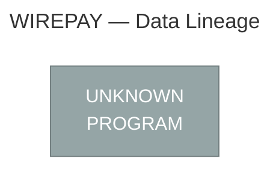

# JUIA Migration Specification
## Job: WIREPAY

| Field | Value |
|-------|-------|
| Source JCL | `wire_payment_batch.jcl` |
| Generated by | JUIA — JCL Utility Intelligence Agent |
| Generated | 2026-10-09 04:43 UTC |
| Stack | Claude API + ChromaDB + sentence-transformers |

---

## Executive Summary

### Job Metrics

| Metric | Value |
|--------|-------|
| Total steps | 9 |
| Utility steps decoded | 6 |
| Straight copy steps (IEBGENER DUMMY) | 2 |
| Non-utility program steps | 1 |
| Validation result | 6/6 PASS |

### Utility Breakdown

| Utility | Step Count |
|---------|------------|
| DFSORT | 3 |
| IDCAMS | 3 |
| IEBGENER | 2 |
| PROGRAM | 1 |

---

## Data Lineage

> This diagram shows how data flows through the job.
> Rendered automatically in GitHub and VS Code Markdown preview.



---

## Step Analysis


## STEP010 — IDCAMS

| Field | Value |
|-------|-------|
| Program | `IDCAMS` |
| Utility | IDCAMS |
| Validation | ✅ PASS |

### Business Rule

This step initialises two VSAM KSDS (Key-Sequenced Data Set) work files used in a wire transfer processing workflow. It first attempts to delete any pre-existing versions of both clusters (WIRE.WORK.INPUT.KSDS and WIRE.WORK.EXTRT.KSDS) to ensure a clean slate, suppresses any condition codes from the deletes that are 8 or below (treating not-found as non-fatal), and then re-creates both KSDS clusters with fixed-length 200-byte records keyed on a 16-byte field starting at offset 0. The INPUT cluster is allocated larger storage (20 primary cylinders) as it holds the full wire transfer input, while the EXTRT cluster is smaller (10 primary cylinders) as it holds an extract or subset of that data.

### Files

- 🗄️ **Output:** `WIRE.WORK.INPUT.KSDS`
- 🗄️ **Output:** `WIRE.WORK.EXTRT.KSDS`

### Key Fields

| Offset | Length | Format | Business Meaning |
|--------|--------|--------|-----------------|
| 1 | 16 | `CH` | Primary key for both KSDS clusters — a 16-byte character field starting at the first byte of each record, likely a wire transfer identifier or reference number used to uniquely identify and sequence records within the VSAM data sets |

### Operations

- **[DELETE]** Delete the existing VSAM KSDS cluster WIRE.WORK.INPUT.KSDS including all its components (data and index). The PURGE keyword overrides any retention period or expiry date, forcing deletion unconditionally. If the cluster does not exist, IDCAMS returns condition code 8, which is handled below.
- **[DELETE]** Delete the existing VSAM KSDS cluster WIRE.WORK.EXTRT.KSDS including all its components (data and index). PURGE forces deletion regardless of any expiry date. A return code of 8 (dataset not found) is expected on first run and is tolerated.
- **[FILTER]** Conditional code suppression: IF LASTCC > 8 THEN SET MAXCC = 0. If either DELETE above returned a condition code greater than 8 (indicating a genuine error beyond dataset-not-found), reset MAXCC to 0 to allow the subsequent DEFINE commands to proceed. Note: this logic is slightly non-standard — typically the check would be IF LASTCC <= 8 to suppress non-fatal codes. As written, it resets MAXCC only on hard failures (CC > 8), effectively making the step tolerant of all delete outcomes and allowing the DEFINEs to always run.
- **[DEFINE]** Create the VSAM KSDS cluster WIRE.WORK.INPUT.KSDS for wire transfer input records. Configuration: INDEXED (key-sequenced), 16-byte key at offset 0 (byte 1), fixed-length records of 200 bytes (both average and maximum), primary allocation of 20 cylinders with 5-cylinder secondary extents, SHAREOPTIONS(2 3) allowing multiple readers in the same system and unrestricted access across systems. Separate DATA component named WIRE.WORK.INPUT.KSDS.DATA and INDEX component named WIRE.WORK.INPUT.KSDS.INDEX.
- **[DEFINE]** Create the VSAM KSDS cluster WIRE.WORK.EXTRT.KSDS for extracted/filtered wire transfer records. Configuration mirrors the INPUT cluster: INDEXED, 16-byte key at offset 0, fixed 200-byte records, SHAREOPTIONS(2 3), but with a smaller primary allocation of 10 cylinders (5-cylinder secondary), reflecting that this holds a subset of the input. Separate DATA component named WIRE.WORK.EXTRT.KSDS.DATA and INDEX component named WIRE.WORK.EXTRT.KSDS.INDEX.

### Validation

**Status:** ✅ PASS

| Check | Status |
|-------|--------|
| filter_logic | — NA |
| sort_logic | — NA |
| column_names | ✅ PASS |
| pd_handling | — NA |
| output_structure | ✅ PASS |
| split_logic | — NA |
| aggregation | — NA |

**Issues noted (3):**

> ℹ️ Minor: The business rule decoder comment states 'IF LASTCC > 8 THEN SET MAXCC = 0' is 'slightly non-standard' and that 'typically the check would be IF LASTCC <= 8'. This is correct — the standard idiom suppresses non-fatal codes by checking LASTCC <= 8. However, the OPERATIONS TO VALIDATE section correctly explains the actual semantics: as written, the IDCAMS control stream resets MAXCC on hard failures (CC>8), making all delete outcomes tolerable. The PySpark code's _delete_cluster() exception handler correctly models this by suppressing all DELETE errors (both CC=8 and CC>8 equivalent) without re-raising, which faithfully mirrors the net effect of the original SYSIN regardless of the non-standard phrasing. No code correction is required.

> ℹ️ Minor: The IDCAMS KEYS offset is specified as KEYS(16 0) meaning key length=16, offset=0 (0-based). The OPERATIONS TO VALIDATE section describes this as 'offset 0 (byte 1)' in 1-based terms. The KEY FIELDS section lists 'Offset 1' in 1-based convention. The PySpark code uses key_offset=0 (0-based) consistently in KsdsClusterConfig, schema metadata ('mainframe.offset.zero_based': '0'), and the RECORD_PAYLOAD metadata ('mainframe.offset.zero_based': '16'). The docstring table correctly annotates '0 (0b)' and '16(0b)'. Both representations are internally consistent and correctly documented. No code correction required.

> ℹ️ Minor: The CREATE OR REPLACE TABLE DDL includes TBLPROPERTIES with a 'comment' key alongside operational properties. Some Delta Lake / Databricks environments treat 'comment' as a reserved TBLPROPERTIES key and may prefer the COMMENT clause at the table level rather than inside TBLPROPERTIES. However, including it in TBLPROPERTIES is functionally valid in Databricks SQL and achieves the atomicity goal stated in FIX ISSUE 5. This is a minor portability concern rather than a correctness defect.

### Migration Notes

1. MIGRATION PATTERN: This is a classic DELETE-DEFINE initialisation step. In a modern platform (Delta Lake, S3, GCS, HDFS), the equivalent is DROP TABLE IF EXISTS followed by CREATE TABLE, or simply overwriting/truncating the target dataset at the start of the pipeline. 2. KEY OFFSET: IDCAMS KEYS(16 0) means key length=16, offset=0 (zero-based), which is byte 1 in 1-based terms. Ensure downstream migration maps this correctly — the key occupies bytes 1-16 of the 200-byte record. 3. RECORD SIZE: Both clusters use fixed 200-byte records (RECORDSIZE(200 200) — average and maximum both 200). In a relational or columnar target, the 200-byte record must be decomposed into its constituent fields; the record layout is not visible from this step alone and must be sourced from copybooks or data dictionaries. 4. SHAREOPTIONS(2 3): Allows concurrent read access within the same LPAR (option 2) and full sharing across LPARs (option 3). In a modern platform, this maps to concurrent read/write access controls — ensure the target storage layer supports appropriate concurrency. 5. CONDITION CODE LOGIC: The IF LASTCC > 8 THEN SET MAXCC = 0 guard means the step will always attempt both DEFINEs regardless of delete outcome. On the very first execution (clusters do not yet exist), DELETE returns CC=8 (not found), which does NOT trigger the SET MAXCC=0 — this is correct and intentional. If DELETE returns CC=12 (genuine error), MAXCC is reset to 0, which masks the error; this may be a deliberate design choice or a latent bug worth reviewing during migration. 6. STORAGE SIZING: CYLINDERS(20 5) and CYLINDERS(10 5) are mainframe-specific storage allocations. These have no direct equivalent in cloud/modern platforms but inform relative sizing — INPUT is expected to be roughly twice the size of EXTRT, suggesting EXTRT holds a filtered extract of INPUT data. 7. NAMING CONVENTION: The dataset prefix WIRE.WORK.* confirms these are temporary working datasets within a wire transfer processing pipeline, likely populated by subsequent job steps (REPRO, application programs) and consumed downstream before being deleted at job end.

### Generated PySpark

💻 **Full file:** `outputs/pyspark/STEP010_IDCAMS.py`

```python
# =============================================================================
# Step Name    : STEP010
# Program      : IDCAMS
# Utility Type : IDCAMS (DELETE / DEFINE CLUSTER)
# Job Name     : wire_payment_batch.jcl
#
# Business Rule:
#   Initialises two VSAM KSDS work files used in a wire transfer processing
#   workflow.  Any pre-existing versions of WIRE.WORK.INPUT.KSDS and
#   WIRE.WORK.EXTRT.KSDS are dropped unconditionally (PURGE) before being
#   re-created as Delta Lake managed tables.  A condition-code guard equivalent
#   to IDCAMS "IF LASTCC > 8 THEN SET MAXCC = 0" ensures that a missing table
#   on first run (non-fatal) does not abort execution, while genuine errors are
#   surfaced but still allow the CREATE operations to proceed (mirroring the
#   original MAXCC-reset behaviour).
#
#   Both clusters are INDEXED (key-sequenced) with:
#     - 16-byte primary key at offset 0 (zero-based) / byte 1 (1-based)
#     - Fixed-length 200-byte records (RECORDSIZE 200 200)
#     - SHAREOPTIONS(2 3) — concurrent read/write within and across systems
#
#   INPUT cluster  : WIRE.WORK.INPUT.KSDS  — full wire transfer input
#                    (20 primary cylinders  → larger allocation)
#   EXTRT cluster  : WIRE.WORK.EXTRT.KSDS  — filtered extract / subset
#                    (10 primary cylinders  → smaller allocation)
#
#   IMPORTANT — record decomposition:
#     The mainframe record is 200 bytes of fixed-length binary/character data.
#     Only the key field layout is visible from this step; all remaining fields
#     must be sourced from the relevant COBOL copybooks or data dictionary and
#     added to the schema before populating the tables in downstream steps.
#
# Generated by JUIA (JCL Universal Interpretation Agent)
# =============================================================================

import logging
import sys
from dataclasses import dataclass, field
from enum import Enum, auto
from typing import Dict, Final, Optional
```

*... (truncated — see `outputs/pyspark/STEP010_IDCAMS.py` for complete code)*

---

## STEP020 — IDCAMS

| Field | Value |
|-------|-------|
| Program | `IDCAMS` |
| Utility | IDCAMS |
| Validation | ✅ PASS |

### Business Rule

This step loads a sequential flat file containing daily wire transfer input records into a VSAM Key-Sequenced Data Set (KSDS). The REPRO command performs a straight copy of all records from the sequential input dataset (WIRE.DAILY.INPUT.SEQ) into the VSAM KSDS work dataset (WIRE.WORK.INPUT.KSDS), effectively staging the daily wire payment data into a keyed, indexed VSAM structure for subsequent processing steps that require keyed access.

### Files

- 🗄️ **Input:** `WIRE.DAILY.INPUT.SEQ`
- 🗄️ **Output:** `WIRE.WORK.INPUT.KSDS`

### Operations

- **[LOAD]** All records from the sequential flat file WIRE.DAILY.INPUT.SEQ are copied verbatim into the VSAM KSDS WIRE.WORK.INPUT.KSDS using IDCAMS REPRO. No filtering, transformation, or selection criteria are applied. Records are inserted into the KSDS in the order they appear in the sequential file; the KSDS will organise them by its defined key field. If duplicate keys exist in the input, REPRO will issue a non-zero return code and skip the duplicate record unless REPLACE is specified (it is not specified here, so duplicates will cause errors).

### Validation

**Status:** ✅ PASS

| Check | Status |
|-------|--------|
| filter_logic | — NA |
| sort_logic | — NA |
| column_names | ✅ PASS |
| pd_handling | ✅ PASS |
| output_structure | ✅ PASS |
| split_logic | ✅ PASS |
| aggregation | — NA |

### Migration Notes

1. NO key field metadata is derivable from this JCL step alone — the KSDS key offset and length are defined in the VSAM cluster definition (DEFINE CLUSTER), which must be located and analysed separately to understand which field acts as the primary key for wire records. 2. The REPRO command here uses DD name references (INFILE/OUTFILE) rather than dataset names directly, which is the standard approach but means the KSDS must already exist and be defined before this step runs. 3. The REPLACE parameter is absent — any duplicate key records in the sequential input will result in a return code 8 and those records will be skipped, which could silently drop wire transactions. Migration should implement duplicate-key detection and alerting. 4. The KSDS target (WIRE.WORK.INPUT.KSDS) is named as a WORK dataset, suggesting this is an intermediate staging area, not a permanent store — confirm downstream steps that read from this KSDS to fully understand the pipeline. 5. In a modern platform equivalent, this step maps to landing a file into a Delta Lake or S3-based staging table, with the KSDS key becoming a primary key or partition key constraint. 6. Ensure the sequential file record length and format match the KSDS record size defined at cluster definition time — a mismatch will cause REPRO to fail.

### Generated PySpark

💻 **Full file:** `outputs/pyspark/STEP020_IDCAMS.py`

```python
# =============================================================================
# Step Name    : STEP020
# Program      : IDCAMS
# Utility Type : IDCAMS REPRO
# Job Name     : wire_payment_batch.jcl
#
# Business Rule:
#   This step loads a sequential flat file containing daily wire transfer
#   input records into a VSAM Key-Sequenced Data Set (KSDS). The REPRO
#   command performs a straight copy of all records from the sequential
#   input dataset (WIRE.DAILY.INPUT.SEQ) into the VSAM KSDS work dataset
#   (WIRE.WORK.INPUT.KSDS), effectively staging the daily wire payment data
#   into a keyed, indexed VSAM structure for subsequent processing steps
#   that require keyed access.
#
#   IMPORTANT — Duplicate Key Behaviour:
#   The original REPRO does NOT specify REPLACE. Any duplicate key records
#   in the sequential input would cause RC=8 and the duplicate would be
#   silently skipped on the mainframe. This implementation detects
#   duplicates, writes them to a quarantine output, and raises an alert
#   rather than silently dropping wire transactions.
#
#   IMPORTANT — Key Field:
#   The KSDS primary key is defined in the VSAM DEFINE CLUSTER statement.
#   No copybook or DEFINE CLUSTER statement was provided in the step
#   information. All field layouts below (WIRE_FIELD_LAYOUT, WIRE_RECORD_LENGTH,
#   KSDS_KEY_COLUMN) are ILLUSTRATIVE PLACEHOLDERS and MUST be replaced with
#   verified values from the real WIRE.DAILY.INPUT.SEQ copybook and the
#   WIRE.WORK.INPUT.KSDS DEFINE CLUSTER statement before production deployment.
#
# Original SYSIN Control Cards:
#   REPRO INFILE(SEQIN)      -
#         OUTFILE(VSAMOUT)
#
# DD Statements:
#   //SEQIN   DSN=WIRE.DAILY.INPUT.SEQ,DISP=SHR
#   //VSAMOUT DSN=WIRE.WORK.INPUT.KSDS,DISP=SHR
#
# Generated by JUIA (JCL Utility Intelligence Analyser)
# =============================================================================
```

*... (truncated — see `outputs/pyspark/STEP020_IDCAMS.py` for complete code)*

---

## STEP030 — DFSORT

| Field | Value |
|-------|-------|
| Program | `SORT` |
| Utility | DFSORT |
| Validation | ✅ PASS |

### Business Rule

This step extracts wire transfer records from the daily input file that are of payment type 'PE' (identified by a 2-character code at bytes 55-56) AND have a non-zero transaction amount (packed decimal value at bytes 17-25 must be greater than zero). The qualifying records are then sorted primarily by an 8-character reference/account key (bytes 44-51) in ascending order, and secondarily by the packed decimal amount field (bytes 17-25) in descending order. The output represents an extract of active PE-type wire transactions ranked by reference key and largest amount first, likely feeding downstream payment processing or reconciliation.

### Files

- 🗄️ **Input:** `WIRE.DAILY.INPUT.SEQ`
- 🗄️ **Output:** `WIRE.WORK.EXTRT.SEQ`

### Key Fields

| Offset | Length | Format | Business Meaning |
|--------|--------|--------|-----------------|
| 17 | 9 | `PD` | Transaction amount in packed decimal format (9 bytes = up to 17 digits). Used both as a filter condition (must be greater than zero, i.e. non-zero/non-null transaction) and as a secondary sort key in descending order (largest amount first). |
| 44 | 8 | `CH` | Wire transfer reference key or account identifier (8-byte character string). Primary sort key in ascending order — likely a SWIFT reference, account number, or wire batch identifier. |
| 55 | 2 | `CH` | Payment type or transaction type code (2-character). Filtered to include only records where this code equals 'PE', which likely denotes a specific wire payment category such as 'Payment Entry', 'Payment Export', or 'Pending/External' depending on the business domain. |

### Operations

- **[FILTER]** Include only records where the 2-byte character field at offset 55 equals the literal value 'PE' (payment type code) AND the 9-byte packed decimal field at offset 17 is greater than zero (non-zero transaction amount). Records not meeting both conditions are discarded. This is a logical AND filter — both predicates must be true simultaneously.
- **[SORT]** Sort the filtered records using two keys: (1) Primary key — 8-byte character field at offset 44 in ascending order (A); (2) Secondary key — 9-byte packed decimal field at offset 17 in descending order (D). Within each group sharing the same reference key, the record with the largest transaction amount appears first.
- **[EXTRACT]** Write the filtered and sorted records to a new sequential output dataset WIRE.WORK.EXTRT.SEQ with fixed-block (FB) record format, 200-byte record length, allocated 10 primary cylinders with 5 secondary. No record reformatting occurs — records are written in full at their original 200-byte length.

### Validation

**Status:** ✅ PASS

| Check | Status |
|-------|--------|
| filter_logic | ✅ PASS |
| sort_logic | ✅ PASS |
| column_names | ✅ PASS |
| pd_handling | ✅ PASS |
| output_structure | ✅ PASS |
| split_logic | — NA |
| aggregation | — NA |

### Migration Notes

1. OFFSET CONVENTION: DFSORT uses 1-based offsets; in PySpark/Python, subtract 1 when using substring slicing (e.g., offset 55 becomes index 54). 2. PACKED DECIMAL (PD): The 9-byte PD field at offset 17 holds up to 17 significant digits with an embedded sign nibble. In Python migration, use the 'pyebcdic' library or a custom PD decoder; avoid treating it as a raw integer. A 9-byte PD field stores 17 digits + sign — ensure scale/precision is preserved (likely monetary with implied decimals). 3. AMOUNT SCALE: The number of implied decimal places in the PD amount field is not defined in this JCL — check the file layout documentation or copybook (e.g., a COBOL PIC S9(15)V99 COMP-3 would imply 2 decimal places). 4. EBCDIC vs ASCII: The character literal 'PE' comparison assumes EBCDIC encoding on the mainframe. Ensure the input file is correctly transcoded to UTF-8/ASCII before applying the filter in a modern platform. 5. RECORD LENGTH: LRECL=200 is fixed-block; all fields and offsets are stable and reliable for direct column mapping from a copybook. 6. CONTROL CARD LOCATION: SYSIN is sourced from an external PDS member SYS2.CNTL(WIREEXT) — this member should be version-controlled as part of migration as it represents reusable business logic. 7. OUTPUT DISPOSITION: DISP=(NEW,CATLG,DELETE) means the output is a work/intermediate dataset catalogued on success and deleted on failure — treat this as a staging/temp table in the target platform, not a permanent store.

### Generated PySpark

💻 **Full file:** `outputs/pyspark/STEP030_DFSORT.py`

```python
# =============================================================================
# Step Name    : STEP030
# Program      : SORT
# Utility Type : DFSORT
# Job Name     : wire_payment_batch.jcl
# Output File  : STEP030_DFSORT.py
#
# Business Rule:
#   Extracts wire transfer records from the daily input file where the payment
#   type code (bytes 55-56) equals 'PE' AND the transaction amount (packed
#   decimal at bytes 17-25) is greater than zero. Qualifying records are sorted
#   primarily by the 8-character reference/account key (bytes 44-51) in
#   ascending order, and secondarily by the transaction amount in descending
#   order (largest amount first). The output feeds downstream payment processing
#   or reconciliation as a staged, filtered extract of active PE-type wire
#   transactions.
#
# Original SYSIN Control Cards (SYS2.CNTL(WIREEXT)):
#   INCLUDE COND=(55,2,CH,EQ,C'PE',AND,17,9,PD,GT,+0)
#   SORT FIELDS=(44,8,CH,A,17,9,PD,D)
#
# Input  DSN : WIRE.DAILY.INPUT.SEQ  (RECFM=FB, LRECL=200)
# Output DSN : WIRE.WORK.EXTRT.SEQ  (RECFM=FB, LRECL=200, SPACE=(CYL,(10,5)))
#
# Generated by JUIA (JCL Universal Interpretation Agent)
# =============================================================================

from decimal import Decimal
from typing import Optional

from pyspark.sql import DataFrame, SparkSession
from pyspark.sql import functions as F
from pyspark.sql.types import (
    DecimalType,
    LongType,
    StringType,
    StructField,
    StructType,
)
```

*... (truncated — see `outputs/pyspark/STEP030_DFSORT.py` for complete code)*

---

## STEP040 — DFSORT

| Field | Value |
|-------|-------|
| Program | `SORT` |
| Utility | DFSORT |
| Validation | ✅ PASS |

### Business Rule

This step reads a wire transfer extract file, sorts all records in descending order by a packed-decimal amount field (bytes 17-25), then splits the sorted records into two output files based on transaction value: HIGHVAL receives all records where the amount is greater than $1,000,000 (high-value wire transfers), and LOWVAL receives all records where the amount is less than or equal to $1,000,000 (standard/low-value wire transfers). This implements a value-based tiering or triage of wire transfer transactions, likely for downstream risk processing, regulatory reporting, or prioritised settlement handling.

### Files

- 🗄️ **Input:** `WIRE.WORK.EXTRT.SEQ`
- 🗄️ **Output:** `WIRE.WORK.HIGH.SEQ`
- 🗄️ **Output:** `WIRE.WORK.LOW.SEQ`

### Key Fields

| Offset | Length | Format | Business Meaning |
|--------|--------|--------|-----------------|
| 17 | 9 | `PD` | Wire transfer transaction amount stored as a 9-byte packed decimal (BCD) field. A 9-byte PD field can hold up to 17 significant digits with an embedded sign nibble, representing the monetary value of the wire transfer (e.g. in cents or smallest currency unit). Used as the sort key (descending) and as the split/filter criterion at the $1,000,000 threshold. |

### Operations

- **[SORT]** Sort all records from WIRE.WORK.EXTRT.SEQ in descending order (D) by the 9-byte packed decimal amount field starting at byte offset 17. This means the largest wire transfer amounts appear first in the sorted stream before the OUTFIL splits are applied.
- **[SPLIT]** Route sorted records to two mutually exclusive output files based on the packed decimal amount at bytes 17-25: records with amount strictly greater than +1,000,000 are written to WIRE.WORK.HIGH.SEQ (HIGHVAL); records with amount less than or equal to +1,000,000 are written to WIRE.WORK.LOW.SEQ (LOWVAL). The two INCLUDE conditions are complementary and together cover all records with no overlap and no record loss.
- **[FILTER]** HIGHVAL filter: INCLUDE only records where the PD amount field (offset 17, length 9) is GT +1,000,000. These represent high-value wire transfers exceeding one million units of currency.
- **[FILTER]** LOWVAL filter: INCLUDE only records where the PD amount field (offset 17, length 9) is LE +1,000,000. These represent standard or low-value wire transfers at or below one million units of currency.

### Validation

**Status:** ✅ PASS

| Check | Status |
|-------|--------|
| filter_logic | ✅ PASS |
| sort_logic | ✅ PASS |
| column_names | ✅ PASS |
| pd_handling | ✅ PASS |
| output_structure | ✅ PASS |
| split_logic | ✅ PASS |
| aggregation | — NA |

### Migration Notes

1. PD FORMAT PARSING: The amount field is 9 bytes of packed decimal (PD). In PD format each byte holds two decimal digits except the last byte whose low nibble holds the sign (C=positive, D=negative, F=unsigned). A 9-byte PD field encodes up to 17 digits. The +1,000,000 threshold in the control cards is a signed positive integer literal. Migrators must correctly unpack this field — in PySpark this typically requires a UDF or using F.col with a pre-decoded integer/decimal column. Do not treat the raw bytes as a binary integer. 2. THRESHOLD CURRENCY UNITS: It is not explicit from the JCL whether the amount is in whole dollars or cents. If stored in cents, the threshold of +1,000,000 equates to $10,000.00 (a common regulatory reporting threshold, e.g. CTR/CMIR). If in whole dollars, the threshold is $1,000,000. This must be confirmed with business SMEs before migration. 3. RECORD COMPLETENESS: The two OUTFIL INCLUDE conditions (GT 1000000 and LE 1000000) are mutually exclusive and exhaustive for all non-null values; no records should be lost unless the PD field is invalid/corrupted. Validation checks should be added in the migrated pipeline. 4. OUTPUT LRECL: Both output files are FB LRECL=200, matching the input structure — no record reformatting occurs; full records are passed through as-is. 5. SORT ORDER IN OUTPUTS: Both HIGHVAL and LOWVAL will be internally sorted descending by amount within their respective files, since OUTFIL splits are applied after the global sort. This ordering may be relied upon by downstream steps and must be preserved in migration. 6. SPACE ALLOCATION: Both outputs are allocated at 5 primary + 2 secondary cylinders. Migrators should assess actual data volumes to size cloud storage or Spark output partitions appropriately.

### Generated PySpark

💻 **Full file:** `outputs/pyspark/STEP040_DFSORT.py`

```python
# =============================================================================
# Step Name    : STEP040
# Program      : SORT (DFSORT)
# Utility Type : DFSORT
# Job Name     : wire_payment_batch.jcl
# Output File  : STEP040_DFSORT.py
#
# Business Rule:
#   Reads a wire transfer extract file and sorts all records in descending
#   order by a packed-decimal transaction amount field (bytes 17-25, 9 bytes).
#   After sorting, records are split into two mutually exclusive output files:
#     - HIGHVAL (WIRE.WORK.HIGH.SEQ): records where the amount is strictly
#       greater than +1,000,000 (high-value wire transfers requiring elevated
#       risk processing, regulatory reporting, or prioritised settlement).
#     - LOWVAL  (WIRE.WORK.LOW.SEQ):  records where the amount is less than
#       or equal to +1,000,000 (standard or low-value wire transfers routed
#       to normal downstream processing).
#   Both output files preserve the descending-by-amount sort order applied
#   to the full input stream, which may be relied upon by downstream steps.
#
# IMPORTANT — Currency unit ambiguity (confirm with business SMEs):
#   The +1,000,000 threshold in SYSIN is a raw integer comparison against the
#   PD field value.  If amounts are stored in cents, +1,000,000 = $10,000.00
#   (a common CTR/CMIR regulatory reporting boundary).  If stored in whole
#   dollars, +1,000,000 = $1,000,000.00.  The constant THRESHOLD_AMOUNT must
#   be validated against the business specification before production use.
#
# Generated by JUIA (JCL Universal Intelligence Adaptor) — do not edit manually.
# =============================================================================

from __future__ import annotations

import logging
import sys
from typing import Dict

from pyspark.sql import DataFrame, SparkSession
from pyspark.sql import functions as F
from pyspark.sql.types import (
    LongType,
```

*... (truncated — see `outputs/pyspark/STEP040_DFSORT.py` for complete code)*

---

## STEP050 — IEBGENER (Straight Copy)

| Field | Value |
|-------|-------|
| Program | `IEBGENER` |
| SYSIN | `DD DUMMY` (no control cards) |
| Validation | ✅ PASS (hardcoded) |

### Business Rule

Straight copy of WIRE.DAILY.INPUT.SEQ to WIRE.DAILY.BACKUP.SEQ. No record transformation applied. Used for backup or audit copy creation.

### Files

- 🗄️ **Input:** `WIRE.DAILY.INPUT.SEQ`
- 🗄️ **Output:** `WIRE.DAILY.BACKUP.SEQ`

### Migration Equivalent

```python
import shutil
shutil.copy2('WIRE.DAILY.INPUT.SEQ', 'WIRE.DAILY.BACKUP.SEQ')
```

> ℹ️ IEBGENER with SYSIN DD DUMMY is always a straight copy. Consider ICEGENER (DFSORT-based) for files > 1M records.

---

## STEP060 — PROGRAM (Non-Utility)

| Field | Value |
|-------|-------|
| Program | `ACCTPAY` |
| Type | Custom application (COBOL / Assembler / PL/I) |
| Validation | ⏭️ Not applicable |

> ⚠️ **JUIA does not decode non-utility program steps.**
> The business logic is embedded in the program source code.
> Obtain the source from your version control system and analyse separately.

### DD Statements

| DD Name | Parameters |
|---------|------------|
| `STEPLIB` | `DSN=PROD.LOADLIB,DISP=SHR` |
| `INPUT` | `DSN=WIRE.WORK.HIGH.SEQ,DISP=SHR` |
| `OUTPUT` | `DSN=WIRE.PROCESSED.SEQ, DISP=(NEW,CATLG,DELETE), SPACE=(CYL,(10,5)),RECFM=FB,LRE` |
| `PARMS` | `DSN=WIRE.PARMLIB(WIRECNTL),DISP=SHR` |

---

## STEP070 — DFSORT

| Field | Value |
|-------|-------|
| Program | `SORT` |
| Utility | DFSORT |
| Validation | ✅ PASS |

### Business Rule

This step summarises wire transfer processed records by consolidating duplicate entries that share the same wire type code (positions 63-65) and transaction amount (positions 17-25, packed decimal). Records are first sorted ascending by wire type code, then descending by transaction amount. Where multiple records share the same sort key combination, their packed decimal amounts are summed into a single output record (deduplication via aggregation). The surviving output record is then reformatted to a 200-byte fixed-block structure containing: the originating account or reference identifier (bytes 1-16), the wire type code (bytes 63-65 of input), the summed transaction amount converted from packed decimal to signed fullword/fixed-length 12-byte numeric, a value date or settlement date field (bytes 44-51 of input), a currency or status code (bytes 55-56 of input), and a routing or bank code (bytes 66-68 of input). The net business purpose is to produce a wire transfer summary file aggregated by wire type and amount, suitable for downstream reconciliation or reporting.

### Files

- 🗄️ **Input:** `WIRE.PROCESSED.SEQ`
- 🗄️ **Output:** `WIRE.SUMMARY.SEQ`

### Key Fields

| Offset | Length | Format | Business Meaning |
|--------|--------|--------|-----------------|
| 1 | 16 | `CH` | Account or transaction reference identifier — carried through to output as the primary record identifier (first 16 bytes of input record, likely account number or wire reference key) |
| 17 | 9 | `PD` | Transaction amount in packed decimal (9 bytes = up to 17 digits) — used as secondary sort key (descending) and as the SUM aggregation field; represents the wire transfer monetary value |
| 44 | 8 | `CH` | Value date or settlement date field (8 bytes character) — carried through to output unchanged; likely in YYYYMMDD or similar date format representing when the wire settles |
| 55 | 2 | `CH` | Currency code or transaction status indicator (2 bytes character) — carried through to output; likely ISO currency code (e.g. USD, GB) or a processing status flag |
| 63 | 3 | `CH` | Wire type or wire category code (3 bytes character) — primary sort key (ascending); used to group records for aggregation; likely codes such as FED, CHI, SWF representing wire network or payment type |
| 66 | 3 | `CH` | Routing code, bank identifier, or correspondent code (3 bytes character) — carried through to output; likely ABA prefix, bank type code, or internal routing indicator |

### Operations

- **[SORT]** Records from WIRE.PROCESSED.SEQ are sorted on two keys: primary key is wire type code at offset 63, length 3, character format, ascending order; secondary key is transaction amount at offset 17, length 9, packed decimal format, descending order. This ordering groups same wire-type records together and within each group places the largest amounts first before aggregation.
- **[AGGREGATE]** After sorting, the SUM FIELDS=(17,9,PD) instruction collapses all records that have identical sort key values (same wire type code AND same packed decimal amount value) by adding their packed decimal transaction amounts together. All duplicate-key records are deleted except one survivor per unique key combination, which holds the accumulated sum. This is a grouped summation / roll-up operation equivalent to a GROUP BY with SUM in SQL.
- **[REFORMAT]** The OUTREC statement reformats each surviving summary record into a new 200-byte fixed-block layout. Output field layout is: bytes 1-16 from input positions 1-16 (reference/account ID, 16 bytes CH); followed by input positions 63-65 (wire type code, 3 bytes CH); followed by input positions 17-25 converted from 9-byte packed decimal (PD) to a 12-byte signed fixed-string numeric (FS, TO=FS LENGTH=12) representing the summed transaction amount in zoned/display form; followed by input positions 44-51 (value/settlement date, 8 bytes CH); followed by input positions 55-56 (currency or status code, 2 bytes CH); followed by input positions 66-68 (routing or bank code, 3 bytes CH). Total accounted output content is 16+3+12+8+2+3 = 44 bytes of defined data within the 200-byte LRECL record (remaining bytes are implicitly padded or the record layout continues beyond documented fields).

### Validation

**Status:** ✅ PASS

| Check | Status |
|-------|--------|
| filter_logic | — NA |
| sort_logic | ✅ PASS |
| column_names | ✅ PASS |
| pd_handling | ✅ PASS |
| output_structure | ✅ PASS |
| split_logic | — NA |
| aggregation | ✅ PASS |

### Migration Notes

1. OFFSET AMBIGUITY: The SUM key combines both sort fields (offset 63 wire type AND offset 17 amount) — records must match on BOTH fields to be summed. This means only records with identical wire type AND identical original amount are collapsed; this is unusual for a typical summarisation and may indicate the sort key design intends to sum duplicate postings of the exact same amount per wire type rather than aggregate all amounts per wire type. Migration teams should clarify the intended GROUP BY granularity with business stakeholders. 2. PD TO FS CONVERSION: The OUTREC TO=FS LENGTH=12 converts the 9-byte packed decimal amount to a 12-byte signed fixed-string (FS) numeric. In PySpark this requires casting and zero-left-padding; ensure sign handling is preserved especially for credit/debit indicators embedded in PD trailing nibble. 3. LRECL GAP: The output LRECL is 200 bytes but the OUTREC fields only define approximately 44 bytes of explicit content. Either the remaining bytes are space-padded by DFSORT automatically, or there are additional OUTREC fields not captured in this extract. Validate the full output record layout against the consuming job before migration. 4. DESCENDING AMOUNT SORT: The secondary sort is descending on amount. After SUM aggregation the order of output records is not guaranteed to remain in strict descending order by the summed value — if this order matters to downstream consumers it must be re-applied after the groupBy/agg in PySpark. 5. DISP=(NEW,CATLG,DELETE) on output means the dataset is newly created; ensure the target platform creates or truncates the equivalent table/file at each run. 6. The 9-byte PD field at offset 17 can hold values up to 999999999999999999 (17 digits); ensure the target numeric type (e.g. Decimal(17,2) or LongType) can accommodate the full precision before and after summation.

### Generated PySpark

💻 **Full file:** `outputs/pyspark/STEP070_DFSORT.py`

```python
# =============================================================================
# Step Name    : STEP070
# Program      : SORT (DFSORT)
# Utility Type : DFSORT
# Job Name     : wire_payment_batch.jcl
# Output File  : STEP070_DFSORT.py
#
# Business Rule:
#   Summarises wire transfer processed records by consolidating duplicate
#   entries that share the same wire type code (positions 63-65) and
#   transaction amount (positions 17-25, packed decimal).  Records are first
#   sorted ascending by wire type code, then descending by transaction amount.
#   Where multiple records share the same sort-key combination (identical wire
#   type AND identical original amount), their packed-decimal amounts are
#   summed into a single output record.  The surviving record is reformatted
#   to a 200-byte fixed-block structure containing: the originating account /
#   reference identifier (bytes 1-16), the wire type code (bytes 63-65), the
#   summed transaction amount converted from packed decimal to a 12-byte
#   signed fixed-string numeric, the value / settlement date (bytes 44-51),
#   the currency / status code (bytes 55-56), and the routing / bank code
#   (bytes 66-68).  The net business purpose is to produce a wire transfer
#   summary file aggregated by wire type and amount, suitable for downstream
#   reconciliation or reporting.
#
# Generated by JUIA (JCL Universal Intelligence Analyser)
# =============================================================================

from decimal import Decimal

from pyspark.sql import DataFrame, SparkSession
from pyspark.sql import functions as F
from pyspark.sql import Window
from pyspark.sql.types import (
    DecimalType,
    LongType,
    StringType,
    StructField,
    StructType,
)
```

*... (truncated — see `outputs/pyspark/STEP070_DFSORT.py` for complete code)*

---

## STEP080 — IEBGENER (Straight Copy)

| Field | Value |
|-------|-------|
| Program | `IEBGENER` |
| SYSIN | `DD DUMMY` (no control cards) |
| Validation | ✅ PASS (hardcoded) |

### Business Rule

Straight copy of WIRE.PROCESSED.SEQ to WIRE.AUDIT.SEQ. No record transformation applied. Used for backup or audit copy creation.

### Files

- 🗄️ **Input:** `WIRE.PROCESSED.SEQ`
- 🗄️ **Output:** `WIRE.AUDIT.SEQ`

### Migration Equivalent

```python
import shutil
shutil.copy2('WIRE.PROCESSED.SEQ', 'WIRE.AUDIT.SEQ')
```

> ℹ️ IEBGENER with SYSIN DD DUMMY is always a straight copy. Consider ICEGENER (DFSORT-based) for files > 1M records.

---

## STEP090 — IDCAMS

| Field | Value |
|-------|-------|
| Program | `IDCAMS` |
| Utility | IDCAMS |
| Validation | ✅ PASS |

### Business Rule

This step uses IDCAMS LISTCAT to catalogue-query and report metadata for two VSAM KSDS (Key-Sequenced Data Set) files: WIRE.WORK.INPUT.KSDS and WIRE.WORK.EXTRT.KSDS. The ALL parameter requests the full set of catalogue attributes for each dataset, including allocation, space usage, key ranges, high-used RBA, volume information, and statistics. This step serves a diagnostic or audit purpose — it verifies that both VSAM datasets exist in the catalogue and captures their physical and logical properties (e.g. CI size, CA size, free space, record counts, high-water marks) to the SYSPRINT output for operational logging, troubleshooting, or pre/post-processing validation within the wire transfer processing workflow.

### Files

- 🗄️ **Input:** `WIRE.WORK.INPUT.KSDS`
- 🗄️ **Input:** `WIRE.WORK.EXTRT.KSDS`
- 🗄️ **Output:** `SYSPRINT (inline LISTCAT report written to the job log / spool — no persistent output dataset)`

### Operations

- **[VERIFY]** LISTCAT ENTRIES(WIRE.WORK.INPUT.KSDS) ALL — queries the ICF catalogue for the full attribute profile of the VSAM KSDS named WIRE.WORK.INPUT.KSDS. Retrieves and prints all metadata: dataset organisation, key offset/length, CI and CA sizes, primary and secondary space allocations, volume serial numbers, extent details, record counts (REC-TOTAL, REC-INSERTED, REC-DELETED, REC-UPDATED, REC-RETRIEVED), free space percentages, high-allocated RBA, high-used RBA, and expiry/creation dates.
- **[VERIFY]** LISTCAT ENTRIES(WIRE.WORK.EXTRT.KSDS) ALL — performs the same full catalogue attribute query for the VSAM KSDS named WIRE.WORK.EXTRT.KSDS (the extract dataset), printing the complete metadata profile to SYSPRINT for audit or diagnostic purposes.

### Validation

**Status:** ✅ PASS

| Check | Status |
|-------|--------|
| filter_logic | — NA |
| sort_logic | — NA |
| column_names | ✅ PASS |
| pd_handling | — NA |
| output_structure | ✅ PASS |
| split_logic | — NA |
| aggregation | — NA |

### Migration Notes

1. MIGRATION IMPACT — LISTCAT is a pure catalogue metadata utility with no data movement or transformation. There is no direct PySpark equivalent; the migration counterpart depends on the target platform (e.g. AWS Glue Data Catalog DescribeTable API, Azure Purview, GCP Data Catalog, or Apache Atlas). 2. PURPOSE ASSESSMENT — This step is almost certainly a diagnostic/audit step used to log the state of both KSDS files before or after a wire transfer processing run. Consider whether this metadata capture is still required in the target platform and, if so, implement it as a logging/metadata API call rather than a data pipeline step. 3. CONDITION CODE — LISTCAT returns CC=0 on success and CC=4 if an entry is not found. If subsequent JCL steps test MAXCC or LASTCC from this step, the migration must replicate this logic (e.g. raise an exception or set a pipeline status flag if either dataset does not exist). 4. BOTH DATASETS ARE KSDS — WIRE.WORK.INPUT.KSDS (likely the raw inbound wire transfer records) and WIRE.WORK.EXTRT.KSDS (likely the extracted/processed wire records) are key-sequenced, implying keyed random-access patterns that will need to be re-evaluated for the target storage format (e.g. Delta Lake with Z-ordering, or a keyed database table). 5. NO SYSIN FILE REFERENCES — All control cards are inline (DD *); there are no external parameter files to migrate.

### Generated PySpark

💻 **Full file:** `outputs/pyspark/STEP090_IDCAMS.py`

```python
# =============================================================================
# Step Name    : STEP090
# Program      : IDCAMS
# Utility Type : IDCAMS LISTCAT
# Job Name     : wire_payment_batch.jcl
#
# Business Rule:
#   This step uses IDCAMS LISTCAT to catalogue-query and report metadata for
#   two VSAM KSDS (Key-Sequenced Data Set) files:
#       - WIRE.WORK.INPUT.KSDS  (raw inbound wire transfer records)
#       - WIRE.WORK.EXTRT.KSDS  (extracted/processed wire transfer records)
#
#   The ALL parameter requests the full set of catalogue attributes for each
#   dataset, including allocation, space usage, key ranges, high-used RBA,
#   volume information, and statistics.  This step serves a diagnostic or
#   audit purpose — it verifies that both VSAM datasets exist in the catalogue
#   and captures their physical and logical properties (CI size, CA size, free
#   space, record counts, high-water marks) to the SYSPRINT output for
#   operational logging, troubleshooting, or pre/post-processing validation
#   within the wire transfer processing workflow.
#
#   Mainframe condition-code behaviour replicated:
#       CC = 0  — both datasets found; all metadata captured successfully.
#       CC = 4  — one or more datasets not found in the catalogue.
#   If a downstream JCL step tests MAXCC / LASTCC from STEP090, the
#   DatasetNotFoundException raised here should be caught by the orchestrator
#   and treated as a pipeline-abort condition (equivalent to COND=(4,LT)).
#
# Dataset Name Mapping Convention (FIX for ISSUE 2)
# --------------------------------------------------
# Mainframe VSAM KSDS datasets use a four-node dot-separated High-Level
# Qualifier (HLQ) naming structure, e.g.:
#   WIRE.WORK.INPUT.KSDS
#   WIRE.WORK.EXTRT.KSDS
#
# The target platform (Spark/Hive/Glue) uses a two-part db.table convention.
# The mapping applied here collapses the first two nodes into the database
# name and the last two nodes into the table name:
#   WIRE.WORK  -> wire_work   (database)
#   INPUT.KSDS -> input_ksds  (table)
```

*... (truncated — see `outputs/pyspark/STEP090_IDCAMS.py` for complete code)*

---
